# DataBridge

[](https://github.com/TechnicalBridge/TB_web/actions/workflows/gateway.yml) [](https://github.com/TechnicalBridge/TB_web/actions/workflows/ms-auth.yml) [](https://github.com/TechnicalBridge/TB_web/actions/workflows/ms-debt.yml) [](https://github.com/TechnicalBridge/TB_web/actions/workflows/ms-payments.yml) [](https://github.com/TechnicalBridge/TB_web/actions/workflows/frontend.yml) [](https://github.com/TechnicalBridge/TB_web/actions/workflows/ms-ai.yml) [](https://github.com/TechnicalBridge/TB_web/actions/workflows/codeql.yml)

**La plataforma donde el deudor en cobranza paga, repacta o reclama su deuda, sin llamar a nadie**, sea
del rubro que sea: arriendos, aranceles, tratamientos, planes mensuales. Proyecto de Capstone del equipo
**Technical Bridge**; las empresas, las personas y los RUT son ficticios.

```powershell
docker compose --profile app up -d --build --wait    # y queda en http://localhost:8080
```

## Índice

| El proyecto | Los diagramas | En detalle |
| :--- | :--- | :--- |
| [1. Descripción](#1-descripción)<br>[2. Tecnologías utilizadas](#2-tecnologías-utilizadas)<br>[3. Cómo ejecutarlo localmente](#3-cómo-ejecutar-el-proyecto-localmente)<br>[4. Integrantes del equipo](#4-integrantes-del-equipo)<br>[5. Metodología de trabajo](#5-metodología-de-trabajo-scrumban)<br>[6. Arquitectura de la solución](#6-arquitectura-de-la-solución) | [7.1 Comunicación entre servicios](#71-comunicación-entre-servicios)<br>[7.2 Entidad-relación](#72-entidad-relación)<br>[7.3 Casos de uso](#73-casos-de-uso)<br>[7.4 Clases](#74-clases)<br>[7.5 Secuencias](#75-secuencias)<br>[7.6 Componentes](#76-componentes) | [8. Reglas del negocio](#8-reglas-del-negocio)<br>[9. Requisitos no funcionales](#9-requisitos-no-funcionales)<br>[10. Docker](#10-docker)<br>[11. Pruebas](#11-pruebas)<br>[12. Innovación](#12-innovación)<br>[13. Recorrido de demostración](#13-recorrido-de-demostración)<br>[14. Estado](#14-estado-al-17-de-octubre-de-2026) |

---

## 1. Descripción

### Qué hace

**DataBridge es donde el deudor moroso paga.** Entra con su RUT y un código de seis caracteres que
le llegó por correo, sin cuenta ni contraseña. Ve qué debe y a quién, con los intereses por mora si
su acreedor los pactó, y decide:

- **pagar de una vez**, con Webpay, Mercado Pago o Khipu;
- **repactar en 3 a 24 cuotas**, y pagar una o varias, siempre desde la que vence primero. Las
  cuotas llevan interés solo si el acreedor lo pactó;
- **reclamar** si la deuda no corresponde (no la reconoce, ya la pagó, o el monto está mal).
  Mientras la empresa lo revisa, la deuda no se cobra ni le llegan recordatorios.

Una barra le muestra en qué va cada deuda: **pendiente → en convenio → pago conciliado**. Si tiene
dudas, le pregunta a un asistente que lee su deuda con su propia sesión. Cuando termina de pagar,
descarga su certificado de deuda cero.

Adentro tiene además:

- sus **próximos vencimientos**, que puede pasar al calendario del teléfono;
- su **historial de pagos**, con un comprobante en PDF de cada uno;
- un **recordatorio por correo** unos días antes de cada cuota, sin monto ni enlace;
- **sus datos**, donde apaga ese recordatorio si no lo quiere.

**La empresa que gestiona la cartera** —la agencia, o el acreedor que cobra directo— la ve al
día desde el mismo portal:

- carga a sus deudores **dentro de una campaña**, con una planilla de Excel. Antes de confirmar ve qué
  entraría, qué se rechazaría y por qué, sin que nada quede guardado;
- ve cuándo se le escribió por última vez a cada deudor y le **reenvía el código** si lo perdió,
  dentro de lo que permite la ley;
- **resuelve los reclamos**, reanudando el cobro o retirando la deuda;
- revisa los pagos que entraron y sigue los **convenios en riesgo** (con una cuota vencida);
- mira en un panel cuánto se ha recuperado y exporta la cartera a Excel.

**Los deudores entran solo por campaña,** cargados desde el portal. La entrega por API
(`/api/v1`, con clave de API), pensada para que el sistema de una empresa entregue solo, está
**apagada por omisión** y responde `404`. `INTEGRACION_API=true` la enciende
([§7.1](#71-comunicación-entre-servicios)).

**La campaña se cumple sola:** DataBridge le escribe a cada deudor los días que fijó quien cobra
(la agencia o, si cobra sin agencia, el mismo acreedor), dentro de lo que permite la ley.

**Cada pago, convenio o reclamo queda a la vista de la empresa** en su portal. Si además tiene un
sistema propio y la entrega por API está encendida, le llega ahí como un aviso firmado: el
acreedor se entera sin entrar. Con la API apagada nadie se puede suscribir a esos avisos, porque
la suscripción se hace por `/api/v1/suscripciones`.

### A quién va dirigido

| Quién | Qué hace acá |
| --- | --- |
| **La persona que debe** | Entra, mira, repacta, paga o reclama. Es quien usa el portal de verdad |
| **La empresa que cobra**: una agencia de cobranza (APOFYX) o el acreedor que cobra sin agencia | Crea sus campañas, carga a sus deudores en ellas, reenvía el código, resuelve los reclamos y sigue la recuperación, todo desde el portal de empresas. Los códigos los manda DataBridge |
| **El acreedor** (una inmobiliaria, un instituto, una clínica), si cobra por una agencia | No entra: su agencia ve la cartera. Con la entrega por API encendida, recibe en su propio sistema el aviso de cada pago, convenio o reclamo |
| **El equipo de DataBridge** (`admin`) | Da de alta a las empresas y a su gente, y mira el estado y las reglas en el panel de administración |

**Contexto.** Kobra fue el cliente directo original del equipo y se retiró. Para continuar el
Capstone se creó **APOFYX**, una agencia de cobranza ficticia. DataBridge es la solución
tecnológica, y se demuestra con APOFYX y tres acreedores ficticios de rubros distintos:

- Patrimonio Inmuebles (arriendos);
- Instituto Andes (aranceles);
- Clínica Dental Sonrisa Norte (tratamientos).

### Qué problema resuelve

Cobrar deudas chicas cuesta más que la deuda. Una llamada a alguien que debe $40.000 se come el
margen, así que a esa persona nadie la llama: le mandan cartas, la mandan a DICOM y la deuda
envejece hasta que se castiga.

Del otro lado está el problema espejo, el que casi nadie mira: **el deudor que sí quiere pagar no
puede**. Tiene que llamar en horario de oficina, esperar, dar sus datos y que alguien le diga
cuánto debe. Y si cree que la deuda no es suya, no tiene dónde decirlo.

DataBridge saca a la persona del medio en los dos sentidos. El deudor paga, repacta o reclama
solo, a las 11 de la noche si quiere. El acreedor se entera sin que nadie escriba un correo.

---

## 2. Tecnologías utilizadas

### Lenguajes

| Lenguaje | Versión | Dónde se usa |
| --- | --- | --- |
| **Java** | 25 | Los cinco servicios del backend: gateway, ms-auth, ms-debt, ms-payments y ms-ai |
| **JavaScript** | ES2022, con JSX | El portal |
| **SQL** | El de MySQL 8.4 | Las migraciones de cada base |

### Frameworks y librerías

| Capa | Tecnología | Para qué |
| --- | --- | --- |
| **Backend** | Spring Boot 3.5 · Spring Security · Spring Data JPA · Bean Validation | Cuatro microservicios de Spring: ms-auth, ms-debt, ms-payments y ms-ai |
| **Gateway** | Spring Cloud Gateway · Bucket4j | La única puerta: enruta, limita las peticiones y revisa CORS |
| **API** | springdoc-openapi (Swagger) · Spring HATEOAS · Spring Boot Actuator | Todos los endpoints en una página; respuestas que dicen qué se puede hacer después; salud para Docker |
| **Asistente** | SDK oficial de OpenAI para Java (`openai-java`) | Una cascada de proveedores compatibles con la de OpenAI (Ollama, Groq y Gemini, en ese orden por omisión). Si uno falla o agota su cuota, responde el siguiente; si ninguno responde, las reglas locales |
| **Base de datos** | **MySQL 8.4**, una base por servicio | El mismo motor que usa APOFYX |
| **Migraciones** | Flyway, con `ddl-auto: validate` | El esquema se versiona; Hibernate no lo cambia a espaldas de nadie |
| **Mensajería** | RabbitMQ 3.13 | Lleva el aviso de pago entre servicios |
| **Pagos** | Webpay Plus, API REST v1.2 de Transbank · Khipu, API de pagos v3 · Mercado Pago, Checkout Pro | Cobro real con tarjeta y por transferencia. Sin credenciales, simuladas |
| **Frontend** | React 18 · React Router 7 · Vite · Zustand · Recharts · CSS propio | El portal del deudor, el de las empresas y el panel de administración |
| **Autenticación** | JWT (JJWT) · códigos de un solo uso | Sin contraseñas |
| **Cifrado** | AES-256-GCM, de la JCA | Los secretos que hay que leer de vuelta se guardan cifrados |
| **Correo** | Jakarta Mail · Thymeleaf | Los correos en HTML y en texto, por Brevo o por un servidor SMTP |
| **Mensajería** | RabbitMQ 3.13 | Lleva el aviso de pago entre servicios |
| **Asistente** | SDK oficial de OpenAI para Java (`openai-java`) | Le habla a Grok (xAI), o a cualquier API compatible con la de OpenAI. Sin llave, el asistente responde con sus reglas |

### Base de datos

| Tecnología | Cómo se usa |
| --- | --- |
| **MySQL 8.4** | Una base por servicio: `tb_auth`, `tb_debt` y `tb_payments`. Es el mismo motor que usa APOFYX |
| **Flyway** | Versiona el esquema. Cada servicio arranca con `ddl-auto: validate`: si las entidades y las tablas no calzan, no parte |

Las tablas y cómo se relacionan están en el [diagrama entidad-relación](#72-entidad-relación).

### Cloud y servicios externos

El despliegue de referencia es **local, con contenedores**. Para la demo, el mismo compose corre en un
**VPS de Namecheap**, en `https://technicalbridge.site`, hasta diciembre ([§10](#en-un-servidor)). Ningún
servicio externo es obligatorio: sin sus llaves, cada uno se simula o se reemplaza.

| Servicio | Para qué | Sin configurarlo |
| --- | --- | --- |
| **Namecheap** · un VPS (4 núcleos, 6 GB) y el dominio `technicalbridge.site` | Donde corre la demo hasta diciembre, con HTTPS de Let's Encrypt y despliegue automático desde `main`. La guía está en [`docs/despliegue`](docs/despliegue/README.md) | Todo corre en el equipo, con Docker |
| **GitHub Container Registry** | Guarda las imágenes que compila GitHub Actions, para que el servidor solo las descargue | Las imágenes se compilan en el equipo |
| **Railway** | Una alternativa que quedó preparada: cada servicio trae su `railway.json`, y la guía está en [`docs/railway`](docs/railway/README.md). Se descartó por costo (#173) | — |
| **Transbank** · Webpay Plus, API REST v1.2 | Cobrar con tarjeta, en la página real de Transbank | Funciona igual, contra su ambiente de integración y con tarjetas de prueba. Sin internet, `TRANSBANK_ENVIRONMENT=SIMULADA` |
| **Khipu** · API de pagos v3 | Cobrar por transferencia; con una cuenta en modo desarrollador, contra un banco ficticio | Simulada, sin `KHIPU_LLAVE` |
| **Mercado Pago** · Checkout Pro | Cobrar con tarjeta en la página de Mercado Pago | Simulada, sin `MERCADOPAGO_ACCESS_TOKEN` |
| **Brevo**, o un servidor SMTP | Mandar los correos de verdad | Los correos van al buzón de prueba (Mailpit) |
  **Un LLM** para el asistente (Ollama local, o `GROQ_API_KEY` / `GEMINI_API_KEY`). Sin ninguno, responde con reglas.

### Herramientas

| Para qué | Tecnología |
| --- | --- |
| **Contenedores** | Docker · Docker Compose: nueve contenedores, una orden |
| **Servidor web** | nginx sin privilegios: sirve el portal compilado y hace de proxy al gateway |
| **Integración continua** | GitHub Actions · CodeQL · Dependabot: pruebas y análisis de seguridad en cada push |
| **Pruebas** | JUnit 5 · Mockito · MockMvc · k6: unitarias, de la capa web y de rendimiento |
| **Correo de prueba** | Mailpit: recibe los correos sin mandárselos a nadie |

---

## 3. Cómo ejecutar el proyecto localmente

### La forma corta: todo en Docker

Lo único que hace falta es **Docker Desktop** corriendo, con al menos 4 GB de memoria para
Docker, e internet la primera vez: se bajan las imágenes y las dependencias de Maven, npm y pip.
La primera vez, `preparar-env.ps1` crea el `.env` con los secretos: claves al azar para la base,
RabbitMQ, el JWT y lo interno. **Ningún secreto tiene un valor escrito en el repositorio**, porque
sería público: sin el `.env`, `docker compose` se detiene y dice cuál falta.

```powershell
git clone https://github.com/TechnicalBridge/TB_web.git
cd TB_web
powershell -ExecutionPolicy Bypass -File .\preparar-env.ps1    # una sola vez: el .env con claves al azar
docker compose --profile app up -d --build --wait
```

`--wait` devuelve el control recién cuando los nueve contenedores están **sanos**, no cuando
arrancaron. La primera vez compila todo y tarda de uno a varios minutos, según la máquina y la
conexión; después son segundos.

| | |
| --- | --- |
| **Portal** | http://localhost:8080 |
| **Documentación de la API (Swagger)** | http://localhost:8080/swagger-ui.html |
| Buzón de prueba (los códigos llegan acá) | http://localhost:8025 |
| RabbitMQ | http://localhost:15672 · `guest`, con la clave de `RABBIT_PASSWORD` de tu `.env` |
| Base de datos | `127.0.0.1:3308` · `tbridge`, con la clave de `MYSQL_PASSWORD` de tu `.env` |

Para apagar: `docker compose --profile app down`. Con `-v` borra además los datos.

### Si algo falla en un equipo nuevo

<details>
<summary><b>Los problemas comunes</b>, y qué hacer</summary>

| Qué pasa | Qué hacer |
| --- | --- |
| `Falta JWT_SECRET en el .env` (o cualquier otro secreto) | No hay `.env`, o le falta ese secreto: `powershell -ExecutionPolicy Bypass -File .\preparar-env.ps1` lo completa sin tocar lo que ya tiene |
| Tu `.env` es de antes y tiene los valores de desarrollo que venían en el repositorio | Esos valores son públicos. El script los reconoce y avisa; con `-Renovar` los cambia, también las claves dentro de MySQL si la base está arriba, sin perder datos. Después, `docker compose --profile app up -d` |
| Una clave se filtró (quedó en una captura, en un registro, en un chat) | `-Cambiar NOMBRE` la cambia aunque ya no sea la de antes, también dentro de MySQL si es una de sus claves. Después, `docker compose --profile app up -d` |
| `port is already allocated` | Otro programa usa ese puerto. Cámbialo en tu `.env`: `PORTAL_PORT` (8080), `MYSQL_PORT` (3308), `RABBIT_PORT` (5672), `RABBIT_ADMIN_PORT` (15672), `MAILPIT_SMTP_PORT` (1025) o `MAILPIT_PORT` (8025) |
| `--wait` termina con un contenedor `unhealthy` o `exited` | `docker compose --profile app ps` dice cuál, y `docker compose logs <servicio>` por qué. Lo más común es poca memoria para Docker: en Docker Desktop, *Settings → Resources* |
| La construcción se cae bajando dependencias | Sin internet, o un proxy que la corta. Se vuelve a correr la misma orden: lo que ya bajó queda en caché |
| Todos los deudores reciben *Demasiadas solicitudes* a la vez | El gateway no reconoce al nginx del portal como proxy y ve a todos como una sola IP. Ya confía en las tres redes privadas que usa Docker; si tu red es otra, ajústala en `TRUSTED_PROXIES` |
| Webpay no abre | Necesita internet. Sin internet, `TRANSBANK_ENVIRONMENT=SIMULADA` |
| Cambiaste el `.env` y no se nota | Las variables se leen al crear el contenedor: `docker compose --profile app up -d` lo vuelve a crear |
| Reconstruiste un solo servicio (por ejemplo `ms-debt`) y el portal responde *error 500* | El gateway se quedó con la dirección vieja del contenedor. Reinícialo también: `docker compose --profile app restart gateway` |

> Se probó así el 4 de octubre de 2026: un clon nuevo de GitHub con los finales de línea de
> Windows, sin imágenes ni caché de Docker. Los nueve contenedores quedaron sanos al primer intento
> (92 s en un i5-14400F con buena conexión), y funcionaron el código de acceso de abajo, la cartera
> de ejemplo, un pago simulado, la ida a Webpay, el asistente y el enlace de la empresa. Apagar y
> volver a levantar sobre la misma base también.

</details>

### Para entrar como empresa

En el portal, **Soy de una empresa**, con `camila.reyes@apofyx.cl`. El enlace para entrar llega
al buzón de prueba.

### Para entrar como deudor

El sistema arranca con la cartera de ejemplo de tres acreedores que APOFYX cobra por su cuenta,
cada deudor en una situación distinta. Es la misma historia que cargan APOFYX y Patrimonio en sus
propios datos de ejemplo, así que los tres sistemas cuentan lo mismo:

| RUT | Deudor | Acreedor | Situación |
| --- | --- | --- | --- |
| 16.482.337-7 | Felipe Rojas Muñoz | Patrimonio Inmuebles | En convenio de 6 cuotas, con 3 pagadas |
| 76.991.245-2 | Comercial Ñandú SpA | Patrimonio Inmuebles | Debe tres meses de arriendo en UF |
| 14.583.206-3 | Rodrigo Pérez Contreras | Patrimonio Inmuebles | Debe cuatro meses |
| 76.284.519-9 | Panadería La Espiga Ltda. | Patrimonio Inmuebles | En convenio en UF, con la primera cuota pagada en pesos |
| 17.893.456-2 | Ignacio Tapia Rojas | Patrimonio Inmuebles | En convenio, con la primera cuota vencida: es el *convenio en riesgo* |
| 19.230.418-0 | Carolina Muñoz Vera | Patrimonio Inmuebles | Pagó todo de una vez, con Khipu |
| 18.642.975-3 | Daniela Cáceres Flores | Patrimonio Inmuebles | Pagó sus tres cuotas juntas |
| 15.227.640-0 | Tomás Fuentes Leiva | Patrimonio Inmuebles | Pagó en la oficina: la cartera siguiente lo trajo al día y la deuda se cerró |
| 21.345.678-4 | Benjamín Araya Toro | Instituto Andes | Debe tres aranceles |
| 20.876.543-4 | Josefina Vidal Cortés | Instituto Andes | Pagó sus dos aranceles con Webpay |
| 13.579.246-2 | Patricio Muñoz Salas | Clínica Dental Sonrisa Norte | Debe una ortodoncia de un solo cargo, vencida hace 75 días |
| 16.789.012-1 | Fernanda Silva Rojas | Clínica Dental Sonrisa Norte | En convenio de 6 cuotas por un implante, con la primera pagada |

Estos datos los carga ms-debt al arrancar (`DEMO_DATOS`), directo en su base: no llegan por
ningún canal. En la historia que cuentan, Instituto Andes subió una planilla y Sonrisa Norte
entregó por la API, que hoy viene apagada; una cartera nueva entra por *Cargar cartera*, en una
campaña. Las deudas de Sonrisa Norte son de un solo cargo: muestran que la regla de los 30 días
sirve también fuera de los cobros mensuales.

Para conseguir un código, la empresa toca **Reenviar código** en su cartera y el código llega al
buzón.

<details>
<summary><b>Pedirle un código directo a ms-auth</b>, desde PowerShell</summary>

También se puede pedir directo a ms-auth:

```powershell
$cuerpo = @{ rut = "16482337-7"; canales = @("correo"); correo = "felipe.rojas@correo.cl"
             acreedor = "Patrimonio Inmuebles"; paraQue = "CTR-2025-014" } | ConvertTo-Json -Compress
$cuerpo | docker compose --profile app exec -T ms-auth sh -c 'curl -s -X POST http://127.0.0.1:8081/internal/codigos -H X-Internal-Key:$INTERNAL_KEY -H Content-Type:application/json --data-binary @-'
```

Responde con el `codigo`. Con él se entra al portal en **Tengo un código de acceso**, con el RUT
`16.482.337-7`. El código sirve **una sola vez** y dura 24 horas.

> El JSON va por la entrada estándar (`--data-binary "@-"`) y no como argumento a propósito:
> PowerShell 5.1 parte en dos un argumento que trae comillas y espacios. Y se pide desde dentro
> del contenedor porque los endpoints internos **no** están publicados hacia afuera
> ([§9](#9-requisitos-no-funcionales)).

</details>

### Para mandar correos de verdad

Sin tocar nada, los correos van al **buzón de prueba** (http://localhost:8025) y no le llegan a
nadie: sirve para programar, no para producción. Para que lleguen de verdad hay dos caminos, y
los dos se eligen en el `.env`, sin editar el compose ni el código:

| Camino | Cuándo | Qué hace falta |
| --- | --- | --- |
| **La API de Brevo** | El de producción, y el único que funciona en Railway sin su plan Pro, que bloquea el SMTP | Una cuenta gratuita de Brevo (300 correos al día) y su clave de API |
| **Un servidor SMTP** | Para probar en un equipo, o con otro proveedor | Una cuenta de Gmail con contraseña de aplicación, u otro servidor |

Si están los dos, gana Brevo.

<details>
<summary><b>Con Brevo</b>, paso a paso</summary>

1. **Un Gmail del equipo**, solo para DataBridge: es el remitente.
2. **Una cuenta en [Brevo](https://www.brevo.com)** con ese Gmail, en el plan gratuito. Entre sus
   remitentes (*Senders*), el Gmail tiene que aparecer verificado; si no, se agrega y se confirma
   con el código que le llega. Si Brevo pide completar los datos de la cuenta antes de mandar, se
   completan.
3. **Una clave de API**, en *SMTP & API → API Keys*. Se copia directo al `.env`, y a ningún otro
   lado. Si Brevo la entrega en base64 (es la clave para MCP), la de la API es la que va adentro, en
   `api_key`, y empieza con `xkeysib-`.
4. **Sin bloqueo por IP.** Brevo rechaza con `401` las llamadas desde una IP que no conoce. En
   [*Security → Authorised IPs*](https://app.brevo.com/security/authorised_ips) se desactiva el
   bloqueo de las IPs desconocidas: en Railway la IP de salida cambia, y no hay una sola que
   autorizar.
5. **En el `.env`:**

```
BREVO_API_KEY=la clave de API de Brevo
MAIL_FROM=tucuenta@gmail.com
MAIL_FROM_NAME=DataBridge
CORREO_SOLO_A=tucuenta@gmail.com
CORREO_DESVIAR_A=tucuenta@gmail.com
```

Como un Gmail no se puede autenticar desde otro servicio, Brevo cambia la dirección del
remitente por una suya (`…@….brevosend.com`); el nombre que se ve sigue siendo *DataBridge*. Con
un dominio propio autenticado en Brevo, basta cambiar `MAIL_FROM`.

</details>

<details>
<summary><b>Con un servidor SMTP</b>, paso a paso</summary>

1. **En la cuenta de Google.** Activar la verificación en dos pasos y crear una **contraseña de
   aplicación** (16 letras). Esa es la que usa DataBridge: la clave de la cuenta no se escribe en
   ningún sistema.
2. **En el `.env`:**

```
SMTP_HOST=smtp.gmail.com
SMTP_PORT=587
SMTP_USER=tucuenta@gmail.com
SMTP_PASSWORD=la contraseña de aplicación
SMTP_AUTH=true
SMTP_STARTTLS=true
MAIL_FROM=tucuenta@gmail.com
MAIL_FROM_NAME=DataBridge
CORREO_SOLO_A=tucuenta@gmail.com
CORREO_DESVIAR_A=tucuenta@gmail.com
```

Con Gmail, `MAIL_FROM` tiene que ser la misma cuenta. Para otro proveedor cambian el servidor, el
puerto y las credenciales; con uno que pide SSL desde el principio (puerto 465), `SMTP_SSL=true` y
`SMTP_STARTTLS=false`. El `.env` no se sube al repositorio.

</details>

**El modo de prueba, que no es opcional con los datos de la demo.** Los deudores de ejemplo
tienen correos inventados, con dominios que pueden ser de alguien, y la campaña corre sola cada 15
minutos. Con un servidor real y sin modo de prueba, les escribiría cobranzas a personas que no
tienen nada que ver.

| Variable | Qué hace |
| --- | --- |
| `CORREO_SOLO_A` | Las direcciones o dominios a los que **sí** se les escribe directo, separados por coma. Una dirección incluye sus alias con `+` (`tucuenta+deudor1@gmail.com`); un dominio va con arroba (`@empresa-prueba.cl`) |
| `CORREO_DESVIAR_A` | Adonde va **todo lo demás**. Llega con el destinatario original en el asunto: *[para felipe.rojas@correo.cl] Tu código de acceso* |

Con la lista y sin el desvío, lo que está fuera de la lista no sale. Sin ninguna de las dos se le
escribe a cualquier dirección: eso es producción, y ms-auth lo avisa al arrancar.

Con una sola cuenta de Gmail alcanza para probar todos los papeles, porque `tucuenta+algo@gmail.com`
llega al mismo buzón y para DataBridge es otra dirección: `tucuenta+admin@gmail.com` para un admin,
`tucuenta+empresa@gmail.com` para la persona de una empresa y `tucuenta+deudor1@gmail.com` para un
deudor.

<details>
<summary><b>Probar que el correo sale</b></summary>

**Reiniciar ms-auth y probar.** `docker compose --profile app up -d ms-auth`, y después un
correo de prueba, que dice si salió, adónde llegó de verdad y por dónde, o lo que respondió el
servidor o Brevo si no salió:

```powershell
docker compose --profile app exec -T ms-auth sh -c 'curl -s -X POST "http://127.0.0.1:8081/internal/correo/prueba?para=tucuenta@gmail.com" -H X-Internal-Key:$INTERNAL_KEY'
```

Al arrancar, ms-auth deja dicho en su registro por dónde manda y en qué modo está. Ni la
contraseña ni la clave de Brevo aparecen ahí ni en la respuesta de la prueba.

Para volver al buzón de prueba, se dejan vacías `BREVO_API_KEY` y `SMTP_HOST`, y se reinicia
ms-auth.

</details>

<details>
<summary><b>Lo que dice cada correo</b>: las plantillas, en HTML y en texto</summary>

**Lo que dice cada correo.** Las plantillas viven en
[`ms-auth/src/main/resources/correos`](ms-auth/src/main/resources/correos), no en el código. Cada
correo tiene su versión en HTML y su versión en texto, y salen juntas (`multipart/alternative`): un
cliente que no muestra HTML muestra el texto, con el código.

| Correo | Plantilla | A quién |
| --- | --- | --- |
| El código de acceso | `codigo` | Al deudor: en la invitación, en cada toque de la campaña y cuando la empresa se lo reenvía |
| El recordatorio de cuota | `recordatorio` | Al deudor con convenio, antes de que venza una cuota, con un código nuevo |
| El enlace para entrar | `enlace` | A quien lo pide en el portal: el deudor que no recibió su código o el personal de una empresa |
| La invitación | `invitacion` | A quien un admin de DataBridge da de alta |
| La prueba | `prueba` | A quien pide el correo de prueba |

- **Con los colores del portal:** crema y verde, y carbón y morado en los clientes que siguen el
  tema oscuro (Apple Mail, Outlook). Están escritas como se escriben los correos, con tablas y el
  estilo en cada elemento, porque Gmail ignora parte del `<style>` y Outlook de escritorio dibuja
  con Word. No llevan imágenes, que casi todos los clientes bloquean.
- **El correo del deudor no trae el monto ni un enlace:** solo la dirección del portal, para que
  la escriba él. El nombre del acreedor se escapa, así que una empresa no puede meter etiquetas ni
  enlaces en el correo de un deudor.
- **El adelanto que muestra el buzón** antes de abrir el correo, que también se ve en la pantalla
  bloqueada del teléfono, nunca trae el código.

</details>

<details>
<summary><b>Si un correo no sale</b>: qué hacen ms-auth y ms-debt</summary>

**Si un correo no sale.** Con un servidor real o con Brevo pasa: una clave mala, el cupo del
día, una dirección que no existe. Un correo que no sale **no cuenta como enviado**:

- ms-auth responde `502` con lo que dijo el servidor, y anula el código de ese correo: nadie lo
  recibió, y el que el deudor ya tenía le sigue sirviendo.
- ms-debt no lo anota como contacto ni lo cuenta para el límite de dos por semana. El motivo queda
  en el deudor, y la empresa lo ve en su cartera: *No se pudo enviar el correo del …: …*. Si
  reenvía el código, ve el error en el momento.
- **Si la culpa es del servidor de correo**, el mismo correo sale solo cuando se corrige: la
  pasada de contacto (cada 15 minutos, dentro del horario de la ley) invita a toda deuda en
  cobranza que todavía no recibió ningún correo, y la campaña vuelve a intentar su toque. La
  pasada se corta al primer fallo, en vez de esperar al servidor una vez por deuda.
- **Si la culpa es de la dirección** (el servidor la rechazó), tres rechazos seguidos la dejan como
  *correo con problemas*: ya no se le escribe solo, hasta que una cartera traiga otro correo. La
  empresa igual puede reenviarle el código a mano.

</details>

> Una cuenta de Gmail deja mandar unos cientos de correos al día y es para probar. Los enlaces de
> los correos apuntan a `PUBLIC_URL` (`http://localhost:8080`), así que se abren en el equipo donde
> corre DataBridge, no desde un teléfono.

### Para pagar con Webpay

Webpay abre la página real de Transbank, en su ambiente de **integración**: no se mueve plata.
Necesita internet, y no hay que configurar nada: DataBridge trae las credenciales públicas de
integración que publica Transbank.

**Las tarjetas de prueba** son las de Transbank (las de Mercado Pago no sirven aquí):

| Tarjeta | Número | CVV | Resultado |
| --- | --- | --- | --- |
| VISA crédito | `4051 8856 0044 6623` | `123` | Aprobada |
| AMEX crédito | `3700 0000 0002 032` | `1234` | Aprobada |
| Mastercard crédito | `5186 0595 5959 0568` | `123` | **Rechazada** |
| Redcompra débito | `4051 8842 3993 7763` | — | Aprobada |
| Redcompra débito | `5186 0085 4123 3829` | — | **Rechazada** |
| Prepago VISA | `4051 8860 0005 6590` | `123` | Aprobada |
| Prepago Mastercard | `5186 1741 1062 9480` | `123` | **Rechazada** |

El vencimiento es cualquier fecha futura, y la autenticación del banco, RUT `11.111.111-1` y clave
`123`. Al aceptar, Transbank devuelve al portal con **Pago aprobado**. **Anular compra** devuelve con
*El pago no se completó*, y la deuda sigue igual.

<details>
<summary><b>Cómo trabaja DataBridge con Webpay</b>, según Transbank</summary>

**Cómo trabaja DataBridge con Webpay**, según la
[documentación de Transbank](https://www.transbankdevelopers.cl/documentacion/webpay-plus):

- **El token sirve una sola vez.** La página que lleva a Webpay lo manda una vez. Si se vuelve a
  abrir (recargar, volver atrás), dice *Webpay ya se abrió para este pago* en vez del *Error 21*
  de Transbank. En el portal, *Abrirla de nuevo* trae al frente la ventana de Webpay, y si se
  cerró, abre un pago nuevo.
- **Si el deudor paga y cierra la ventana antes de volver, el pago se registra igual.** Cada 10
  segundos ms-payments le pregunta a Transbank por los cobros abiertos
  (`GET /transactions/{token}`): pagado y sin confirmar, lo confirma; ya confirmado, lo registra;
  rechazado o anulado, queda fallido.
- **Los plazos son los de Transbank.** El token dura 5 minutos y el formulario 10 en integración
  (4 en producción): el cobro vence a los 15 minutos (9 en producción), y el portal dice hasta qué
  hora se puede pagar. Ningún cobro se da por vencido sin preguntarle antes a Transbank.
- **Al abrir otro cobro de la misma deuda,** el anterior se mira en Transbank. Si ya se pagó, se
  registra y no se cobra de nuevo; si no, queda vencido, y aunque se pagara después no se confirma
  (sin confirmar, Transbank lo reversa).
- **La vuelta por tiempo agotado se comprueba.** Webpay devuelve solo la orden de compra y la
  sesión: la orden lleva el número del pago, que se adivina, pero la sesión es una firma del pago
  que solo conoce ms-payments. Sin ella, nadie puede hacer fallar el cobro de otro deudor.

</details>

<details>
<summary><b>Para pasar Webpay a producción</b></summary>

1. **HTTPS obligatorio.** Transbank no acepta comercios sin https, ni una vuelta a `http://`.
2. **Registrarse como comercio** en [publico.transbank.cl](https://publico.transbank.cl) y recibir
   el código de comercio.
3. **Validar la integración:** enviar las evidencias en el formulario de Transbank. Transbank
   revisa las transacciones de prueba y entrega la llave secreta productiva.
4. **Configurar** `TRANSBANK_API_URL=https://webpay3g.transbank.cl`, `TRANSBANK_COMMERCE_CODE` y
   `TRANSBANK_API_KEY` con los valores productivos. El plazo de los cobros pasa solo a 9 minutos.
5. **Hacer una compra de $50** para comprobar que todo funciona, antes de abrir al público.

Transbank pide además escaneos de vulnerabilidades cada tres meses, los componentes al día y un WAF
o IPS delante del sitio.

</details>

### Para pagar con Mercado Pago de verdad

Sin configurar nada, Mercado Pago es simulada. Para que cobre de verdad hace falta el access
token de una cuenta de Mercado Pago: en [Mercado Pago Developers](https://www.mercadopago.cl/developers),
crea una aplicación y usa las **credenciales de prueba** de una cuenta de vendedor de prueba.

1. Copia `.env.example` como `.env` y pon el token en `MERCADOPAGO_ACCESS_TOKEN` (y la public key
   en `MERCADOPAGO_PUBLIC_KEY`). **El token es un secreto, también el de prueba:** va solo en el
   `.env`, que no se sube al repositorio.
2. `docker compose --profile app up -d ms-payments` para que lo tome.

Con eso, **Mercado Pago** abre su página y se paga con la tarjeta de prueba Mastercard
`5416 7526 0258 2580`, vencimiento `11/30`, CVV `123`. Mercado Pago descarta las direcciones de
vuelta que no son https, así que en local no devuelve solo al portal. No hace falta: cada 10 s
DataBridge le pregunta a Mercado Pago por los cobros abiertos y registra el pago aunque el deudor
cierre la ventana. La preferencia vence a los 30 minutos (`MERCADOPAGO_VENCE_EN`): pasado eso,
Mercado Pago ya no la deja pagar y el cobro queda vencido también aquí. Con un túnel https la vuelta
automática funciona.

### Para pagar con Khipu de verdad

Sin configurar nada, Khipu es simulada. Para que cobre de verdad hace falta la llave de una cuenta
de cobro:

1. En [khipu.com](https://khipu.com), crea una cuenta y una **cuenta de cobro en modo
   desarrollador**: ahí los bancos y la plata son de mentira.
2. En las opciones de esa cuenta, *Para integrar Khipu a tu sitio web*, crea una **llave de API**.
3. Copia `.env.example` como `.env` y pon la llave en `KHIPU_LLAVE`. **La llave es un secreto:**
   el `.env` no se sube al repositorio.
4. `docker compose --profile app up -d ms-payments` para que la tome.

Con eso, **Khipu** abre la página de Khipu. Se paga con el banco de prueba (DemoBank), y Khipu
devuelve al portal, que le pregunta a Khipu cómo quedó: *Verificando tu pago* y después **Pago
aprobado**. Khipu no da el pago por hecho hasta verificar la transferencia: con DemoBank se midió
cerca de un minuto entre que el deudor transfiere y Khipu la confirma. La página sigue preguntando
hasta que vence el cobro, y el portal se actualiza solo. Si el deudor se arrepiente en Khipu, el cobro se anula en Khipu para que nadie lo pague
después, el pago queda como no completado y la deuda sigue igual.

Khipu no puede avisarle a un DataBridge que corre en `localhost`, así que ms-payments le pregunta
a Khipu por los cobros abiertos cada 10 segundos. Con una dirección pública, `KHIPU_URL_AVISOS` y
`KHIPU_SECRETO` activan el aviso firmado de Khipu.

### En un servidor, para la demo

Para la demo, DataBridge corre en un VPS con el mismo `docker compose`, más
[`docker-compose.prod.yml`](docker-compose.prod.yml): Caddy delante con HTTPS, y nada más publicado. La guía
paso a paso, desde comprar el dominio hasta encender el despliegue automático, está en
[`docs/despliegue`](docs/despliegue/README.md) ([§10](#en-un-servidor)).

### Para programar

Con las imágenes no se programa: recompilar en cada cambio sería insoportable. Se levanta la
infraestructura en Docker y los servicios en la máquina.

Hace falta **Docker Desktop**, un **JDK 25** (no un JRE: Maven compila) y **Node 22+**. Si
`JAVA_HOME` apunta a otro Java, se corrige en cada terminal:
`$env:JAVA_HOME = "C:\Program Files\Java\jdk-25"`.

```powershell
powershell -ExecutionPolicy Bypass -File .\preparar-env.ps1    # si todavía no tienes .env
docker compose up -d                 # solo MySQL, RabbitMQ y el buzón
```

Después, **una terminal por pieza**: cada servicio se compila y arranca solo, con su propio
`pom.xml`, y lee los secretos del mismo `.env`. El perfil `dev` muestra el SQL y el detalle de
cada ruta:

```powershell
.\mvnw.cmd -f ms-auth\pom.xml spring-boot:run "-Dspring-boot.run.profiles=dev"
.\mvnw.cmd -f ms-debt\pom.xml spring-boot:run "-Dspring-boot.run.profiles=dev"
.\mvnw.cmd -f ms-payments\pom.xml spring-boot:run "-Dspring-boot.run.profiles=dev"
.\mvnw.cmd -f gateway\pom.xml spring-boot:run "-Dspring-boot.run.profiles=dev"
.\mvnw.cmd -f ms-ai\pom.xml spring-boot:run "-Dspring-boot.run.profiles=dev"
```

```powershell
cd frontend
npm install
npm run dev
```

El portal queda en http://localhost:5173, servido por Vite con recarga automática.

---

## 4. Integrantes del equipo

| Integrante | Rol |
| --- | --- |
| **Flavio Henríquez** | Product Owner |
| **Martín Gutiérrez** | Scrum Master |
| **Esteban Maino** | Desarrollador fullstack y Project Coordinator |
| **Pedro Campos** | Desarrollador fullstack y QA Tester |

---

## 5. Metodología de trabajo: Scrumban

**Scrumban.** Usamos los **roles de Scrum**, pero el trabajo fluye como en **Kanban**: sin sprints, cada
tarjeta pasa por el tablero hasta quedar hecha. Para entregar, sumamos algunas prácticas ligeras de **DevOps**.

- **Roles (Scrum).**
  - **Flavio Henríquez, Product Owner:** prioriza el backlog, escribe los criterios de aceptación y decide qué
    pasa a *Ready*.
  - **Martín Gutiérrez, Scrum Master:** cuida que el trabajo fluya, que nadie tenga más de dos tarjetas en
    curso, y abre las retrospectivas.
  - **Esteban Maino, desarrollador fullstack y Project Coordinator:** programa en el backend y el portal, y
    coordina el proyecto.
  - **Pedro Campos, desarrollador fullstack y QA Tester:** programa en el backend y el portal, y prueba lo
    que se entrega.
- **Revisión.** Cada autor elige quién revisa su PR. En los de Flavio, las dos cuentas se reparten
  el trabajo:
  1. **`4mnesia` hace:** el issue, la rama, los commits y el PR, a nombre de Flavio.
  2. **`H4desDevs` revisa.** Si algo está mal o la CI falla, pide cambios en el PR y dice
     exactamente qué corregir.
  3. **`4mnesia` corrige**, responde nombrando el commit, y se repite hasta que la CI pasa en verde.
  4. **`H4desDevs` aprueba**, y recién ahí se mergea, en orden si los PRs van apilados.
- **Flujo (Kanban).** Sin sprints: cada persona toma la siguiente tarjeta de *Ready* cuando termina
  la que tiene. Las columnas del [tablero](https://github.com/orgs/TechnicalBridge/projects/3) son
  Backlog, Ready, In progress, In review y Done, y el tablero reúne los tres repositorios.
- **Issues.** Cada repositorio trae formularios en `.github/ISSUE_TEMPLATE/`, y todo issue entra solo
  al tablero. Para el producto: historia de usuario (con su criterio de aceptación), épica, error e
  investigación. Para el equipo: tarea técnica, decisión, versión mayor de una dependencia y, en este
  repositorio, la retrospectiva.
- **Ramas (trunk-based).** Todo entra a `main` por PRs chicos y bien descritos. Cada rama vive uno o
  dos días, sale de `main` y se llama `tipo/número-qué`, por ejemplo `feat/45-descuento-contrato`. Un
  issue grande se entrega en varios PRs: los intermedios dicen *Parte de #45* y el último *Closes #45*.
  Lo que todavía no está terminado entra apagado, detrás de una configuración, en vez de esperar en
  una rama larga. Cada PR pasa la CI y se mergea con squash.
- **PRs.** La plantilla pide qué cambia, cómo se probó y cómo se deshace, y trae la **Definition of
  Done** como checklist. Es la del informe de la fase 2: cumplimiento funcional, verificación,
  validación de interfaz, seguridad, integración, documentación, y revisión y entrega. Lo que queda
  pendiente se deja identificado y no se presenta como terminado.

El trabajo se organizó en un tablero con cinco épicas —autenticación, gestión de deudas,
pagos, asistente y reportes— y un backlog de tareas que se fueron tomando de a una. El
seguimiento tarea por tarea hasta el 2 de octubre, con **en qué nos apartamos del plan original y
por qué**, está en [`docs/plan-kanban.md`](docs/plan-kanban.md). Desde ahí, el trabajo vive en el
tablero, en épicas como el panel de administración (#136) y la entrada por campaña (#193).

De DevOps se tomaron tres prácticas, cada una porque resolvía un problema concreto:

| Práctica | Qué resuelve |
| --- | --- |
| **Integración continua** (GitHub Actions) | Las pruebas corren en cada push, en un equipo limpio. Lo que funciona "en mi máquina" no cuenta |
| **Infraestructura como código** (Docker Compose) | Levantar el sistema es una orden, y no una página de instrucciones que alguien sigue mal |
| **Esquema versionado** (Flyway) | Cambiar la base es un archivo con número, revisable, y no un `ALTER TABLE` que alguien corrió una vez |

---

## 6. Arquitectura de la solución

DataBridge es una **arquitectura de microservicios**: cuatro servicios de negocio, cada uno con su
base, detrás de un **API Gateway**. El navegador solo habla con el portal; el portal manda todo lo
que empiece con `/api` al gateway, y el gateway decide a qué servicio le toca. Ningún servicio
queda expuesto hacia afuera.

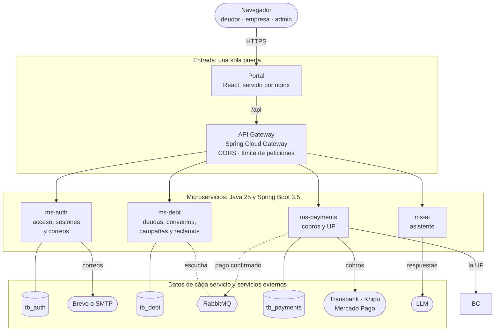

**Qué la hace de microservicios:**

- **Una sola puerta.** El API Gateway es lo único que recibe peticiones de afuera: aplica CORS y el
  límite de peticiones, y enruta a cada servicio por el comienzo de la ruta.
- **Una base por servicio.** ms-auth, ms-debt y ms-payments tienen cada uno la suya (`tb_auth`,
  `tb_debt`, `tb_payments`) y ninguno lee la de otro. Lo que necesitan de otro servicio se lo piden
  por HTTP con la clave interna: ms-debt le pide a ms-auth que mande un correo, ms-payments le
  pregunta a ms-debt cuánto cobrar y ms-auth le pregunta a ms-debt si existe una empresa. ms-ai no
  tiene base: lee las deudas en ms-debt con la sesión del deudor.
- **Mensajes asíncronos.** El aviso de pago viaja de ms-payments a ms-debt por RabbitMQ
  (`pago.confirmado`). Sale de una bandeja con reintentos y, si RabbitMQ está apagado, va por HTTP.
- **Cada uno por su cuenta.** Cada servicio tiene su `pom.xml`, su `Dockerfile`, su workflow y su
  imagen, y se compila, se prueba y se despliega sin los demás.
- **Por dentro, en capas.** Cada microservicio se ordena igual: `controller` → `service` →
  `repository` ([cómo está organizado cada servicio](#cómo-está-organizado-cada-servicio)). Las
  capas son la forma de cada servicio; la solución completa es de microservicios.

Las rutas del gateway y las llamadas entre servicios, con sus llaves, están en
[§7.1](#71-comunicación-entre-servicios). La entrega por API para los sistemas de otras empresas
(`/api/v1`) está **apagada por omisión**, porque los deudores entran por campaña desde el portal;
`INTEGRACION_API=true` la enciende.

### Los componentes

| Pieza | Qué hace |
| --- | --- |
| **portal** | React con Zustand y CSS propio. Se compila y lo sirve nginx, que además hace de proxy hacia el gateway: el navegador ve un solo origen y no hay CORS que resolver |
| **gateway** | La única puerta: CORS, límite de peticiones con Bucket4j y enrutamiento. Al retorno de Webpay le quita el `Origin`, porque es la página de Transbank la que devuelve al navegador con un formulario; CORS no se abre a nadie más |
| **ms-auth** | Código de acceso (RUT + 6 caracteres, un solo uso, 24 h) y enlace de respaldo por correo, que es también como entra el personal de las empresas. Emite el JWT, maneja las sesiones y manda los correos, incluido el recordatorio de cuota |
| **ms-debt** | Deudas, cargos y cuotas; convenios de 3 a 24 cuotas; los intereses por mora y del convenio, si el acreedor los pactó; la ejecución de las campañas; reclamos y su resolución; ingesta de la cartera v1 por API o CSV; eventos de vuelta a quien entregó la cartera; resumen para el panel; certificado y comprobantes en PDF; recordatorio de las cuotas por vencer; claves de API de cada empresa |
| **ms-payments** | Los cobros. Webpay contra Transbank, Mercado Pago con Checkout Pro y Khipu (si tiene llave) de verdad; sin credenciales, simulados. El monto lo decide ms-debt, nunca el navegador. En UF fija los pesos al abrir el cobro. Un cobro abandonado se vence: a los 15 minutos en Webpay, a los 30 en Khipu |
| **ms-ai** | Asistente de solo lectura. Lee las deudas con la sesión del deudor, sin acceso propio a la base, y detecta frustración o desconfianza para ajustar el tono. Responde con una cascada de LLMs (Ollama, Groq, Gemini): el que falle o agote su cuota deja el turno al siguiente; si ninguno responde, usa reglas |
| **MySQL 8.4** | Una base por servicio, con el esquema versionado en Flyway ([`db/README.md`](db/README.md)) |
| **RabbitMQ** | Lleva el aviso de pago de ms-payments a ms-debt. Si está apagado, el mismo aviso va por HTTP; en los dos casos sale de una bandeja con reintentos, así que no se pierde |

### Los roles de acceso

Hay dos roles para las personas que trabajan con DataBridge, y el control lo tiene solo DataBridge:

| Rol | Quién es | Dónde entra | Qué ve |
| --- | --- | --- | --- |
| `admin` | Solo DataBridge. Ninguna otra empresa puede tener un `admin` | El panel de administración (`/api/admin/**`) | La plataforma: totales por empresa, nunca los datos de un deudor |
| `usuario` | Una empresa usuaria: la que incorpora DataBridge a su operación, sea una agencia de cobranza o un acreedor que cobra directo | El portal de empresas | Solo la cartera de su empresa: la de sus clientes |

Los clientes de una empresa usuaria son los deudores. No tienen un rol ni una cuenta: entran al
portal del deudor con su RUT y su código de acceso.

- **Un `admin` nunca es de una empresa, y una persona de una empresa nunca es `admin`.** Lo exige
  la base, no solo el código: `staff_users` no deja guardar un `admin` con empresa ni un `usuario`
  sin ella.
- **El primer `admin` sale de `ADMIN_CORREO`.** Al arrancar, si todavía no hay ninguno, ms-auth lo
  crea con ese correo. Entra con un enlace que le llega ahí, sin contraseña, igual que un usuario.
  Sin esa variable no hay `admin` y nadie entra al panel.
- **Cada sesión lleva su rol en el JWT:** `ADMIN`, `CREDITOR` (el usuario de una empresa) o
  `DEBTOR`. Todo lo que cuelga de `/api/admin` exige `ADMIN`, y todo lo demás exige `CREDITOR` o
  `DEBTOR`: el `admin` no entra a un portal ajeno, y un usuario o un deudor reciben `403` en el
  panel. La regla es de la ruta entera, no de cada endpoint, así que uno nuevo no puede quedar
  abierto por olvido.

<details>
<summary><b>El panel de administración</b>: qué tiene y cómo se da y se quita el acceso</summary>

El panel está en `/admin`, y se entra por `/admin/login` con el correo del `admin`. Hoy tiene:

- **Inicio**, que muestra si cada servicio responde con esa sesión (`/api/admin/<servicio>/estado`).
- **Empresas**, para dar de alta una empresa usuaria (una agencia, o un acreedor que cobra directo)
  con su primera persona, y ver las que hay. De cada una se ven totales (cuántas deudas y cuánto
  falta por cobrar), sus mandatos y quiénes entran en su nombre. Nunca una deuda ni un deudor.
- **Equipo de DataBridge**, para dar de alta a otro `admin`.
- **Reglas**, de solo lectura: lo que rige en cada servicio y de qué variable del `.env` sale. La
  mora mínima, la tasa máxima, el aviso antes de una cuota, el horario y el límite de contacto de
  la ley con los feriados de este año y del siguiente (los mismos que usan las campañas), cuánto
  duran el código, el enlace y la sesión, por dónde salen los correos, qué pasarelas cobran de
  verdad y en cuánto vence un cobro, de dónde sale la UF y cómo entran los deudores (solo por
  campaña, o también por la API). De las credenciales dice solo si están.

Dar de alta a una persona es darle acceso: le llega una **invitación** a su correo, con un enlace de
un solo uso que dura 24 horas (`INVITACION_TTL_HORAS`) y que dice por dónde entrar las veces
siguientes. A cualquiera se le puede **quitar el acceso** y devolvérselo: al quitarlo no le llegan
más enlaces, los que tenía sin abrir dejan de servir y sus sesiones se cierran. Un `admin` no se
puede quitar el acceso a sí mismo, así que siempre queda uno que puede entrar.

- **El rol lo decide por dónde se da de alta, no un campo.** Una persona creada bajo una empresa
  es `usuario` de esa empresa; un `admin` se crea aparte y sin empresa. Un correo que ya es de una
  empresa no puede pasar a ser `admin`.
- **La empresa vive en ms-debt y su gente en ms-auth**, unidas por el RUT. Antes de darle una
  persona a una empresa, ms-auth le pregunta a ms-debt si existe.
- **Todo queda anotado**, con el `admin` que lo hizo y cuándo, en la tabla `admin_log` de cada
  servicio, y se ve en la ficha de la empresa.

Lo que falta del panel está en [#136](https://github.com/TechnicalBridge/TB_web/issues/136).

</details>

### Cómo está organizado cada servicio

Los tres servicios con base de datos tienen la misma forma, así que quien conoce uno se ubica en
los otros:

```
com/tbridge/<servicio>/
├── config/        seguridad, Swagger, RabbitMQ, cifrado, datos de ejemplo
├── controller/    los endpoints: traducen HTTP y delegan, sin reglas de negocio
├── service/       las reglas de negocio
├── repository/    el acceso a la base (Spring Data JPA)
├── model/         las entidades, una por tabla
├── dto/request/   lo que entra, validado con Bean Validation
├── dto/response/  lo que sale, documentado para Swagger
├── assembler/     los enlaces de HATEOAS de cada recurso
├── client/        las llamadas a otros sistemas (otro servicio, Transbank, Khipu)
└── exception/     los errores propios del servicio
```

**Cada servicio por sí solo.** No hay un pom padre ni una librería compartida: cada servicio
tiene su `pom.xml` (con Spring Boot como padre y sus propias versiones), su `Dockerfile`, su
workflow y su base, y se compila, se prueba y se despliega sin los demás. Lo que antes estaba en
una librería común lo tiene cada uno en sus paquetes, solo lo que usa: `security/` (verificar el
JWT; ms-auth además lo firma), `exception/` (todos responden `{"error": "..."}` con el código que
corresponde) y `util/` (el RUT y el hash). El aviso de pago (`events/PagoConfirmado`) lo tienen
ms-payments, que lo escribe, y ms-debt, que lo lee, y los dos se prueban contra el mismo contrato:
[`docs/eventos/pago-confirmado.json`](docs/eventos/pago-confirmado.json). El gateway no tiene
base: solo `config/` (las rutas) y `filter/` (el límite de peticiones, la IP real y el retorno de
Webpay). ms-ai tampoco: `controller/`, `service/` (las reglas y el LLM), `client/` (las deudas, que
pide a ms-debt con la sesión del deudor), `dto/` y `exception/`.

**Swagger.** Cada servicio documenta sus endpoints en grupos según quién los llama —el **portal**,
el **panel de administración**, el **contrato de integración** y lo **interno**—, y el gateway los junta en una sola
página: http://localhost:8080/swagger-ui.html. Cada grupo ofrece en *Authorize* solo la llave que
usa: el JWT del portal, la clave de API del contrato o la clave interna. Lo público se llama por la
misma dirección desde la que se abrió Swagger, sea `localhost:8080` o el dominio. Lo interno apunta
directo al servicio, porque el gateway no expone `/internal`: con Docker ese puerto no se publica,
así que *Try it out* no llega desde el navegador, y el grupo dice cómo llamarlo desde dentro del
contenedor, como en [§3](#3-cómo-ejecutar-el-proyecto-localmente).

<details>
<summary><b>HATEOAS y configuración</b>: los enlaces de cada respuesta y de dónde sale cada valor</summary>

**HATEOAS.** Las respuestas del portal traen `_links` con lo que se puede hacer después, según el
estado y quién mira:

- una deuda pendiente le ofrece al deudor `simular`, `repactar`, `pagar` y `disputar`;
- a la empresa, `enviar-codigo`, y si la deuda está en reclamo, `resolver-disputa`;
- una deuda pagada ofrece el `certificado`, y un pago su `comprobante`;
- con la entrega por API encendida, una clave de API vigente ofrece `revocar`.

Los enlaces salen con la dirección pública (`http://localhost:8080/...`) porque cada servicio lee
las cabeceras `X-Forwarded-*` del gateway. El contrato `/api/v1` no lleva enlaces: su forma está
publicada y la leen sistemas de otras empresas.

**Configuración.** Cada servicio tiene `application.properties`, con todo en
`${VARIABLE:valor por omisión}` salvo los secretos, que van como `${VARIABLE}` y sin valor: si
falta uno, el servicio no arranca y dice cuál. `application-dev.properties` es para programar, y
`application-test.properties`, con sus propios valores, para las pruebas.

</details>

---

## 7. Diagramas

Los diagramas que hicimos, cada uno con su **vista general** y, desplegable, el de **cada servicio**.
Salen del código: los nombres son las clases, las rutas y las tablas de verdad.

| Diagrama | General | De cada servicio | Dónde |
| --- | --- | --- | --- |
| Comunicación entre servicios | Quién le habla a quién, por dónde y con qué llave | — (cada par está en la tabla) | [§7.1](#71-comunicación-entre-servicios) |
| Entidad-relación | Las 25 tablas de las tres bases | `tb_auth`, `tb_debt` y `tb_payments` | [§7.2](#72-entidad-relación) |
| Casos de uso | El sistema completo | De cada actor | [§7.3](#73-casos-de-uso) |
| Clases | El dominio | ms-auth, ms-debt, ms-payments, ms-ai y gateway | [§7.4](#74-clases) |
| Secuencias | El pago, de punta a punta | ms-auth, ms-debt, ms-payments y ms-ai | [§7.5](#75-secuencias) |
| Componentes | El repositorio y las capas | ms-auth, ms-debt, ms-payments, ms-ai, gateway y el portal | [§7.6](#76-componentes) |

Los demás están en [`docs/diagramas`](docs/diagramas/README.md): los
[estados](docs/diagramas/estados.md) de una deuda, una cuota, un pago y una campaña; los
[procesos](docs/diagramas/procesos.md) (el BPMN del negocio, el flujo de la cartera, la actividad de una
campaña y lo que corre solo); el [despliegue](docs/diagramas/despliegue.md), y todas las clases, secuencias y
casos de uso con su detalle.

La arquitectura está en [§6](#6-arquitectura-de-la-solución).

### 7.1 Comunicación entre servicios

Quién le habla a quién y por dónde. Las flechas continuas son llamadas HTTP; las punteadas, lo que va por
la cola o lo que está apagado por omisión.

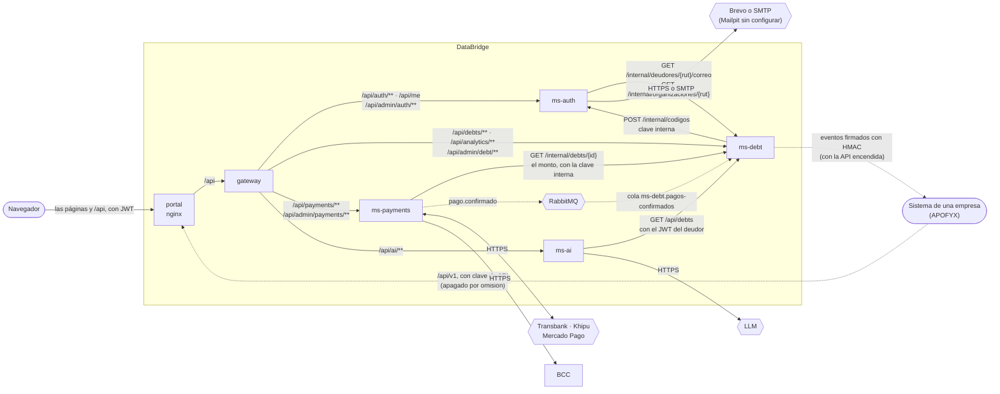

| Entre quiénes | Cómo | Por qué así |
| --- | --- | --- |
| Navegador → servicios | HTTP por el gateway, con JWT | Una sola puerta que revisar |
| Sistemas de las empresas → ms-debt | HTTP por el gateway (`/api/v1`), con clave de API. **Solo con `INTEGRACION_API=true`** | Entran por la misma puerta, con su límite de peticiones |
| ms-payments → ms-debt | **RabbitMQ**, cola `ms-debt.pagos-confirmados` | El pago ya ocurrió: si ms-debt está caído, el aviso espera en la cola en vez de perderse |
| ms-debt → ms-auth, ms-payments → ms-debt | HTTP interno con `X-Internal-Key`, fuera del gateway | Son llamadas entre servicios, no de usuarios. El gateway no las expone |
| ms-payments ↔ Transbank | HTTPS con el código de comercio y su llave | Crear la transacción y confirmarla; el navegador solo va y vuelve |
| ms-payments ↔ Khipu | HTTPS con la llave de la cuenta de cobro (`x-api-key`) | Crear el cobro y preguntar en qué va; el navegador solo va y vuelve |
| APOFYX ↔ DataBridge | HTTP con clave de API, y eventos firmados con HMAC-SHA256. **Solo con `INTEGRACION_API=true`** | Son empresas distintas: ninguna entra en la base de la otra |
| ms-auth → el correo | La API de Brevo (HTTPS) o un servidor SMTP; sin ninguno, Mailpit | El único servicio que escribe correos. ms-debt le pide el código y el recordatorio |

Si RabbitMQ no está, ms-payments manda el mismo aviso por HTTP (`POST /internal/events/pago-confirmado`);
en los dos casos sale de una bandeja con reintentos, así que no se pierde.

<details>
<summary><b>Tres clases de interfaz</b>, cada una con su llave</summary>

| Interfaz | Rutas | Para quién | Con qué se entra | ¿La publica el gateway? |
| --- | --- | --- | --- | --- |
| **Portal** | `/api/auth/**`, `/api/me`, `/api/debts/**`, `/api/analytics/**`, `/api/payments/**`, `/api/ai/**` | El deudor y el usuario de una empresa | JWT de una sesión `DEBTOR` o `CREDITOR` | Sí |
| **Panel de administración** | `/api/admin/auth/**`, `/api/admin/debt/**`, `/api/admin/payments/**` | El `admin` de DataBridge | JWT de una sesión `ADMIN` | Sí |
| **Contrato de integración** | `/api/v1/**`, y las claves en `/api/claves/**` | El sistema de una empresa | Clave de API | Sí, pero apagado por omisión: responde `404` |
| **Interno** | `/internal/**` | Otro servicio, o la operación | Clave interna (`X-Internal-Key`) | No |

Las vueltas y avisos de las pasarelas (`/api/payments/public/**`) entran sin sesión: se validan con la firma
del enlace de pago, y lo que dicen se le vuelve a preguntar a la pasarela.

</details>

**Apagado por omisión.** Desde que los deudores entran solo por campaña, todo `/api/v1` y
`/api/claves` responde `404` mientras `INTEGRACION_API` no sea `true`. Encendido funciona como se
describe aquí, salvo que el portal ya no tiene *Claves de API*: la clave se emite con
`POST /api/claves`, con la sesión de la empresa, o por dentro con `POST /internal/claves`.

**La cadena con APOFYX la necesita encendida.** APOFYX entrega la cartera por `/api/v1`, así que
para correr los tres sistemas juntos ms-debt arranca con `INTEGRACION_API=true`. Los scripts de la
demo de la cadena la encienden solos.

<details>
<summary><b>El contrato v1</b>, de sistema a sistema (solo con <code>INTEGRACION_API=true</code>)</summary>

- `GET /api/v1/cuenta`: el sistema comprueba su clave y ve a qué empresa pertenece.
- `POST /api/v1/carteras`, `/mandatos`, `/campanas` y `/suscripciones`: entrega la cartera, registra sus
  mandatos y campañas, y se suscribe a los avisos.
- De vuelta, ms-debt le manda los eventos firmados (`pago.confirmado`, `deuda.disputada`, …).

**Con la API encendida, la conexión se hace sola.** La agencia pega su clave en su sistema, y al
conectarse la comprueba con `GET /api/v1/cuenta` y se suscribe a los avisos. Un acreedor que
DataBridge no conoce **lo registra el mandato** de su agencia, que trae su RUT, su razón social y
su nombre. Solo la agencia, APOFYX, existe desde el arranque; las demás empresas las da de alta
un `admin` en el panel.

El contrato completo, con sus ejemplos y su esquema JSON, está en
[`docs/integracion/`](docs/integracion/README.md).

</details>

### 7.2 Entidad-relación

**Una base por servicio**, las tres en el mismo MySQL 8.4. No comparten tablas: si ms-payments
necesita saber cuánto se debe, se lo **pregunta** a ms-debt. Así cada servicio cambia su esquema
sin romper a los demás, y un error en pagos no puede corromper la cartera.

El esquema lo versiona **Flyway**, y cada servicio arranca con `ddl-auto: validate`, que compara
las entidades con las tablas y se niega a partir si no calzan. En total son **25 tablas, 3 vistas y
26 llaves foráneas**, ninguna entre una base y otra.

| Base | Servicio | Tablas | Migraciones |
| --- | --- | --- | --- |
| [`tb_debt`](#tb_debt--la-cartera) | ms-debt | 15 y 2 vistas | `V1` esquema inicial · `V2` recordatorios · `V3` secreto de las suscripciones, cifrado · `V4` intereses · `V5` descuento · `V6` bitácora del panel · `V7` contactos al deudor, en su tabla · `V8` el correo que no sale |
| [`tb_auth`](#tb_auth--quién-entra) | ms-auth | 6 | `V1` esquema inicial · `V2` sesiones · `V3` enlace pedido · `V4` roles `admin` y `usuario` · `V5` bitácora del panel |
| [`tb_payments`](#tb_payments--la-plata) | ms-payments | 4 y 1 vista | `V1` esquema inicial · `V2` pago duplicado · `V3` interés del pago · `V4` Webpay una vez · `V5` descuento del pago |

Los diagramas salen del esquema que dejan las migraciones. `PK` es la llave primaria, `FK` una
llave foránea y `UK` un valor que no se repite; en las líneas, `||` es *uno*, `o{` es *cero o
muchos* y `|o` es *cero o uno*. Las reglas que exige cada base (`CHECK`) están en
[`docs/diagramas/entidad-relacion.md`](docs/diagramas/entidad-relacion.md).

#### El diagrama general: las tres bases

Todas las tablas de DataBridge en un solo diagrama, cada una con el nombre de su base. Las **líneas
continuas** son llaves foráneas dentro de una base. Las **punteadas** cruzan de una base a otra: no
hay llave foránea, se unen por el RUT o por el id de la deuda, y esa unión la mantiene el código.

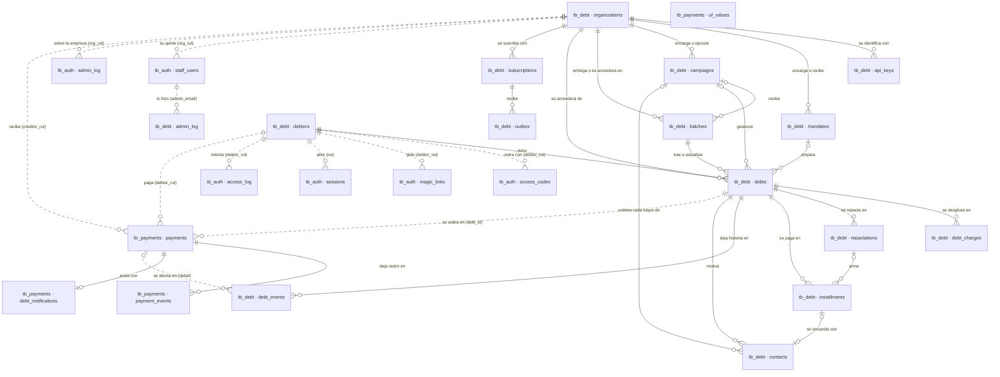

| Desde | Hacia | Con qué | Quién la mantiene |
| --- | --- | --- | --- |
| `tb_auth.staff_users.org_rut` | `tb_debt.organizations.rut` | El RUT de la empresa | ms-auth lo pone en el JWT, y ms-debt busca la empresa por ese RUT |
| Los `debtor_rut` de `tb_auth` | `tb_debt.debtors.rut` | El RUT del deudor | ms-debt pide el código para ese RUT; ms-auth le pregunta a ms-debt el correo registrado |
| `tb_payments.payments.debt_id` e `installment_ids` | `tb_debt.debts.id` e `installments.id` | Los id de la deuda y de sus cuotas | ms-payments se los pide a ms-debt al abrir el cobro, junto con el monto |
| `tb_payments.payments.debtor_rut` y `creditor_rut` | `tb_debt.debtors.rut` y `organizations.rut` | El RUT de quien paga y de a quién | Vienen en la misma respuesta de ms-debt |
| `tb_debt.debt_events.detail` | `tb_payments.payments.id` | El id del pago aplicado | Lo trae el aviso `pago.confirmado` |
| `admin_log`, en las dos bases | `tb_auth.staff_users.email` y `tb_debt.organizations.rut` | Quién lo hizo y sobre qué empresa | Sale del JWT de la sesión del `admin`, no del cuerpo de la petición |

#### `tb_debt` — la cartera

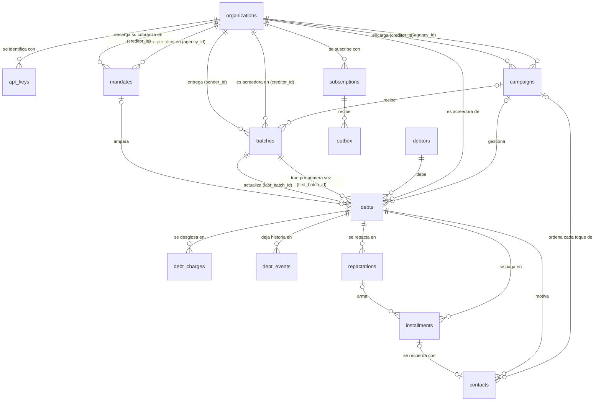

<details>
<summary>Las 15 tablas de <code>tb_debt</code> con todas sus columnas</summary>

```mermaid
erDiagram
    organizations ||--o{ api_keys : "se identifica con"
    campaigns |o--o{ batches : "recibe"
    organizations ||--o{ batches : "es acreedora en (creditor_id)"
    organizations ||--o{ batches : "entrega (sender_id)"
    organizations ||--o{ campaigns : "ejecuta (agency_id)"
    organizations ||--o{ campaigns : "encarga (creditor_id)"
    campaigns |o--o{ contacts : "ordena cada toque de"
    debts ||--o{ contacts : "motiva"
    installments |o--o| contacts : "se recuerda con"
    debts ||--o{ debt_charges : "se desglosa en"
    debts ||--o{ debt_events : "deja historia en"
    campaigns |o--o{ debts : "gestiona"
    organizations ||--o{ debts : "es acreedora de"
    debtors ||--o{ debts : "debe"
    batches ||--o{ debts : "trae por primera vez (first_batch_id)"
    batches ||--o{ debts : "actualiza (last_batch_id)"
    mandates |o--o{ debts : "ampara"
    debts ||--o{ installments : "se paga en"
    repactations |o--o{ installments : "arma"
    organizations ||--o{ mandates : "cobra por otros en (agency_id)"
    organizations ||--o{ mandates : "encarga su cobranza en (creditor_id)"
    subscriptions ||--o{ outbox : "recibe"
    debts ||--o{ repactations : "se repacta en"
    organizations ||--o{ subscriptions : "se suscribe con"
    admin_log {
        bigint id PK
        varchar(254) admin_email "el admin que lo hizo"
        varchar(40) action
        varchar(12) org_rut "opcional · la empresa sobre la que se hizo"
        varchar(254) subject "opcional · a qué o a quién"
        datetime occurred_at
    }
    api_keys {
        bigint id PK
        bigint organization_id FK
        varchar(80) name
        char(64) key_hash UK "SHA-256 de la clave"
        varchar(12) prefix "para reconocerla sin revelarla"
        datetime created_at
        datetime last_used_at "opcional"
        datetime revoked_at "opcional · desde cuándo no sirve"
    }
    batches {
        bigint id PK
        bigint sender_id FK "no se repite junto con external_id"
        bigint creditor_id FK
        bigint campaign_id FK "opcional"
        varchar(64) external_id "el id que le puso quien la envió · no se repite junto con sender_id"
        date cut_off "la fecha de corte de la cartera"
        varchar(10) source "api o file"
        varchar(12) status "processed o rejected"
        int received_count
        int accepted_count
        int rejected_count
        char(64) payload_hash "para reconocer un reenvío idéntico"
        json response "lo que se respondió, deuda por deuda"
        datetime received_at
    }
    campaigns {
        bigint id PK
        bigint agency_id FK "no se repite junto con external_id"
        bigint creditor_id FK
        varchar(64) external_id "el id que le puso la agencia · no se repite junto con agency_id"
        varchar(120) name
        date starts_on
        date ends_on "opcional"
        json channels "por dónde se contacta"
        smallint attempts "entre 1 y 10"
        json cadence_days "opcional · en qué días se le escribe al deudor"
        json mora_discount "opcional · % de descuento por tramo de mora"
        varchar(10) status "running, paused o finished"
        datetime created_at
    }
    contacts {
        bigint id PK
        bigint debt_id FK "la deuda por la que se le escribió; el deudor es el de esa deuda · no se repite junto con campaign_id y touch_number"
        varchar(12) kind "invitation, campaign, reminder o resend"
        varchar(10) channel "por dónde se le escribió: hoy, solo email"
        varchar(254) destination "opcional · a dónde, con la dirección tapada"
        bigint campaign_id FK "opcional · solo en un toque de campaña · no se repite junto con debt_id y touch_number"
        smallint touch_number "opcional · qué toque es de esa campaña para esa deuda: 1, 2… · no se repite junto con debt_id y campaign_id"
        bigint installment_id FK, UK "opcional · solo en un recordatorio: la cuota que se avisó"
        datetime occurred_at
    }
    debt_charges {
        bigint id PK
        bigint debt_id FK
        varchar(120) concept
        varchar(7) period "opcional · el mes del cargo"
        decimal(18_2) amount
        date due_date
    }
    debt_events {
        bigint id PK
        bigint debt_id FK
        varchar(30) type "registered, updated, withdrawn, portal_entered, repacted, payment_applied, settled o disputed"
        varchar(10) actor "debtor, creditor, agency o system"
        decimal(18_2) amount "opcional"
        varchar(3) currency "opcional · CLP o UF"
        varchar(80) reference "opcional · a qué se refiere: el pago, la cartera, el motivo"
        json detail "opcional · lo que no calza en una columna"
        datetime occurred_at
    }
    debtors {
        bigint id PK
        varchar(12) rut UK
        varchar(10) kind "person o company"
        varchar(160) full_name
        varchar(254) email "opcional"
        datetime email_failed_at "opcional · la última vez que un correo no salió; vacío si el último salió"
        varchar(300) email_failure "opcional · por qué no salió, con la dirección tapada"
        smallint email_rejections "rechazos seguidos de la dirección; a los 3, no se le escribe solo"
        varchar(20) phone "opcional"
        boolean reminders "si quiere el recordatorio de sus cuotas"
        datetime created_at
        datetime updated_at
    }
    debts {
        bigint id PK
        bigint creditor_id FK "no se repite junto con external_id"
        bigint debtor_id FK
        varchar(64) external_id "el id que le puso el acreedor · no se repite junto con creditor_id"
        varchar(3) currency "CLP o UF"
        varchar(200) concept
        json refs "opcional · referencias del acreedor"
        decimal(18_2) original_amount "el monto con que llegó"
        decimal(5_2) interest_rate "opcional · % mensual que pactó el acreedor; vacío, sin interés"
        varchar(12) status "open, repacted, paid, withdrawn o disputed"
        bigint mandate_id FK "opcional"
        bigint campaign_id FK "opcional"
        bigint first_batch_id FK "la cartera que la trajo"
        bigint last_batch_id FK "la última cartera que la actualizó"
        varchar(30) withdrawn_reason "opcional · por qué se retiró"
        datetime created_at
        datetime updated_at
    }
    installments {
        bigint id PK
        bigint debt_id FK "no se repite junto con number"
        bigint repactation_id FK "opcional · vacío en la cuota original"
        smallint number "no se repite junto con debt_id"
        date due_date
        decimal(18_2) amount
        decimal(18_2) interest_amount "el interés del convenio dentro de la cuota"
        varchar(10) status "pending, paid o void"
        datetime paid_at "opcional"
    }
    mandates {
        bigint id PK
        bigint agency_id FK "no se repite junto con creditor_id y valid_from"
        bigint creditor_id FK "no se repite junto con agency_id y valid_from"
        date valid_from "no se repite junto con agency_id y creditor_id"
        date valid_to "opcional"
        smallint max_overdue_days "días de mora hasta donde cobra la agencia"
        decimal(5_2) max_mora_discount "opcional · % máximo de la mora que se puede condonar"
        varchar(10) status "active o ended"
        varchar(160) declared_by "opcional · quién lo declaró"
        datetime created_at
    }
    organizations {
        bigint id PK
        varchar(12) rut UK
        varchar(160) legal_name
        varchar(120) trade_name
        varchar(10) kind "creditor, agency o both"
        varchar(10) status "active o suspended"
        datetime created_at
        datetime updated_at
    }
    outbox {
        bigint id PK
        char(36) event_id "el mismo evento, una fila por suscriptor · no se repite junto con subscription_id"
        bigint subscription_id FK "no se repite junto con event_id"
        varchar(30) type
        json payload
        datetime occurred_at
        varchar(10) status "pending, delivered o failed"
        smallint attempts
        datetime next_attempt_at "cuándo se reintenta"
        datetime delivered_at "opcional"
        varchar(300) last_error "opcional"
    }
    repactations {
        bigint id PK
        bigint debt_id FK
        smallint months "entre 1 y 24"
        decimal(18_2) monthly_amount "el valor de la cuota"
        decimal(5_2) interest_rate "opcional"
        decimal(18_2) principal "opcional · lo repactado: capital más mora"
        varchar(3) currency "CLP o UF"
        datetime accepted_at
        datetime superseded_at "opcional · cuándo lo reemplazó otro convenio"
    }
    subscriptions {
        bigint id PK
        bigint organization_id FK "no se repite junto con url"
        varchar(300) url "no se repite junto con organization_id"
        varchar(255) secret "cifrado, con una llave fuera de la base"
        json events "opcional · cuáles quiere; vacío, todos"
        boolean active
        datetime created_at
    }
```

</details>

Quince tablas y dos vistas (`v_debt_balance`, `v_creditor_portfolio`). Lo que conviene mirar:

- **`organizations`** guarda a los acreedores y a la agencia, con un `kind` que dice cuál es cuál.
  No hay rubro: un acreedor es cualquiera que tenga cobros. Un `mandates` las une: *esta agencia
  cobra por cuenta de este acreedor, desde esta fecha*. Sin mandato vigente, una cartera se
  rechaza.
- **El saldo no se guarda, se calcula.** `debts` tiene sus `debt_charges`, los pagos se anotan
  aparte y el saldo sale de la vista. Así no hay dos números que puedan discrepar.
- **La mora tampoco se guarda.** `debts.interest_rate` es la tasa que pactó el acreedor (vacía, sin
  interés) y la mora se calcula al día. Lo que sí queda escrito es lo que ya se fijó: el interés del
  convenio dentro de cada cuota (`installments.interest_amount`), lo repactado y su tasa
  (`repactations`), y el interés que se cobró en cada pago (`tb_payments.payments.interest_amount`).
- **`debts.status`** es uno de `open`, `repacted`, `disputed`, `paid` o `withdrawn`
  ([estados de una deuda](docs/diagramas/estados.md#una-deuda)). Un reclamo queda en `debt_events` con su motivo y el texto del
  deudor, que no sale de DataBridge.
- **`contacts`** guarda cada vez que DataBridge le escribió a un deudor: la invitación, un toque de
  campaña con su número, el recordatorio de una cuota o el código que reenvía la empresa. Es el
  registro de gestiones que pide la ley, y de ahí se cuenta el límite de dos por semana. La base
  misma impide repetir un toque de una campaña para una deuda, o recordar dos veces una cuota.
- **`outbox`** es la bandeja de salida de los eventos, escrita en la misma transacción que el
  hecho que los provoca. Si el sistema se cae entre "cobré" y "avisé", el aviso sigue ahí.
- **`subscriptions.secret`** va **cifrado** ([§9](#9-requisitos-no-funcionales)).

#### `tb_auth` — quién entra

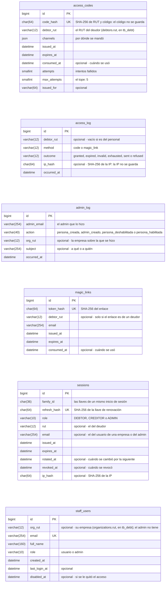

**No hay tabla de usuarios deudores:** el deudor no tiene cuenta. Se guarda el hash del código,
nunca el código; el hash de la llave de renovación, nunca la llave; y en `access_log` el hash de
la IP, nunca la IP. Las seis tablas no tienen llaves foráneas entre sí: cada una se busca por su
propia huella, o por el RUT o el correo de alguien. `staff_users` guarda a la gente de las
empresas (`usuario`) y a los `admin` de DataBridge, y `admin_log` lo que un `admin` hizo con ellas.

#### `tb_payments` — la plata

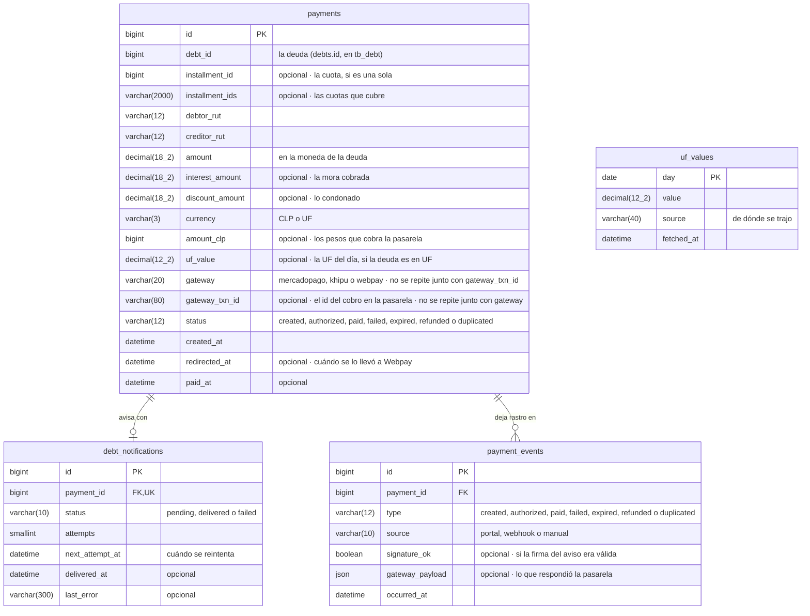

Un pago se crea al abrir el cobro, no al confirmarlo, y cambia de estado; cada cambio queda en
`payment_events`, que es **append-only**: solo se agrega. Lo que respondió la pasarela (la
confirmación de Transbank, o lo que dijo Khipu) queda entero en `payment_events.gateway_payload`.
`UNIQUE (gateway, gateway_txn_id)` impide cobrar dos veces la misma transacción aunque la pasarela
repita el aviso. `debt_notifications` es el aviso a ms-debt, con sus reintentos, y la vista
`v_collection` suma lo recaudado por acreedor y por mes.

### 7.3 Casos de uso

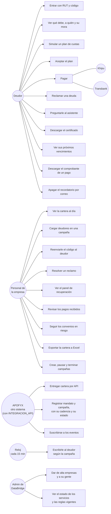

El certificado (`U7`) solo se emite si la deuda está **pagada**: una deuda retirada también queda
en saldo cero, y certificar eso sería decir algo falso.

#### De cada actor

<details>
<summary><b>El deudor</b></summary>

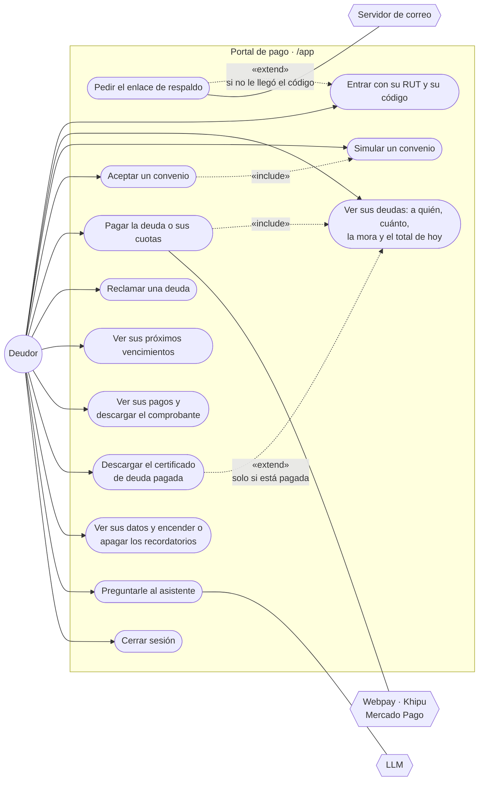

</details>

<details>
<summary><b>El usuario de una empresa</b></summary>

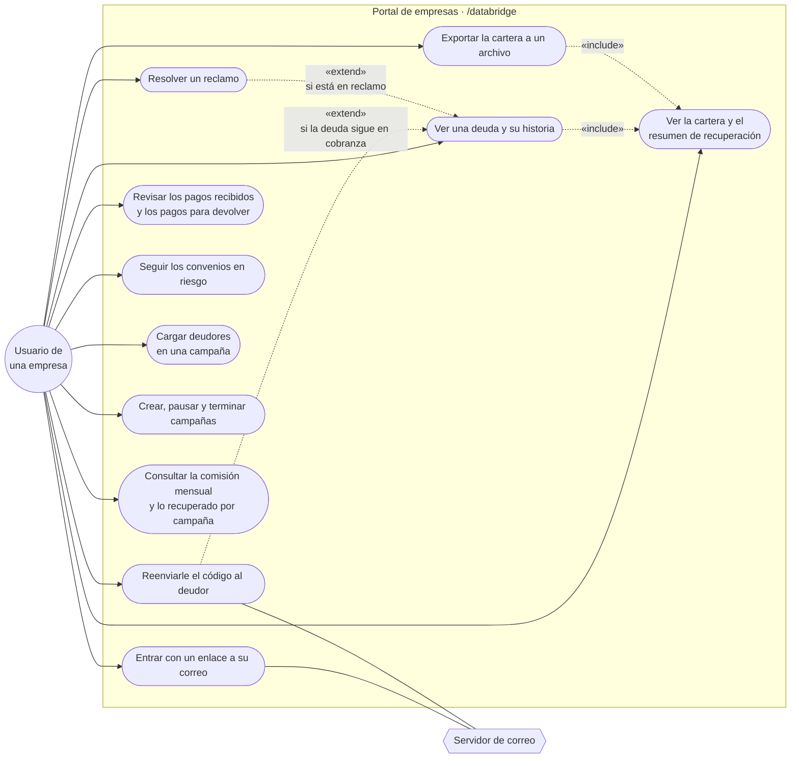

</details>

<details>
<summary><b>El admin de DataBridge</b></summary>

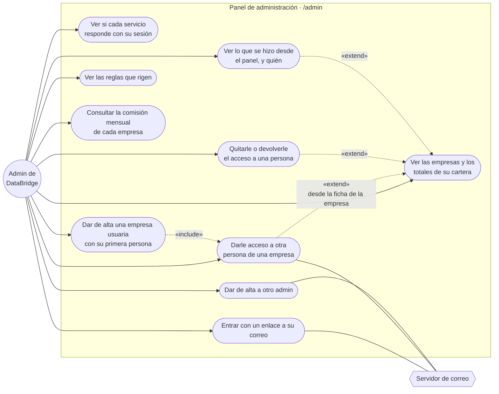

</details>

<details>
<summary><b>El sistema de una empresa, con la API encendida</b></summary>

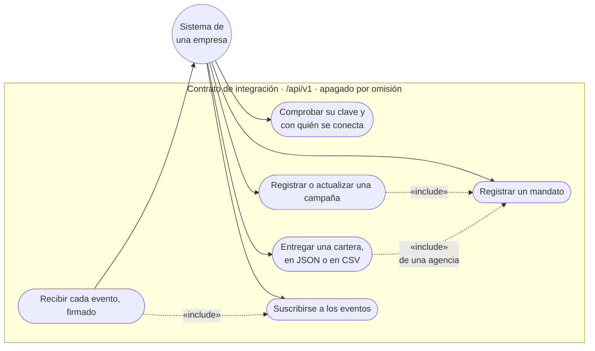

</details>

<details>
<summary><b>Lo que corre solo, y la operación</b></summary>

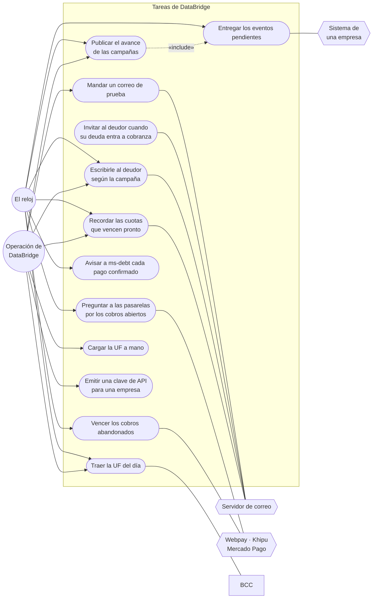

</details>

Cada caso con su endpoint está en [`docs/diagramas/casos-de-uso.md`](docs/diagramas/casos-de-uso.md).

#### Los escenarios que recorren los diagramas

| Escenario | Lo dispara | Clases | Dónde se ve | Servicios |
| --- | --- | --- | --- | --- |
| **E1. Cargar la cartera** | La empresa, en una campaña | `Batch`, `Debt`, `DebtCharge`, `Campaign` | [Secuencia de ms-debt](#75-secuencias) | portal → gateway → ms-debt |
| **E2. Invitar y recordar** | La deuda que entra, y el reloj | `Campaign`, `Contact` | [Actividad de la campaña](docs/diagramas/procesos.md#actividad-cómo-databridge-ejecuta-una-campaña) | ms-debt → ms-auth → correo |
| **E3. Pagar** | El deudor | `Payment`, `Installment` | [Secuencia del pago](#el-pago-con-khipu-la-funcionalidad-principal) | portal → gateway → ms-payments ↔ pasarela, RabbitMQ → ms-debt |
| **E4. Repactar** | El deudor | `Repactation`, `Installment` | [Secuencia del convenio](docs/diagramas/secuencia.md#5-simular-y-aceptar-un-convenio) | portal → gateway → ms-debt |
| **E5. Reclamar** | El deudor; la empresa resuelve | `Debt` en `disputed`, `DebtEvent` | [Estados de una deuda](docs/diagramas/estados.md#una-deuda) | portal → gateway → ms-debt |

### 7.4 Clases

El cálculo de la comisión mensual y sus dependencias se detallan en
[El modelo de negocio](docs/diagramas/clases.md#el-modelo-de-negocio).

#### El dominio

Los conceptos de la cartera viven en ms-debt; el pago, en ms-payments, que nombra la deuda por su
id porque cada servicio tiene su base. El acceso (códigos y sesiones) vive en ms-auth y se
describe en el [modelo de datos](#tb_auth--quién-entra).

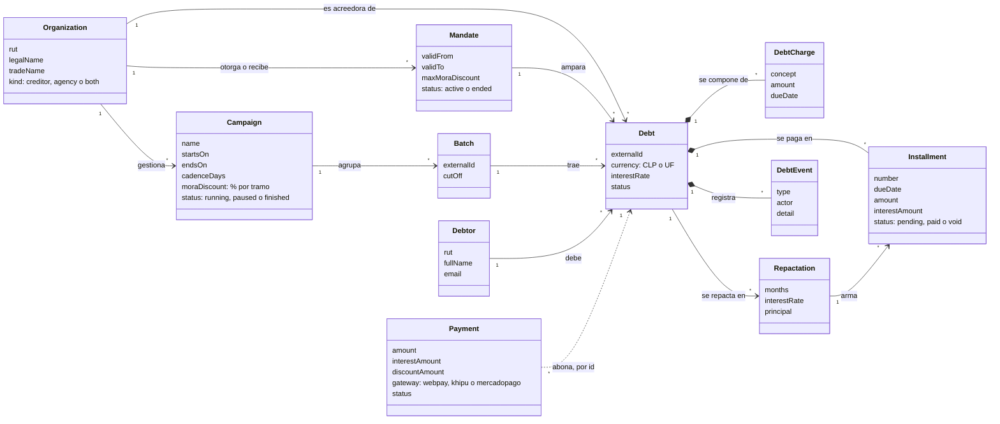

Lo que se guarda y lo que se calcula: el **saldo** y la **mora** no son atributos, se calculan con
los cargos, las cuotas y la tasa ([§7.2](#72-entidad-relación)). Lo que sí queda escrito es lo que ya se
fijó: el interés de cada cuota del convenio, y el interés y el descuento de cada pago. El descuento
de una campaña nunca pasa del máximo que el acreedor autorizó en el mandato.

#### De cada servicio

<details>
<summary><b>ms-auth</b> · el acceso: códigos, enlaces, sesiones y personas</summary>

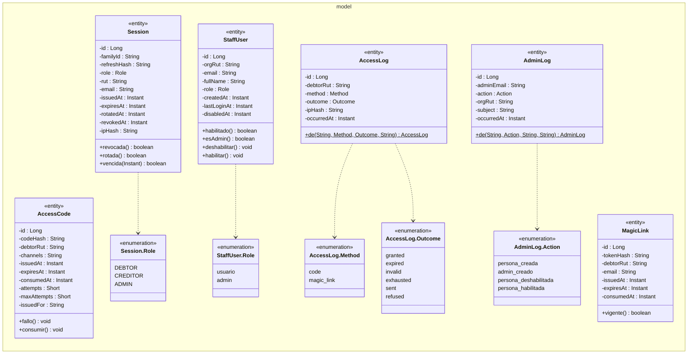

</details>

<details>
<summary><b>ms-debt</b> · la cartera: deudas, cuotas, convenios, campañas y empresas</summary>

```mermaid
classDiagram
    direction TB
    namespace model {
        class Organization {
            <<entity>>
            -id : Long
            -rut : String
            -legalName : String
            -tradeName : String
            -kind : Kind
            -status : Status
            -createdAt : Instant
            -updatedAt : Instant
            +esAgencia() boolean
        }
        class Organization_Kind["Organization.Kind"] {
            <<enumeration>>
            creditor
            agency
            both
        }
        class Organization_Status["Organization.Status"] {
            <<enumeration>>
            active
            suspended
        }
        class ApiKey {
            <<entity>>
            -id : Long
            -organization : Organization
            -name : String
            -keyHash : String
            -prefix : String
            -createdAt : Instant
            -lastUsedAt : Instant
            -revokedAt : Instant
        }
        class Mandate {
            <<entity>>
            -id : Long
            -agency : Organization
            -creditor : Organization
            -validFrom : LocalDate
            -validTo : LocalDate
            -maxOverdueDays : Short
            -maxMoraDiscount : BigDecimal
            -status : Status
            -declaredBy : String
            -createdAt : Instant
            +vigenteAl(LocalDate) boolean
        }
        class Mandate_Status["Mandate.Status"] {
            <<enumeration>>
            active
            ended
        }
        class Campaign {
            <<entity>>
            -id : Long
            -agency : Organization
            -creditor : Organization
            -externalId : String
            -name : String
            -startsOn : LocalDate
            -endsOn : LocalDate
            -channels : String
            -attempts : Short
            -cadenceDays : String
            -moraDiscount : String
            -status : Status
            -createdAt : Instant
        }
        class Campaign_Status["Campaign.Status"] {
            <<enumeration>>
            running
            paused
            finished
        }
        class Batch {
            <<entity>>
            -id : Long
            -sender : Organization
            -creditor : Organization
            -externalId : String
            -cutOff : LocalDate
            -source : Source
            -status : Status
            -receivedCount : Integer
            -acceptedCount : Integer
            -rejectedCount : Integer
            -payloadHash : String
            -response : String
            -receivedAt : Instant
        }
        class Batch_Source["Batch.Source"] {
            <<enumeration>>
            api
            file
        }
        class Batch_Status["Batch.Status"] {
            <<enumeration>>
            processed
            rejected
        }
        class Debtor {
            <<entity>>
            -id : Long
            -rut : String
            -kind : Kind
            -fullName : String
            -email : String
            -emailFailedAt : Instant
            -emailFailure : String
            -emailRejections : short
            -phone : String
            -reminders : boolean
            -createdAt : Instant
            -updatedAt : Instant
            +correoNoSalio(String, boolean, Instant) void
            +correoSalio() void
            +correoConProblemas() boolean
        }
        class Debtor_Kind["Debtor.Kind"] {
            <<enumeration>>
            person
            company
        }
        class Debt {
            <<entity>>
            -id : Long
            -creditor : Organization
            -debtor : Debtor
            -externalId : String
            -currency : Currency
            -concept : String
            -refs : String
            -originalAmount : BigDecimal
            -interestRate : BigDecimal
            -status : Status
            -mandate : Mandate
            -campaign : Campaign
            -firstBatch : Batch
            -lastBatch : Batch
            -withdrawnReason : String
            -createdAt : Instant
            -updatedAt : Instant
        }
        class Debt_Currency["Debt.Currency"] {
            <<enumeration>>
            CLP
            UF
        }
        class Debt_Status["Debt.Status"] {
            <<enumeration>>
            open
            repacted
            paid
            withdrawn
            disputed
        }
        class DebtCharge {
            <<entity>>
            -id : Long
            -debt : Debt
            -concept : String
            -period : String
            -amount : BigDecimal
            -dueDate : LocalDate
        }
        class Repactation {
            <<entity>>
            -id : Long
            -debt : Debt
            -months : Short
            -monthlyAmount : BigDecimal
            -currency : Debt.Currency
            -interestRate : BigDecimal
            -principal : BigDecimal
            -acceptedAt : Instant
            -supersededAt : Instant
        }
        class Installment {
            <<entity>>
            -id : Long
            -debt : Debt
            -repactation : Repactation
            -number : Short
            -dueDate : LocalDate
            -amount : BigDecimal
            -interestAmount : BigDecimal
            -status : Status
            -paidAt : Instant
            +enConvenio() boolean
            +capital() BigDecimal
        }
        class Installment_Status["Installment.Status"] {
            <<enumeration>>
            pending
            paid
            void_
        }
        class DebtEvent {
            <<entity>>
            -id : Long
            -debt : Debt
            -type : Type
            -actor : Actor
            -amount : BigDecimal
            -currency : Debt.Currency
            -reference : String
            -detail : String
            -occurredAt : Instant
            +de(Debt, Type, Actor)$ DebtEvent
            +conMonto(BigDecimal, Debt.Currency) DebtEvent
            +conReferencia(String) DebtEvent
            +conDetalle(String) DebtEvent
        }
        class DebtEvent_Type["DebtEvent.Type"] {
            <<enumeration>>
            registered
            updated
            withdrawn
            portal_entered
            repacted
            payment_applied
            settled
            disputed
        }
        class DebtEvent_Actor["DebtEvent.Actor"] {
            <<enumeration>>
            debtor
            creditor
            agency
            system
        }
        class Contact {
            <<entity>>
            -id : Long
            -debt : Debt
            -kind : Kind
            -channel : Channel
            -destination : String
            -campaign : Campaign
            -touchNumber : Short
            -installment : Installment
            -occurredAt : Instant
            +invitacion(Debt, String)$ Contact
            +toque(Debt, Campaign, int, String)$ Contact
            +recordatorio(Installment, String)$ Contact
            +reenvio(Debt, String)$ Contact
            +el(Instant) Contact
            +deLaEmpresa() boolean
        }
        class Contact_Kind["Contact.Kind"] {
            <<enumeration>>
            invitation
            campaign
            reminder
            resend
        }
        class Contact_Channel["Contact.Channel"] {
            <<enumeration>>
            email
        }
        class DetallePago {
            <<record>>
            +pagoId : Long
            +montoClp : Long
            +valorUf : BigDecimal
            +pasarela : String
            +cuotas : List~Integer~
            +de : Integer
            +fuera : Integer
            +interes : BigDecimal
            +descuento : BigDecimal
            +empresaRut : String
            +empresaNombre : String
            +campanaId : String
            +campanaNombre : String
        }
        class Subscription {
            <<entity>>
            -id : Long
            -organization : Organization
            -url : String
            -secret : String
            -events : String
            -active : Boolean
            -createdAt : Instant
        }
        class OutboxEvent {
            <<entity>>
            -id : Long
            -eventId : String
            -subscription : Subscription
            -type : String
            -payload : String
            -occurredAt : Instant
            -status : Status
            -attempts : Short
            -nextAttemptAt : Instant
            -deliveredAt : Instant
            -lastError : String
            +para(Subscription, String, String, String, Instant)$ OutboxEvent
            +entregado() void
            +fallo(String) void
        }
        class OutboxEvent_Status["OutboxEvent.Status"] {
            <<enumeration>>
            pending
            delivered
            failed
        }
        class AdminLog {
            <<entity>>
            -id : Long
            -adminEmail : String
            -action : Action
            -orgRut : String
            -subject : String
            -occurredAt : Instant
            +de(String, Action, String, String)$ AdminLog
        }
        class AdminLog_Action["AdminLog.Action"] {
            <<enumeration>>
            empresa_creada
        }
    }
    Organization ..> Organization_Kind
    Organization ..> Organization_Status
    Mandate ..> Mandate_Status
    Campaign ..> Campaign_Status
    Batch ..> Batch_Source
    Batch ..> Batch_Status
    Debtor ..> Debtor_Kind
    Debt ..> Debt_Currency
    Debt ..> Debt_Status
    Installment ..> Installment_Status
    DebtEvent ..> DebtEvent_Type
    DebtEvent ..> DebtEvent_Actor
    Contact ..> Contact_Kind
    Contact ..> Contact_Channel
    OutboxEvent ..> OutboxEvent_Status
    AdminLog ..> AdminLog_Action
    ApiKey "*" --> "1" Organization : organization
    Mandate "*" --> "1" Organization : agency
    Mandate "*" --> "1" Organization : creditor
    Campaign "*" --> "1" Organization : agency
    Campaign "*" --> "1" Organization : creditor
    Batch "*" --> "1" Organization : sender
    Batch "*" --> "1" Organization : creditor
    Debt "*" --> "1" Organization : creditor
    Debt "*" --> "1" Debtor : debtor
    Debt "*" --> "0..1" Mandate : mandate
    Debt "*" --> "0..1" Campaign : campaign
    Debt "*" --> "1" Batch : firstBatch
    Debt "*" --> "1" Batch : lastBatch
    DebtCharge "*" --> "1" Debt : debt
    Repactation "*" --> "1" Debt : debt
    Installment "*" --> "1" Debt : debt
    Installment "*" --> "0..1" Repactation : repactation
    DebtEvent "*" --> "1" Debt : debt
    Contact "*" --> "1" Debt : debt
    Contact "*" --> "0..1" Campaign : campaign
    Contact "*" --> "0..1" Installment : installment
    Subscription "*" --> "1" Organization : organization
    OutboxEvent "*" --> "1" Subscription : subscription
    DebtEvent ..> DetallePago : detail
    Repactation ..> Debt_Currency
    DebtEvent ..> Debt_Currency
```

</details>

<details>
<summary><b>ms-payments</b> · los cobros: pagos, sus eventos, el aviso y la UF</summary>

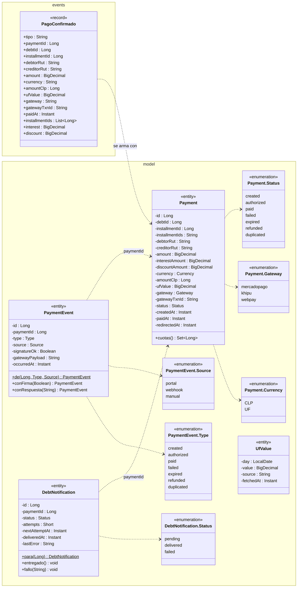

</details>

<details>
<summary><b>ms-ai</b> · el asistente, todo el servicio</summary>

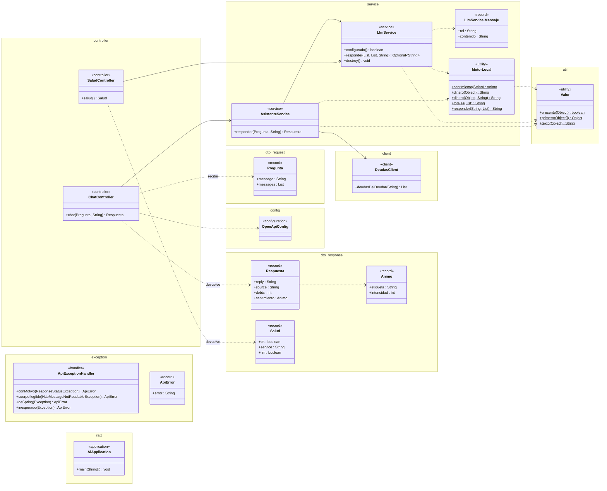

</details>

<details>
<summary><b>gateway</b> · la puerta, todo el servicio</summary>

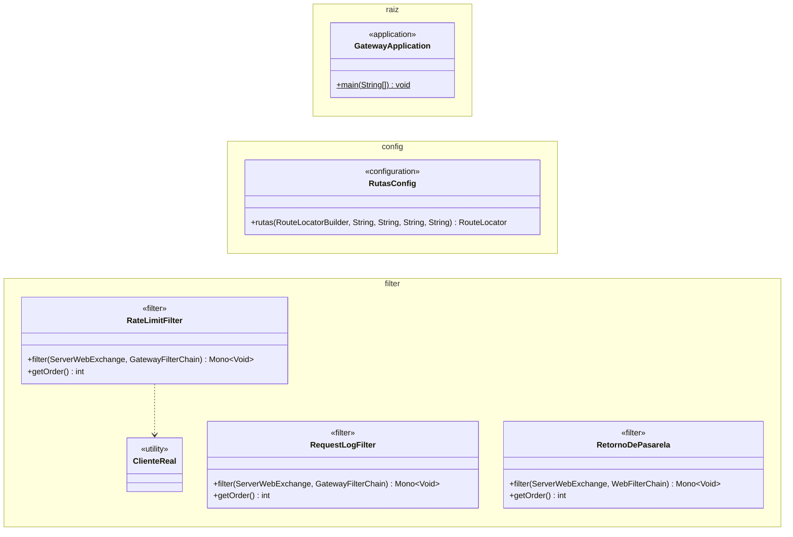

</details>

Las demás clases de cada servicio (controladores, servicios, repositorios, seguridad) están en
[`docs/diagramas/clases.md`](docs/diagramas/clases.md).

### 7.5 Secuencias

#### El pago con Khipu, la funcionalidad principal

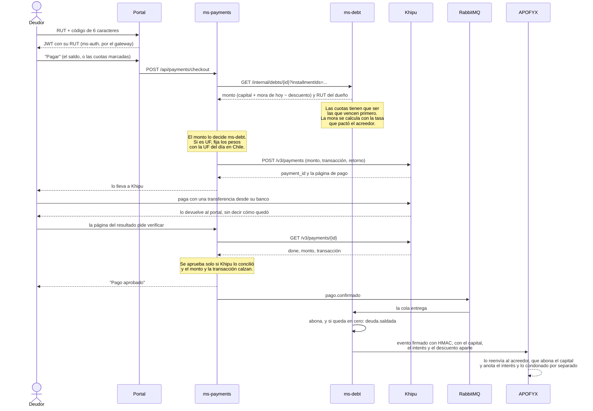

**El navegador nunca dice cuánto hay que pagar ni si el pago salió bien.** El monto lo pregunta
ms-payments a ms-debt, y la aprobación la confirma ms-payments con Khipu, de servidor a servidor.
Si el deudor cierra la ventana antes de volver, el pago igual se registra: ms-payments le pregunta
a Khipu por los cobros abiertos cada 10 segundos.

<details>
<summary><b>Mientras la pasarela verifica</b>, nadie paga dos veces ni se pierde un pago; y cómo es con Webpay</summary>

Entre que el deudor
transfiere y que Khipu lo confirma pasa un rato, y en ese rato la cuota todavía se ve pendiente.

- **Un pago a la vez por deuda.** Al abrir un pago, ms-payments mira los otros pagos abiertos de esa
  deuda. Si uno está en verificación (Khipu `verifying`, Mercado Pago `in_process` o `pending`), el
  nuevo se rechaza: *Tienes un pago en verificación*. Si uno quedó abierto sin pagar, se anula en
  la pasarela (Khipu lo borra y la preferencia de Mercado Pago vence en el acto) y queda vencido.
- **Cada pago guarda las cuotas que cubre**, tal como las cobró ms-debt. Una cuota ya pagada que
  ms-debt todavía no abona no se vuelve a cobrar.
- **Si igual se paga dos veces** (Webpay no se puede anular: solo cobra si ms-payments confirma la
  transacción al volver el deudor), el segundo pago queda `duplicated`. No se abona, y la empresa
  lo ve en *Pagos recibidos*, en *Pagos para devolver*, con el RUT del deudor y la referencia de la
  pasarela para devolverlo.
- **No se vence lo que se está verificando.** Si el plazo se cumple mientras la pasarela verifica,
  el pago sigue abierto hasta que se confirme. Un cobro que vence sin pagarse se anula en Khipu.
- **Los vencidos se revisan un día más.** Cada 5 minutos, ms-payments pregunta por los cobros que
  vencieron en las últimas 24 horas. En Khipu, un intento empezado justo antes del vencimiento
  tiene hasta 3 horas para terminar: si alguno aparece pagado, se registra igual. El aviso de
  Khipu también lo registra.

**Con Webpay es igual, con otra forma:** ms-payments abre la transacción en Transbank y lleva al
deudor a Webpay con un formulario POST. Cuando Webpay lo devuelve, ms-payments confirma la
transacción con Transbank (`PUT /transactions/{token}`) antes de mostrarle el resultado. Se aprueba
solo con `AUTHORIZED`, código de respuesta 0, el monto cobrado y la orden de compra de ese pago. El
aviso de vuelta tampoco pasa por el navegador.

</details>

#### De cada servicio

<details>
<summary><b>ms-auth</b> · el deudor entra con su RUT y su código</summary>

```mermaid
sequenceDiagram
    actor D as Deudor
    participant P as Portal (React)
    participant G as Gateway
    participant AC as AuthController
    participant AS as AuthService
    participant SS as SessionService
    participant B as tb_auth

    D->>P: escribe su RUT y su código
    P->>G: POST /api/auth/acceso {rut, codigo}
    Note over G: RateLimitFilter: 10 por minuto<br/>por origen en /api/auth
    alt se pasó del límite
        G-->>P: 429 Demasiadas solicitudes
    else dentro del límite
        G->>AC: la enruta a ms-auth
        AC->>AS: entrarConCodigo(rut, codigo, ip)
        AS->>B: access_log: intentos fallidos de ese origen<br/>en los últimos 10 minutos
        Note over AS: con 10 o más, responde 429
        AS->>B: el último código sin usar de ese RUT
        alt no hay código, venció, se agotó o no calza
            AS->>B: suma el intento y anota en access_log
            AS-->>P: 401 o 429, con el mismo mensaje
            Note over AS: «no hay código» y «no corresponde» responden igual:<br/>así no se puede averiguar qué RUT tienen deuda
        else el código calza
            Note over AS: compara la huella SHA-256(rut:codigo),<br/>en tiempo constante
            AS->>B: consume el código y anota granted
            AS->>SS: abrir(DEBTOR, rut)
            SS->>B: sessions: familia nueva, con la huella de la llave
            SS-->>AS: la llave de renovación, en claro una sola vez
            AS-->>AC: Sesion(JWT de 15 minutos, usuario, llave)
            AC-->>P: 200 {token, user, expiraEnSegundos}<br/>y la cookie tb_renovacion
        end
    end
    P->>G: GET /api/me, con el JWT
    G-->>P: quién es
    P-->>D: sus deudas
```

</details>

<details>
<summary><b>ms-debt</b> · la empresa carga a sus deudores en una campaña</summary>

```mermaid
sequenceDiagram
    actor U as Usuario de una empresa
    participant P as Portal (Cargar cartera)
    participant CC as CargaController
    participant CS as CargaService
    participant CI as CarteraIntakeService
    participant B as tb_debt
    participant IV as InvitacionService
    participant AU as ms-auth

    U->>P: abre Cargar cartera
    P->>CC: GET /api/debts/cartera/opciones
    CC->>CS: opciones(sesión)
    CS->>B: la empresa, los acreedores que le dieron mandato y sus campañas
    CC-->>P: acreedores y campañas, con su estado
    opt no hay una campaña que sirva
        U->>P: la crea ahí mismo
        P->>CC: POST /api/debts/campanas (CampanaController)
    end
    U->>P: elige la campaña y sube la planilla
    P->>CC: POST /api/debts/cartera/revision<br/>(planilla, acreedor, campaña, id del lote)
    CC->>CS: revisar(...)
    Note over CS: abre una transacción marcada<br/>para deshacerse desde el primer momento
    alt sin campaña
        CS-->>P: 400 sin_campana
    else la campaña está terminada
        CS-->>P: 409 campana_terminada
    else
        CS->>CI: recibir(empresa, cartera, archivo)
        CI->>B: las mismas validaciones y escrituras de siempre
        CS->>B: se deshace: no queda ni la deuda, ni el lote, ni un contacto
        CC-->>P: lo que entraría y cuánto suma por moneda,<br/>lo que se rechazaría y por qué
    end
    U->>P: Confirmar
    P->>CC: POST /api/debts/cartera, con el mismo id del lote
    CC->>CS: subir(...)
    CS->>CI: recibir(empresa, cartera, archivo)
    alt el lote ya se cargó con el mismo contenido
        CI-->>P: la misma respuesta de la primera vez: no se carga dos veces
    else es nuevo
        CI->>B: debtors, debts, debt_charges e installments, en la campaña
        CI-)IV: DeudaEnCobranza, una por deuda aceptada
        CC-->>P: recibidas, aceptadas y rechazadas
    end
    Note over IV: después del commit, en segundo plano,<br/>dentro del horario y el límite de la ley
    IV->>AU: POST /internal/codigos
    AU-->>U: al deudor le llega su código por correo
```

</details>

<details>
<summary><b>ms-payments</b> · pagar con Webpay</summary>

```mermaid
sequenceDiagram
    actor D as Deudor
    participant P as Portal
    participant G as Gateway
    participant PS as PaymentService
    participant DB as ms-debt
    participant T as Transbank
    participant B as tb_payments

    D->>P: Pagar, con Webpay
    P->>PS: POST /api/payments/checkout
    PS->>DB: el monto y a quién se le debe
    PS->>B: payments: created
    PS->>T: crea la transacción: orden, sesión, monto y dirección de vuelta
    T-->>PS: el token
    PS->>B: payments: guarda el token
    PS-->>P: el enlace /api/payments/public/{id}/webpay?sig=…
    P->>PS: abre ese enlace
    PS->>B: payments: anota que ya se abrió
    PS-->>D: una página que envía el token a Webpay por POST
    Note over PS: el token se manda una sola vez. Abrir el enlace de nuevo<br/>explica que Webpay ya se abrió, en vez de repetirlo

    D->>T: paga en Webpay
    T-->>D: lo devuelve a /api/payments/public/webpay/retorno
    D->>G: llega con token_ws, o con TBK_TOKEN si anuló
    Note over G: RetornoDePasarela le quita el Origin:<br/>es la página de Transbank la que hace volver al navegador
    G->>PS: retornoWebpay(token_ws, TBK_TOKEN, orden, sesión)
    alt solo token_ws: pagó
        PS->>T: confirma la transacción
        T-->>PS: estado, código de respuesta, monto y orden
        alt AUTHORIZED, código 0, y el monto y la orden calzan
            PS->>B: payments: paid, payment_events: paid<br/>y debt_notifications: pendiente
        else no calza
            PS->>B: payments: failed
        end
    else TBK_TOKEN: anuló, o el formulario falló
        PS->>B: payments: failed
    else solo orden y sesión: se le acabó el tiempo
        Note over PS: la sesión tiene que ser la de ese cobro:<br/>la orden se puede adivinar, la sesión no
        PS->>B: payments: failed
    end
    PS-->>D: 302 a la página del resultado, en el portal
```

</details>

<details>
<summary><b>ms-ai</b> · preguntarle al asistente</summary>

```mermaid
sequenceDiagram
    actor D as Deudor
    participant P as Portal (Chatbot)
    participant G as Gateway
    participant CC as ChatController
    participant AS as AsistenteService
    participant DC as DeudasClient
    participant MD as ms-debt
    participant L as LlmService
    participant X as LLM
    participant ML as MotorLocal

    D->>P: escribe su pregunta
    P->>G: POST /api/ai/chat {message, messages}, con el JWT
    G->>CC: la enruta a ms-ai
    Note over CC: sin Authorization: 401 No autorizado
    CC->>AS: responder(pregunta, authorization)
    AS->>DC: deudasDelDeudor(authorization)
    DC->>MD: GET /api/debts, con el JWT del deudor
    MD-->>DC: sus deudas, y solo las suyas
    AS->>ML: sentimiento(último mensaje)
    ML-->>AS: el ánimo: para ajustar el tono
    AS->>L: responder(conversación, deudas, ánimo)
    alt hay un LLM configurado y responde
        L->>X: la conversación, con las deudas como contexto
        X-->>L: la respuesta
        L-->>AS: el texto
    else no hay, o falló
        L-->>AS: nada
        AS->>ML: responder(mensaje, deudas)
        ML-->>AS: la respuesta por reglas
    end
    AS-->>CC: Respuesta: el texto, de dónde salió y el ánimo
    CC-->>P: 200
    P-->>D: la respuesta
```

</details>

El gateway aparece en la de ms-auth: es por donde pasa toda petición, con su límite por origen. Las
16 secuencias del sistema están en [`docs/diagramas/secuencia.md`](docs/diagramas/secuencia.md).

### 7.6 Componentes

#### El repositorio y las capas

Un solo repositorio con dos lenguajes: Java en los servicios y JavaScript en el portal. **Cada
servicio es un proyecto de Maven aparte**, con Spring Boot como padre: no hay un pom padre del
repositorio ni una librería compartida. Lo único que comparten es lo publicado: el contrato y el
aviso de pago.

```mermaid
flowchart TB
    subgraph REPO["Repositorio TB_web"]
        subgraph JAVA["Java 25 y Spring Boot 3.5: cada uno con su pom.xml"]
            AUTH["ms-auth"]
            DEBT["ms-debt"]
            PAY["ms-payments"]
            AI["ms-ai"]
            GWY["gateway"]
        end
        FE["frontend<br/>React y Vite"]
        DOCS["docs/integracion<br/>el contrato v1"]
        EVT["docs/eventos<br/>el aviso de pago"]
        DBD["db<br/>las bases y sus usuarios"]
    end
    FE -. "llama por HTTP" .-> GWY
    GWY -. "enruta" .-> AUTH
    AI -. "lee las deudas por HTTP" .-> DEBT
    PAY -. "le pide el monto por HTTP" .-> DEBT
    DOCS -. "lo implementa" .-> DEBT
    EVT -. "lo escribe" .-> PAY
    EVT -. "lo lee" .-> DEBT
    DBD -. "crea las bases<br/>que migra cada servicio" .-> JAVA
```

Dentro de cada servicio, las mismas capas, de afuera hacia adentro (el detalle de cada carpeta está
en [§6](#cómo-está-organizado-cada-servicio)):

```mermaid
flowchart LR
    HTTP(("HTTP")) --> CTRL["controller<br/>traduce HTTP"]
    CTRL --> SRV["service<br/>las reglas de negocio"]
    SRV --> REP["repository<br/>Spring Data JPA"]
    REP --> BASE[("su base<br/>con Flyway")]
    SRV --> CLI["client<br/>otros servicios<br/>y pasarelas"]
    CTRL -.-> DTO["dto<br/>lo que entra y sale"]
    CTRL -.-> ASM["assembler<br/>enlaces HATEOAS"]
    SRV -.-> MOD["model<br/>las entidades"]
```

Una regla las ordena: **el controller traduce y delega, y las reglas viven en el service**. Por eso
las reglas se prueban sin levantar el servidor web, con los repositorios simulados, y la capa web
se prueba sin base de datos ([§11](#11-pruebas)).

#### De cada servicio

<details>
<summary><b>ms-auth</b> · el acceso</summary>

```mermaid
flowchart LR
    controller["controller<br/>3 clases"]
    assembler["assembler<br/>1 clase"]
    service["service<br/>7 clases"]
    client["client<br/>1 clase"]
    repository["repository<br/>6 clases"]
    model["model<br/>6 clases"]
    dto["dto<br/>16 clases"]
    subgraph TRANSVERSAL["Los usa cualquiera"]
        direction TB
        security["security<br/>3 clases"]
        config["config<br/>7 clases"]
        exception["exception<br/>4 clases"]
        util["util<br/>3 clases"]
    end
    controller --> assembler
    controller --> service
    controller -.-> dto
    assembler -.-> controller
    assembler -.-> dto
    service --> client
    service --> repository
    service --> model
    service -.-> dto
    repository --> model
    dto -.-> model
```

</details>

<details>
<summary><b>ms-debt</b> · la cartera</summary>

```mermaid
flowchart LR
    controller["controller<br/>11 clases"]
    assembler["assembler<br/>1 clase"]
    service["service<br/>31 clases"]
    client["client<br/>2 clases"]
    repository["repository<br/>19 clases"]
    model["model<br/>17 clases"]
    events["events<br/>1 clase"]
    dto["dto<br/>54 clases"]
    subgraph TRANSVERSAL["Los usa cualquiera"]
        direction TB
        security["security<br/>4 clases"]
        config["config<br/>6 clases"]
        exception["exception<br/>6 clases"]
        util["util<br/>3 clases"]
    end
    controller --> assembler
    controller --> service
    controller --> model
    controller -.-> events
    controller -.-> dto
    assembler -.-> controller
    assembler -.-> model
    assembler -.-> dto
    service --> client
    service --> repository
    service --> model
    service -.-> events
    service -.-> dto
    repository --> model
    dto -.-> model
```

</details>

<details>
<summary><b>ms-payments</b> · los cobros</summary>

```mermaid
flowchart LR
    controller["controller<br/>4 clases"]
    assembler["assembler<br/>1 clase"]
    service["service<br/>9 clases"]
    client["client<br/>6 clases"]
    repository["repository<br/>4 clases"]
    model["model<br/>4 clases"]
    events["events<br/>1 clase"]
    dto["dto<br/>13 clases"]
    subgraph TRANSVERSAL["Los usa cualquiera"]
        direction TB
        security["security<br/>3 clases"]
        config["config<br/>3 clases"]
        exception["exception<br/>3 clases"]
        util["util<br/>1 clase"]
    end
    controller --> assembler
    controller --> service
    controller -.-> dto
    assembler -.-> controller
    assembler -.-> dto
    service --> client
    service --> repository
    service --> model
    service -.-> events
    service -.-> dto
    client --> model
    client -.-> dto
    repository --> model
    dto -.-> model
```

</details>

<details>
<summary><b>ms-ai</b> · el asistente</summary>

```mermaid
flowchart LR
    controller["controller<br/>2 clases"]
    service["service<br/>3 clases"]
    client["client<br/>1 clase"]
    dto["dto<br/>4 clases"]
    subgraph TRANSVERSAL["Los usa cualquiera"]
        direction TB
        config["config<br/>1 clase"]
        exception["exception<br/>2 clases"]
        util["util<br/>1 clase"]
    end
    controller --> service
    controller -.-> dto
    service --> client
    service -.-> dto
```

</details>

<details>
<summary><b>gateway</b> · la puerta</summary>

```mermaid
flowchart LR
    filter["filter<br/>4 clases"]
    subgraph TRANSVERSAL["Los usa cualquiera"]
        direction TB
        config["config<br/>1 clase"]
    end
    config --> filter
```

</details>

<details>
<summary><b>portal</b> · React: páginas, componentes y llamadas a la API</summary>

```mermaid
flowchart LR
    subgraph PAG["pages · las pantallas"]
        direction TB
        subgraph PUB["Sin sesión"]
            Landing
            Login
            Magic
            Pasarela
        end
        subgraph DEU["/app · el deudor"]
            Debts
            Repact
            Pay
            Vencimientos
            Historial
            MisDatos
        end
        subgraph EMP["/databridge · la empresa"]
            DataBridge
            PagosRecibidos
            EnRiesgo
            Cargar
            Campanas
        end
        subgraph ADM["/admin · DataBridge"]
            AdminInicio
            AdminEmpresas
            AdminEmpresa
            AdminEquipo
            AdminReglas
        end
    end

    subgraph COM["components"]
        direction TB
        Layout
        Chatbot
        FormCampana
        AdminPersonas
    end

    subgraph STO["store"]
        authStore
    end

    subgraph API["api · una función por endpoint"]
        direction TB
        sesion["sesion.js"]
        deudas["deudas.js"]
        pagos["pagos.js"]
        analitica["analitica.js"]
        campanas["campanas.js"]
        asistente["asistente.js"]
        admin["admin.js"]
        client["client.js<br/>el JWT en memoria<br/>y la renovación"]
    end

    GW{{"gateway"}}

    Login & Magic --> authStore
    authStore --> sesion
    Debts & Repact & Vencimientos & MisDatos --> deudas
    Pay --> deudas & pagos
    Historial & Pasarela & PagosRecibidos --> pagos
    DataBridge --> deudas & analitica
    EnRiesgo --> deudas
    Cargar --> deudas
    Cargar & Campanas --> FormCampana --> campanas
    Campanas --> campanas & deudas
    AdminInicio & AdminEmpresas & AdminReglas --> admin
    AdminEmpresa & AdminEquipo --> admin
    AdminEmpresa & AdminEquipo --> AdminPersonas
    Layout --> deudas
    Chatbot --> asistente

    sesion & deudas & pagos & analitica & campanas & asistente & admin --> client
    client -->|"/api"| GW
```

</details>

Qué hay en cada paquete, y cómo se conecta cada componente, está en
[`docs/diagramas/componentes.md`](docs/diagramas/componentes.md).

---

## 8. Reglas del negocio

Lo que DataBridge exige a una cartera, cómo cobra los intereses que pactó el acreedor, y cómo cumple una
campaña dentro de lo que permite la ley.

### El modelo de negocio

DataBridge calcula una comisión mensual por empresa usuaria sobre lo que recupera con la plataforma.
La paga quien cargó la deuda: la agencia de cobranza o el acreedor que cobra directamente. El deudor
no paga esta comisión y un mismo pago no se atribuye a dos empresas.

`G` es la suma en pesos de los pagos abonados durante el mes calendario, con la hora de Chile,
en todas las campañas de esa empresa. En UF cuentan los pesos cobrados por la pasarela, no una
conversión con la UF de hoy. Los pagos fallidos, anulados o duplicados no se abonan y no suman.

Al aplicar un pago se guardan la empresa que cargó la deuda y su campaña en el detalle del evento.
Recargar después esa deuda con otra empresa o campaña no reasigna ese pago. Para eventos antiguos
sin esa atribución se usan la empresa y campaña actuales: no se puede reconstruir con certeza un
historial que no se guardó. El detalle real usa `monto_clp` y `valor_uf`; también se admiten los nombres
anteriores en camelCase.

| Recuperado por la empresa en el mes (G) | Porcentaje p(G) |
| --- | --- |
| Más de $0 y hasta $1.000.000 | 6 % |
| Más de $1.000.000 y hasta $5.000.000 | 10 % |
| Más de $5.000.000 y hasta $10.000.000 | 12 % |
| Más de $10.000.000 | 15 % |

**Comisión de DataBridge:** `P(G) = G × p(G) / 100`, con `p(G)` expresado como 6, 10, 12 o 15.
**Para la empresa:** `G − P(G)`. La comisión se redondea al peso más cercano; medio peso sube.
Sin recuperación, ambos montos y el porcentaje son cero y no hay tramo vigente.

| Recuperado | Porcentaje | Comisión | Para la empresa |
| --- | --- | --- | --- |
| $800.000 | 6 % | $48.000 | $752.000 |
| $1.000.001 | 10 % | $100.000 | $900.001 |
| $12.000.000 | 15 % | $1.800.000 | $10.200.000 |

**El porcentaje va sobre todo G, no por tramos escalonados.** Al pasar un corte aumenta la comisión
sobre el total: con $1.000.000 quedan $940.000 para la empresa y con $1.000.001 quedan $900.001.
Es el modelo acordado por el equipo y se conserva ese salto.

La empresa ve el mes en *Campañas*, puede consultar uno anterior y ve lo recuperado por cada campaña.
El admin ve la comisión por empresa en *Empresas*. El tramo depende del total de la empresa,
no de cada campaña por separado. Esto calcula y muestra la comisión: no emite una factura ni
descuenta dinero automáticamente de los pagos de las pasarelas.

| Consulta | Quién la usa | Respuesta |
| --- | --- | --- |
| `GET /api/analytics/comision?mes=2026-10` | Empresa autenticada | Solo su recuperación, comisión, tramos y campañas |
| `GET /api/admin/debt/comisiones?mes=2026-10` | Admin de DataBridge | Las empresas con pagos en el mes y los totales |

Sin `mes` se consulta el actual en Chile. En el JSON el mes es una fecha (su primer día), los
montos son números enteros en pesos y los porcentajes son números. El detalle del cálculo está en
[las clases del modelo de negocio](docs/diagramas/clases.md#el-modelo-de-negocio).

### Las reglas de la cartera

**El alcance son los deudores morosos.** Una deuda entra a cobranza cuando su cargo impago más
antiguo lleva al menos **30 días vencido** (`MIN_DIAS_MORA`). Con menos todavía no es mora, y se
rechaza al recibir la cartera con el código `bajo_umbral_mora`. Se mide en días, y no en meses
impagos, para que sirva en cualquier rubro: un arriendo con dos meses atrasados y un tratamiento
dental de un solo cargo vencido hace 75 días son igual de morosos.

**Llegan todos los clientes, deban o no.** El acreedor entrega cada mes a todos sus clientes con
contrato, y DataBridge detecta al moroso. El que está al día viene con `cargos: []`:

| La deuda | Qué pasa |
| --- | --- |
| Es nueva | Resultado `al_dia`: no se guarda nada |
| Estaba en cobranza | Se cierra como retirada, motivo `pago_directo`: pagó directo al acreedor |
| Ya estaba pagada o retirada | Nada |

**El mes siguiente no deshace lo acordado.**

- Un convenio sigue en pie: el mes nuevo se agrega como una cuota aparte, que el portal marca
  *Fuera del convenio*.
- Una deuda pagada se reabre si el deudor se vuelve a atrasar, con el mismo mínimo de 30 días.
- La que pasa los 120 días de mora, APOFYX la devuelve al acreedor y DataBridge deja de cobrarla
  (`fuera_de_mandato`).

**La invitación sale sola.** Cuando una deuda entra o se reabre, DataBridge le manda al deudor su
código por correo, sin monto ni enlace. Si el envío falla, la cartera entra igual, y desde el
portal se reenvía.

El detalle está en las [reglas del contrato](docs/integracion/README.md#64-reglas-de-validación).

### Los intereses

**Solo generan interés las deudas en que el acreedor lo pactó.** El acreedor manda la tasa en cada
deuda (`tasa_interes_mensual`, en porcentaje mensual), por ejemplo porque su contrato de arriendo
comercial la incluye. Ni la agencia ni DataBridge ponen una tasa: cobran la que el acreedor pactó.
Sin tasa, la deuda vale lo que mandó el acreedor y el convenio es sin interés, como siempre.

**Hay un tope legal.** Ningún interés puede superar la tasa máxima convencional, que publica la CMF
cada mes (`INTERES_TASA_MAXIMA_MENSUAL`, hoy 3% mensual). Una deuda con una tasa mayor se rechaza al
entrar, con `tasa_sobre_maxima`.

**La mora: cada cargo atrasado crece todos los días**, desde el día siguiente a su vencimiento:

> interés de un día = monto atrasado × tasa mensual ÷ 30

Es interés simple: el interés no genera más interés, porque la ley (Ley 18.010) no lo permite.

**El pago fija el interés y lo devuelve aparte.** El monto se fija al abrir el cobro: si la pasarela
confirma días después, no se cobra la diferencia. El aviso del pago (`pago.confirmado`) dice cuánto
fue capital y cuánto interés, y el acreedor abona el capital a sus cargos y anota el interés por
separado: Patrimonio deja los tres arriendos pagados y *$18.800 de intereses cobrados*. El recorrido
completo está en la [secuencia del pago](#el-pago-con-khipu-la-funcionalidad-principal).

**El convenio: se repacta lo que debe más la mora de ese día**, en cuotas iguales (sistema francés):
cada cuota paga el interés del mes sobre lo que falta y el resto baja la deuda. Por eso al principio
se paga más interés y al final menos. Antes de aceptar, el portal muestra la tasa, la
cuota y el total a pagar. Si una cuota del convenio se atrasa, genera mora solo sobre la parte que
baja la deuda, no sobre su interés.

<details>
<summary><b>Los ejemplos, probados en vivo</b>: la mora de tres arriendos y un convenio en 6 cuotas</summary>

**La mora.** Tres arriendos de $300.000 al 2% mensual, pagados el 6 de octubre. Cada
uno crece $300.000 × 2% ÷ 30 = **$200 por día**:

| Arriendo | Venció el | Días de atraso | Interés |
| --- | --- | --- | --- |
| Agosto | 5 de agosto | 62 | $12.400 |
| Septiembre | 5 de septiembre | 31 | $6.200 |
| Octubre | 5 de octubre | 1 | $200 |
| **Total** | | | **$18.800** |

El deudor ve **$918.800**, con la línea *Incluye $18.800 de intereses por mora (2% mensual)*, y al
pagar, el desglose: *$900.000 de capital y $18.800 de intereses por mora*.

**El convenio.** Otro contrato, al 1,5% mensual, con tres arriendos de $300.000
y $14.100 de mora (94 días × $150), repactó **$914.100** en 6 cuotas:

| Cuota | Deuda al empezar el mes | Interés del mes | Baja la deuda en | Cuota |
| --- | --- | --- | --- | --- |
| 1 | $914.100 | $13.712 | $146.736 | $160.448 |
| 2 | $767.364 | $11.510 | $148.938 | $160.448 |
| 3 | $618.426 | $9.276 | $151.172 | $160.448 |
| 4 | $467.254 | $7.009 | $153.439 | $160.448 |
| 5 | $313.815 | $4.707 | $155.741 | $160.448 |
| 6 | $158.074 | $2.371 | $158.074 | $160.445 |
| **Total** | | **$48.585** | **$914.100** | **$962.685** |

La última cuota absorbe el redondeo de los pesos.

</details>

| Otros casos | Qué pasa con el interés |
| --- | --- |
| La deuda no trae tasa | Nada cambia: se cobra lo que mandó el acreedor, y el convenio es sin interés |
| El deudor reclama | La mora **sigue corriendo**. Si la empresa le da la razón, la deuda se retira y no se cobra nada; si no, se cobra con los días que pasaron |
| La deuda está en UF | Igual, con dos decimales |

### Cómo crear una campaña con descuento por pronto pago

El descuento beneficia al deudor y se aplica sobre los intereses de mora; es independiente de la
comisión que la empresa paga a DataBridge. Para configurarlo desde el portal:

1. Entra como usuario de la empresa y abre *Campañas*.
2. En *Nueva campaña*, escribe el nombre y elige el acreedor si tienes más de uno.
3. Define inicio, fin, número de contactos y días de contacto. El canal actual es correo.
4. En los descuentos por mora, indica un porcentaje de 0 a 100 para cada tramo: *1 a 30 días*,
   *31 a 90 días* y *Más de 90 días*. Por ejemplo, 0, 50 y 100. Vacío equivale a no ofrecer descuento.
5. Guarda. Si cobras como agencia, ningún porcentaje puede superar el máximo que el acreedor
   autorizó en su mandato; si cobras tu propia cartera, el máximo es 100 %.
6. Usa *Cargar deudores* en esa campaña, sube la planilla y revisa lo que entraría antes de confirmar.
7. El deudor ve la oferta vigente al consultar su deuda. Solo se ofrece en una campaña en curso,
   dentro de sus fechas, al pagar la deuda completa: no al pagar una parte ni una cuota de convenio.

Por ejemplo, sobre $900.000 de capital y $18.800 de mora, un descuento del 50 % de esa mora
rebaja $9.400: el deudor paga $909.400. Lo que se descuenta no es el 50 % del capital. Si la empresa
recuperó solo ese pago en el mes, la comisión de DataBridge es el 6 % de $909.400: $54.564.

### Las campañas

**Quien cobra decide la estrategia y DataBridge la cumple.** Una campaña es el plan para
recordarles a los deudores de una cartera que deben: por qué medio, cuántas veces y cada cuántos
días. La crea quien cobra, en el portal de empresas, en *Campañas*: una empresa de cobranza con
mandato sobre el acreedor, o **el mismo acreedor cuando cobra sin agencia**, sin mandato. Ahí
mismo la cambia, la pausa y la termina, y en ella carga a sus deudores. Con la entrega por API
encendida, un sistema también la registra por `/api/v1/campanas` (en la demo de la cadena, APOFYX
desde su panel), con las mismas reglas. DataBridge manda cada recordatorio, que es el mismo correo
de la invitación: un código para entrar, sin el monto ni un enlace. Si alguien reenvía o roba el correo, no le sirve de
nada, y no hay un enlace que se pueda imitar.

| Dato de la campaña | Qué hace DataBridge |
| --- | --- |
| **Cadencia** (por ejemplo, días 1, 4, 11, 25, 45) | El recordatorio *n* sale ese día, contado desde que la deuda entró a la campaña |
| **Intentos** | Cuántos recordatorios recibe cada deudor como máximo |
| **Inicio y fin** | Fuera de esas fechas no se contacta |
| **Estado** | Solo una campaña en curso contacta. Si quien cobra la pausa o la termina, en el portal (o por la API, si está encendida), DataBridge deja de contactar al instante |
| **Canales** | Hoy solo correo. WhatsApp y SMS se suman cuando estén conectados |

Una deuda que se paga, se repacta, se reclama o se retira deja de recibir recordatorios de la
campaña. La repactada sigue con el recordatorio de cada cuota.

**La ley manda sobre la cadencia** (Ley 19.496, art. 37, con los cambios de la Ley 21.320):

| Regla | Qué exige |
| --- | --- |
| Días | De lunes a sábado. Nunca un domingo ni un feriado: los nacionales se calculan para cualquier año con las reglas de la ley, y `CONTACTO_FERIADOS` suma los que se decretan |
| Horario | De 8:00 a 20:00 |
| Cantidad | Como máximo **dos correos por semana** a una misma persona: los últimos siete días, hoy incluido |
| Separación | Al menos **dos días** entre un correo y el siguiente |
| Registro | Cada correo queda en la historia de la deuda |

Las reglas valen para todos los correos: la invitación, los de la campaña, el recordatorio de una
cuota y el código que reenvía la empresa. Un correo que cae en un momento prohibido no se pierde:
sale en la primera oportunidad permitida.

**Para una demo se pueden apagar** las dos, solo para probar: `CONTACTO_SIN_HORARIO=true` deja escribir a
cualquier hora y `CONTACTO_SIN_LIMITE=true` sin el tope de dos por semana. *Reglas* lo muestra a gritos, y
en producción van en `false` ([§10](#variables-de-entorno)).

- **La invitación** de una cartera que llega de noche, un domingo o un feriado sale con la primera
  pasada de contacto dentro del horario.
- **El recordatorio de cuota** no sale un domingo ni un feriado. Lo manda la pasada del día
  siguiente en que se puede, que avisa las cuotas que vencen en los próximos tres días.
- **El código que reenvía la empresa** fuera de horario no sale, y la empresa ve el aviso *La ley
  solo deja escribirle a un deudor de lunes a sábado, de 8:00 a 20:00*. Si ya se le escribió lo
  que permite la semana, ve *Ya se le escribió lo que permite la ley*. Cómo decide DataBridge si escribe
  está en el [diagrama de actividad](docs/diagramas/procesos.md#actividad-cómo-databridge-ejecuta-una-campaña).

<details>
<summary><b>Un ejemplo, día por día</b>: una campaña de cadencia 1, 4, 11 frente a la ley</summary>

**Un ejemplo, día por día**, probado con una campaña de cadencia 1, 4, 11 y 3 intentos, para una
deuda que entró el martes 6 de octubre:

| Día | Qué pasó | Por qué |
| --- | --- | --- |
| Martes 6 | **Sale la invitación** | La deuda entró |
| Miércoles 7 | Nada | Tocaba el correo 1 (día 1), pero la invitación salió ayer: no hay dos días entre uno y otro |
| Jueves 8 | **Sale el correo 1** | Ya pasaron dos días |
| Sábado 10 | Nada | Tocaba el correo 2 (día 4), pero ya van dos correos en la semana |
| Domingo 11 | Nada | Domingo |
| Lunes 12 | Nada | Feriado |
| Martes 13, 7:30 | Nada | Antes de las 8:00 |
| Martes 13, 10:00 | **Sale el correo 2** | La invitación del 6 ya quedó fuera de los últimos siete días |
| Martes 20 | Nada | El correo 3 tocaba el sábado 17 (día 11), pero la agencia pausó la campaña en APOFYX |

Tres correos en total, todos dentro de la ley, aunque la cadencia pedía más seguido. Si la agencia
reanuda la campaña, sigue donde quedó, sin repetir los correos que ya salieron.

</details>

DataBridge revisa las campañas cada 15 minutos.

<details>
<summary><b>Para probar una cadencia</b> sin esperar semanas</summary>

Para probar una cadencia sin esperar semanas:

```powershell
docker compose --profile app exec -T ms-debt sh -c 'curl -s -X POST http://127.0.0.1:8083/internal/campanas/contactos?ahora=2026-10-08T10:00:00\&campana=APX-CMP-8 -H X-Internal-Key:$INTERNAL_KEY'
```

La clave interna no se escribe: el contenedor la tiene en su entorno (`$INTERNAL_KEY`), sacada del
`.env`.

`ahora` es la hora de Chile que se simula y `campana` limita la pasada a una sola campaña. Cada
correo queda fechado a esa hora.

</details>

---

## 9. Requisitos no funcionales

**Seguridad**

| Requisito | Cómo se cumple | Dónde está |
| --- | --- | --- |
| **Autenticación** | El deudor entra con RUT + 6 caracteres, sin cuenta ni contraseña. Un solo uso, 24 h, 5 intentos. El alfabeto excluye `0 O 1 I L` porque el código se dicta por teléfono | `ms-auth/AuthService` |
| **Sesión** | El JWT dura **15 minutos** y vive en la memoria de la pestaña, no en `localStorage`. Mantiene a la persona adentro una llave de renovación de 256 bits en una cookie `HttpOnly` y `SameSite=Strict`, que ningún script puede leer. Cada uso la cambia por otra; cerrar sesión la revoca **en el servidor**, y si una llave usada reaparece, se revoca toda la sesión | `ms-auth/SessionService`, `V2__sesiones.sql` |
| **Origen** | Cada freno cuenta por IP, así que la IP no se puede inventar: nginx sobrescribe `X-Forwarded-For`, y el gateway solo les cree a sus proxies (`TRUSTED_PROXIES`). CORS acepta solo los orígenes del portal (`CORS_ORIGINS`), no `*` | `frontend/nginx.conf.template`, `gateway/ClienteReal` |
| **Secretos** | Lo que solo se compara se guarda como hash: códigos, tokens de enlace, llaves de renovación y claves de API. Lo que hay que leer de vuelta —el secreto con que se firman los avisos— va **cifrado con AES-256-GCM**, con una llave fuera de la base (`CIFRADO_LLAVE`). Un secreto en claro de antes se cifra solo al arrancar | `ms-debt/config/Cifrado`, `V3__secretos_cifrados.sql` |
| **Pagos** | Nada de lo que traiga el navegador se aplica: ms-payments le pregunta a la pasarela. Un pago de Webpay se aprueba solo si Transbank confirma `AUTHORIZED` con código 0 **y** el monto y la orden calzan; un retorno repetido no se vuelve a confirmar. Uno de Khipu, solo si Khipu dice que está conciliado (`done`, sin reversa) **y** el monto y la transacción calzan; su aviso se verifica con firma HMAC. Un pago real no se puede confirmar por el camino de la simulación | `ms-payments/PaymentService`, `WebpayClient`, `KhipuClient`, `FirmaDeKhipu` |
| **Enlace** | El enlace de respaldo va **solo al correo que registró el acreedor** para ese RUT (ms-auth se lo pregunta a ms-debt con la clave interna); el que se escribe no se usa, y el deudor lo pide solo con su RUT. Al personal le llega solo si su cuenta está habilitada. Si ms-debt no responde, no sale nada. Un enlace pedido con RUT abre solo la sesión de ese deudor, y la bitácora anota si el correo salió o no | `AuthService.pedirEnlace`, `DeudasClient`, `V3__enlace_pedido.sql` |
| **Enumeración** | "No hay código" y "código incorrecto" responden **lo mismo**, para que nadie averigüe qué RUT tienen deuda. Pedir un enlace también responde siempre lo mismo, salga o no el correo, y el correo sale en segundo plano para que tampoco lo delate el tiempo de respuesta | `AuthService.entrarConCodigo`, `AuthService.pedirEnlace` |
| **Autorización** | Cada sesión se identifica por RUT. Un deudor ve, paga y reclama solo lo suyo; una agencia ve y resuelve solo la cartera de su mandato | `DebtService`, `DisputaService` |
| **Integridad** | Los eventos van firmados con HMAC-SHA256, caducan a los 5 minutos y se descartan si llegan repetidos | `docs/integracion/README.md` §8 |
| **Superficie** | De la aplicación, **solo el portal publica un puerto**. MySQL, RabbitMQ y el buzón publican el suyo **a propósito**, para revisarlos en desarrollo; en un despliegue real esas líneas `ports:` se borran | `docker-compose.yml` |
| **Contenedores** | Ninguna imagen corre como root: los servicios usan el usuario `10001` y el portal la nginx sin privilegios. Las imágenes de Java llevan solo el JRE, sin compilador ni código fuente | `*/Dockerfile` |
| **Entradas** | Cada petición entra como un tipo con sus reglas (`@NotBlank`, `@Size`, `@Pattern`...), y lo que no cumple se responde con `400` y un mensaje para la persona. Un JSON mal escrito o una ruta que no existe responden `400` y `404`, no `500` | `dto/request/`, `exception/ApiExceptionHandler` de cada servicio |

**Rendimiento**

| Requisito | Cómo se cumple | Dónde está |
| --- | --- | --- |
| **Medido** | Con 100 personas a la vez, **cero errores** en unas 32.000 peticiones y un p95 de 7 a 12 ms según el día. En estrés, holgado hasta 1.000 peticiones por segundo; **toca techo en unas 1.800**, donde se pone lento pero no falla. Mediciones del 23 y 24 de septiembre, con máquina y detalle en [`rendimiento/`](rendimiento/README.md) | `rendimiento/` |
| **Límite de peticiones** | Dos capas: el gateway deja 10 por minuto en `/api/auth/**` y 120 globales por IP, y `ms-auth` bloquea diez minutos al origen que falla diez códigos | `gateway/RateLimitFilter`, `AuthService` |
| **Consultas** | Índices para los caminos que se usan: `ix_debt_creditor_status` (la cartera de un acreedor), `ix_debt_debtor` (lo que debe una persona). `uq_payment_gateway` evita cobrar dos veces la misma transacción y además es el índice con que se busca el retorno de Webpay y el aviso de Khipu | `V1__esquema_inicial.sql` |
| **Memoria** | La JVM lee el límite del contenedor (`MaxRAMPercentage=75`), y cada servicio tiene su tope declarado | `*/Dockerfile` |
| **Portal** | La página de la empresa, la de los gráficos, se carga de forma diferida: el JS principal pesa 364 kB y el de esa página 420 kB, antes de gzip (115 kB cada uno con gzip) | `frontend/src/App.jsx` |

**Privacidad, disponibilidad, escalabilidad y mantención**

| Requisito | Cómo se cumple | Dónde está |
| --- | --- | --- |
| **Privacidad** | Ningún evento lleva datos personales del deudor. El texto que escribe al reclamar se queda en DataBridge: a la cadena viaja solo el motivo | `EventosService`, decisión I5 del contrato |
| **Usabilidad** | Tema claro (crema y verde bosque) y oscuro (carbón y morado), que sigue al del sistema hasta que la persona elige. Quien pidió menos movimiento no ve animaciones. La barra de estado se anuncia como barra de progreso a los lectores de pantalla | `frontend/src/index.css` |
| **Disponibilidad** | Los nueve contenedores declaran `healthcheck`, y ninguno arranca antes que aquel del que depende. La salud la da Actuator, que incluye la conexión a la base. `restart: unless-stopped` los repone si se caen | `docker-compose.yml` |
| **Disponibilidad** · entrega | Todo lo que sale hacia otro sistema pasa por una bandeja con reintentos (1 min, 5 min, 30 min, 2 h, 6 h, 24 h). Si APOFYX está caído, el aviso se entrega cuando vuelve | `outbox`, `EventDispatcher` |
| **Escalabilidad** | La identidad viaja en JWT y las sesiones se guardan en `tb_auth`. Para varias réplicas falta coordinar dos cosas: los límites del gateway viven en la memoria de cada instancia, y las tareas programadas (recordatorios, despachadores, vencimiento de pagos) correrían en cada una. No se validó con varias instancias | `RateLimitFilter`, `EventDispatcher`, `ConciliacionPasarelas`, `WebpayVencidos` |
| **Portabilidad** | Una orden levanta el sistema entero en cualquier máquina con Docker | `docker-compose.yml` |
| **Mantenibilidad** | Los tres servicios tienen la misma estructura de paquetes. `ddl-auto: validate` se niega a arrancar si las entidades y las tablas no calzan | `application.properties` |
| **Documentación** | Todos los endpoints en Swagger, con sus respuestas posibles y ejemplos reales | http://localhost:8080/swagger-ui.html |

---

## 10. Docker

### Qué se construye

| Imagen | Con qué |
| --- | --- |
| `tbridge/ms-auth` · `tbridge/ms-debt` · `tbridge/ms-payments` · `tbridge/ms-ai` · `tbridge/gateway` | Un Dockerfile por servicio: [`ms-auth`](ms-auth/Dockerfile), [`ms-debt`](ms-debt/Dockerfile), [`ms-payments`](ms-payments/Dockerfile), [`ms-ai`](ms-ai/Dockerfile), [`gateway`](gateway/Dockerfile) |
| `tbridge/portal` | [`frontend/Dockerfile`](frontend/Dockerfile): compila con Node y sirve con nginx |

Cada servicio de Java se construye desde su propia carpeta, con su `pom.xml` y su código, sin
nada de los demás:

```powershell
docker build -t tbridge/ms-debt ms-debt
```

Son **dos etapas**: la primera compila con Maven y el JDK, y la segunda se queda solo con el JRE y
el `.jar`. Las dependencias de Maven quedan en su propia capa, que se reutiliza mientras no cambie
el `pom.xml`.

El [`docker-compose.yml`](docker-compose.yml) orquesta los nueve contenedores. Sin perfil levanta
solo la infraestructura (MySQL, RabbitMQ y el buzón); con `--profile app`, el sistema entero.

### Los contenedores y sus puertos

| Contenedor | Puerto interno | Publicado en el equipo | Para qué |
| --- | --- | --- | --- |
| `portal` | 8080 | **8080** | La única puerta: el portal y `/api` hacia el gateway |
| `gateway` | 8082 | — | Enruta, limita peticiones y revisa CORS |
| `ms-auth` · `ms-debt` · `ms-payments` · `ms-ai` | 8081 · 8083 · 8084 · 8085 | — | Solo los ve el gateway y entre ellos |
| `mysql` | 3306 | 3308 | Para revisar la base desde el equipo |
| `rabbitmq` | 5672 · 15672 | 5672 · 15672 | La cola y su consola |
| `mailpit` | 1025 · 8025 | 1025 · 8025 | El buzón de prueba y su página |

Los puertos publicados se cambian desde `.env` ([§3](#si-algo-falla-en-un-equipo-nuevo)). En un
despliegue real, cada servicio puede ir en su propio nodo detrás del gateway, con las salvedades de
[§9](#9-requisitos-no-funcionales).

### En un servidor

La demo corre en un VPS de Namecheap, en `https://technicalbridge.site`, hasta diciembre (#172, #173):

| Pieza | Qué hace |
| --- | --- |
| [`docker-compose.prod.yml`](docker-compose.prod.yml) | Se suma al compose de siempre. Caddy va delante y es lo único que publica puertos (80 y 443); MySQL, RabbitMQ y el portal quedan cerrados; el buzón de prueba no se levanta, y los servicios usan las imágenes de GHCR |
| [`deploy/Caddyfile`](deploy/Caddyfile) | El HTTPS del dominio con Let's Encrypt, que Caddy renueva solo, y la IP del visitante hacia nginx |
| [`deploy/preparar-servidor.sh`](deploy/preparar-servidor.sh) | Prepara el VPS una vez: Docker, firewall, swap, el usuario que despliega y un `.env` con claves nuevas |
| [`deploy/respaldar.sh`](deploy/respaldar.sh) | Un respaldo de las tres bases cada madrugada, los últimos 7 días |
| [`.github/workflows/desplegar.yml`](.github/workflows/desplegar.yml) | Compila las seis imágenes, las publica en GHCR y, por SSH, el servidor las descarga y se actualiza. **Apagado hasta que exista la variable `DESPLIEGUE_HOST`** |

La guía completa está en [`docs/despliegue`](docs/despliegue/README.md).

### En Railway

Las mismas imágenes sirven para desplegar en [Railway](https://railway.com): cada carpeta trae su
`railway.json`, y la guía con las variables de cada servicio está en
[`docs/railway`](docs/railway/README.md). Antes hay que decidir el plan y el correo (#173): Railway
bloquea el SMTP en sus planes Free, Trial y Hobby.

### Variables de entorno

Van en un archivo `.env` al lado del `docker-compose.yml`, que no se sube al repositorio.
[`.env.example`](.env.example) las trae todas, comentadas, y `preparar-env.ps1` crea el `.env`
desde él. El mismo `.env` lo leen los servicios cuando se corren con Maven.

**Los secretos no tienen valor por omisión** (los marcados *el `.env`*): el repositorio es
público, y un valor escrito aquí lo podría leer cualquiera. El script los genera al azar. Lo que
no es secreto sí tiene un valor de desarrollo.

<details>
<summary><b>Puertos y dirección pública</b> (2)</summary>

| Variable | Por omisión | Para qué |
| --- | --- | --- |
| `PORTAL_PORT`, `MYSQL_PORT`, `RABBIT_PORT`, `RABBIT_ADMIN_PORT`, `MAILPIT_SMTP_PORT`, `MAILPIT_PORT` | `8080`, `3308`, `5672`, `15672`, `1025`, `8025` | Los puertos que se publican en el equipo. Se cambian si alguno ya está ocupado |
| `PUBLIC_URL` | `http://localhost:8080` | La dirección del portal que va en los correos y en el retorno de Webpay y de Khipu |

</details>

<details>
<summary><b>La base y la cola</b> (5)</summary>

| Variable | Por omisión | Para qué |
| --- | --- | --- |
| `MYSQL_USER` | `tbridge` | El usuario de la base para los servicios |
| `MYSQL_PASSWORD`, `MYSQL_ROOT_PASSWORD` | el `.env` | Las claves de la base. Una vez creada la base, se cambian con `preparar-env.ps1 -Renovar`, que las cambia también dentro de MySQL |
| `RABBIT_USER` | `guest` | El usuario de RabbitMQ |
| `RABBIT_PASSWORD` | el `.env` | Su clave |
| `EVENTS_RABBIT` | `true` en Docker, `false` con Maven | Si el aviso de pago va por RabbitMQ o por HTTP. En Docker está fijo en `true` |

</details>

<details>
<summary><b>Secretos, sesión y acceso</b> (9)</summary>

| Variable | Por omisión | Para qué |
| --- | --- | --- |
| `JWT_SECRET` | el `.env` | Firma los JWT. **El mismo en ms-auth, ms-debt y ms-payments.** Al menos 32 bytes: con menos, los servicios no arrancan |
| `INTERNAL_KEY` | el `.env` | Autentica las llamadas entre servicios |
| `CIFRADO_LLAVE` | el `.env` | Cifra en la base el secreto de las suscripciones. Si se cambia, los suscritos tienen que volver a suscribirse |
| `ADMIN_CORREO` | vacía | El correo del primer `admin` de DataBridge, que entra al panel de administración. Vacía, no hay `admin`. No puede ser el de una persona de una empresa |
| `JWT_TTL_MINUTES` | `15` | Cuánto dura el JWT. Corto a propósito: no se puede revocar |
| `REFRESH_TTL_HOURS` | `168` | Cuánto dura una sesión desde que se entra. Renovar no la alarga |
| `COOKIE_SECURE` | `false` | **Encender detrás de HTTPS.** Una cookie `Secure` sobre HTTP el navegador la descarta sin avisar |
| `CODE_TTL_HOURS`, `MAGIC_TTL_MINUTES` | `24`, `15` | Cuánto dura el código de acceso del deudor, y el enlace de respaldo |
| `INVITACION_TTL_HORAS` | `24` | Cuánto dura el enlace de la invitación que le llega a una persona recién dada de alta desde el panel |

</details>

<details>
<summary><b>El correo</b> (6)</summary>

| Variable | Por omisión | Para qué |
| --- | --- | --- |
| `SMTP_HOST`, `SMTP_PORT`, `SMTP_USER`, `SMTP_PASSWORD`, `SMTP_AUTH`, `SMTP_STARTTLS`, `SMTP_SSL` | vacía, `587`, vacías, `true`, `true`, `false` | El servidor de correo ([cómo](#para-mandar-correos-de-verdad)). Sin `SMTP_HOST`, en Docker los correos van al buzón de prueba y lo demás se ignora |
| `BREVO_API_KEY` | vacía | Con ella, los correos salen por la API de Brevo y no por SMTP ([cómo](#para-mandar-correos-de-verdad)). Es la de producción |
| `BREVO_URL` | `https://api.brevo.com/v3/smtp/email` | La dirección de la API de Brevo. Solo se cambia para probar contra un servidor falso |
| `SMTP_TIMEOUT_MS` | `10000` | Cuánto se espera al servidor de correo, o a Brevo, antes de darlo por caído |
| `MAIL_FROM`, `MAIL_FROM_NAME`, `MAIL_REPLY_TO` | `noreply@technicalbridge.local`, `DataBridge`, vacía | El remitente, el nombre que muestra el buzón a su lado, y a quién se le responde si no es al remitente. Con Gmail, el remitente tiene que ser la propia cuenta |
| `CORREO_SOLO_A`, `CORREO_DESVIAR_A` | vacías | El modo de prueba: a quién se le escribe directo, y adónde se desvía lo demás. Vacías, se le escribe a cualquier dirección |

</details>

<details>
<summary><b>El gateway</b> (3)</summary>

| Variable | Por omisión | Para qué |
| --- | --- | --- |
| `CORS_ORIGINS` | los del portal | Qué orígenes pueden hacer peticiones con credenciales al gateway |
| `TRUSTED_PROXIES` | local y las redes privadas (`10.x`, `172.16–31`, `192.168.x` y las de IPv6, `fc00::/7`) | En qué proxies confía el gateway para saber la IP del cliente. No puede quedar vacía |
| `RATE_AUTH_CAPACITY`, `RATE_GLOBAL_CAPACITY` | `10` / `120` | Peticiones por minuto |

</details>

<details>
<summary><b>Pagos y UF</b> (12)</summary>

| Variable | Por omisión | Para qué |
| --- | --- | --- |
| `WEBHOOK_SECRET` | el `.env` | Firma los enlaces de pago y verifica los avisos de las pasarelas simuladas |
| `TRANSBANK_ENVIRONMENT` | `TEST` | `TEST` cobra contra el ambiente de integración de Transbank; `SIMULADA`, sin internet, vuelve a la pasarela simulada |
| `TRANSBANK_API_URL`, `TRANSBANK_COMMERCE_CODE`, `TRANSBANK_API_KEY` | los públicos de integración | Los únicos con un valor escrito: Transbank los publica para todos en su documentación, para probar. En producción, los del comercio van solo en el `.env` |
| `TRANSBANK_VENCE_EN` | según el ambiente | Cuánto vale un cobro de Webpay. Vacía, lo que da Transbank: 15 minutos en integración (5 de token y 10 de formulario) y 9 en producción |
| `KHIPU_LLAVE` | vacía | La llave de API de una cuenta de cobro de Khipu. Con ella, Khipu cobra de verdad; vacía, es simulada. **Es un secreto: solo en el `.env`** |
| `KHIPU_URL_AVISOS`, `KHIPU_SECRETO` | vacías | Con una dirección pública de DataBridge: dónde avisa Khipu, y el secreto con que se verifica su firma |
| `KHIPU_VENCE_EN` | `30m` | Cuándo se vence un cobro de Khipu que nadie pagó |
| `KHIPU_URL` | `https://payment-api.khipu.com` | La dirección de la API de Khipu. Solo se cambia para probar contra un servidor falso |
| `MERCADOPAGO_ACCESS_TOKEN`, `MERCADOPAGO_PUBLIC_KEY` | vacías | Las credenciales de una cuenta de Mercado Pago. Con ellas, Mercado Pago cobra de verdad; vacías, es simulada. **El token es un secreto: solo en el `.env`** |
| `MERCADOPAGO_ENVIRONMENT`, `MERCADOPAGO_URL` | `TEST`, `https://api.mercadopago.com` | `TEST` con credenciales de prueba, `PRODUCCION` con las reales, `SIMULADA` sin internet |
| `MERCADOPAGO_VENCE_EN` | `30m` | Cuándo vence un cobro de Mercado Pago que nadie pagó: la preferencia expira a esa hora y el pago queda vencido |
| `LLM_ORDEN` | `ollama,groq,gemini` | La cascada de LLMs del asistente: se prueban en este orden y el que falle o agote su cuota pasa al siguiente |
| `LLM_ENFRIAMIENTO_MINUTOS` | `60` | Cuántos minutos se salta un proveedor que falló o agotó su cuota. `0` = sin memoria |
| `GROQ_API_KEY`, `GEMINI_API_KEY` | vacías | Las llaves de Groq y Gemini. Sin ellas esos proveedores quedan fuera de la cascada. **Son secretos: solo en el `.env`** |
| `OLLAMA_BASE_URL`, `OLLAMA_MODEL` | `http://host.docker.internal:11434/v1`, `llama3.3` | Ollama, local y sin llave. Va primero si está en `LLM_ORDEN` |

</details>

<details>
<summary><b>Las reglas de la cartera y las campañas</b> (7)</summary>

| Variable | Por omisión | Para qué |
| --- | --- | --- |
| `MIN_DIAS_MORA` | `30` | Desde cuántos días de mora del cargo impago más antiguo entra una deuda a cobranza |
| `RECORDATORIO_DIAS_ANTES` | `3` | Cuántos días antes de cada cuota llega el recordatorio. Nunca se repite para la misma cuota |
| `INTERES_TASA_MAXIMA_MENSUAL` | `3.0` | El tope de la tasa que pacta el acreedor, en % mensual: la tasa máxima convencional vigente. Una deuda con una tasa mayor se rechaza (`tasa_sobre_maxima`) |
| `CONTACTO_FERIADOS` | vacía | Los feriados que se decretan y no se pueden calcular (una elección, un plebiscito, un feriado especial), separados por coma. Se suman a los nacionales, que se calculan solos para cualquier año. Las campañas no contactan esos días |
| `CONTACTO_SIN_HORARIO` | `false` | **Solo para probar.** Con `true` se le escribe al deudor a cualquier hora, también de noche, los domingos y los feriados: sirve para probar la invitación o el reenvío del código fuera del horario. **Nunca en producción.** Al arrancar, ms-debt lo avisa en su registro. El límite de dos por semana sigue igual |
| `CONTACTO_SIN_LIMITE` | `false` | **Solo para probar.** Con `true` se le escribe al deudor cuantas veces se pida, sin el tope de dos correos por semana: sirve para pedir códigos en una demo con *Reenviar código*. Cada correo se sigue anotando. **Nunca en producción.** Al arrancar, ms-debt lo avisa en su registro, y *Reglas* lo muestra |
| `INTEGRACION_API` | `false` | La entrega por API (`/api/v1`, con clave) y las claves (`/api/claves`). Apagada, responden `404` y los deudores entran solo por campaña, desde el portal. `true` la enciende, por si una empresa necesita automatizar |
| `DEMO_DATOS` | `true` | Carga al arrancar la cartera de ejemplo. Solo agrega lo que falte: una base con datos propios no pierde nada |

</details>

<details>
<summary><b>El asistente y la documentación</b> (3)</summary>

| Variable | Por omisión | Para qué |
| --- | --- | --- |
| `XAI_API_KEY` | vacía | El LLM del asistente. Sin ella, responde con reglas |
| `XAI_BASE_URL`, `XAI_MODEL` | `https://api.x.ai/v1`, `grok-4.5` | El proveedor y el modelo del LLM |
| `SWAGGER_ENABLED` | `true` | Apagar la documentación, por ejemplo en producción |

</details>

**Los valores por omisión son de desarrollo y están escritos en un archivo público: no sirven
para nada que no sea una demostración.**

---

## 11. Pruebas

```powershell
.\mvnw.cmd -f ms-debt\pom.xml clean test                        # un servicio (lo mismo con gateway, ms-auth, ms-payments o ms-ai)
foreach ($s in "gateway","ms-auth","ms-debt","ms-payments","ms-ai") { .\mvnw.cmd -q -f "$s\pom.xml" clean test }   # los cinco
```

En GitHub cada módulo tiene su propio workflow (`gateway`, `ms-auth`, `ms-debt`, `ms-payments`,
`frontend`, `ms-ai`), que prueba solo si cambió su carpeta y deja en el resumen cuántas pruebas
pasaron, clase por clase. Los de Java comparten [`java.yml`](.github/workflows/java.yml). Todos
con permisos de solo lectura y con cada acción externa fijada a un commit exacto.

**`main` está protegida.** Nadie sube directo: todo entra por un PR, se mergea con squash y solo si
pasan los seis checks `CI de <módulo>`. En un PR cada workflow corre siempre, pero si su carpeta no
cambió se salta las pruebas y su check pasa en segundos. Así un PR que solo cambia el README no
espera pruebas que nunca van a correr.

Cada servicio tiene sus pruebas en `src/test/java`, con la misma estructura de paquetes que el
código. **Ninguna necesita base de datos ni internet**, así que corren en segundos en cualquier
equipo: Transbank, Khipu, Mercado Pago, Brevo y el LLM se reemplazan por un servidor HTTP local.

> Usa `clean`. El editor de VS Code compila por su cuenta dentro de `target/`, y sin `clean`
> Maven puede dar por buena una clase vieja.

**852 pruebas**, todas en Java y sin fallos:

| Módulo | Pruebas |
| --- | --- |
| `gateway` | 19 |
| `ms-auth` | 193 |
| `ms-debt` | 412 |
| `ms-payments` | 185 |
| `ms-ai` | 43 |

Además, la cadena completa con los tres sistemas se prueba de punta a punta con un script que
vive fuera de este repositorio, en la carpeta que reúne a los tres
([estado](#14-estado-al-17-de-octubre-de-2026)).

<details>
<summary><b>Qué cubre cada tipo de prueba</b></summary>

| Tipo | Qué cubre |
| --- | --- |
| **Del modelo de negocio** | Los cuatro tramos, los límites y el redondeo en pesos; el total mensual de todas las campañas, con la zona horaria de Chile; los pagos en UF con sus pesos guardados; los meses vacíos, el aislamiento de la empresa y la vista del admin. Un detalle antiguo nulo o mal formado no impide calcular un pago en pesos |
| **Unitarias** (JUnit 5 + Mockito) | Las reglas de cada servicio con los repositorios simulados. Que cada quien vea solo lo suyo; que el monto salga de ms-debt y no del navegador; que un pago avisado dos veces se abone una; que las cuotas se paguen en orden; que solo entren deudores morosos; que un cliente al día cierre lo que estaba en cobranza; que el mandato registre al acreedor nuevo; que un convenio sobreviva al mes siguiente; el reclamo y sus dos resoluciones; el cifrado y que un secreto viejo se cifre al arrancar; la sesión revocable, el código de acceso, la UF, la firma de los eventos y el recordatorio |
| **De Webpay** | El cliente contra un Transbank falso: crear, confirmar, consultar y sus errores, sin que el detalle de Transbank ni la llave lleguen a la persona; el plazo según el ambiente. El retorno aprobado; rechazado, sin código, con otro monto o con otra orden; anulado, con error de formulario y por tiempo; repetido; con Transbank caído; con un token ajeno. La página que manda el token una sola vez. La consulta periódica: el pago sin confirmar que se confirma, el confirmado que se registra, el fallido, reversado o anulado, el que sigue abierto, el que vence pasado el plazo y el que vence si Transbank no contesta en un día. Al abrir otro cobro, el anterior pagado se registra y frena el nuevo, y el anterior sin pagar se vence |
| **De seguridad de las pasarelas** | La página de Webpay escapa lo que muestra; con la firma de otro pago no se abre ni se gasta el token; una vuelta por tiempo con una sesión inventada no hace fallar el cobro de otro; la respuesta del cobro no muestra el token; un cobro vencido que se pagó no se confirma (para no cobrar dos veces); la consulta no acepta otro monto ni otra orden; la vuelta, la página y la consulta bloquean la fila del pago, y entre la consulta y la vuelta se confirma una sola vez |
| **De las pasarelas lentas o caídas** | Webpay, Khipu, Mercado Pago y ms-debt, contra un servidor que tarda más que el tiempo máximo y contra un puerto donde no escucha nadie: cada cliente corta en menos de dos segundos, sin mostrar el detalle técnico |
| **De Mercado Pago** | El cliente contra un Mercado Pago falso: la preferencia con el token, la vuelta (con `auto_return` solo si es https) y el `init_point`, y sus errores; la preferencia vence a la hora pedida. La conciliación por las órdenes de la preferencia, también la periódica que vence lo abandonado: sin pagos, con un pago aprobado (también después de una tarjeta rechazada), con una tarjeta rechazada que deja el cobro abierto para reintentar, con Mercado Pago caído o con una preferencia que no existe; la vuelta y el aviso, sin sesión |
| **De Khipu** | El cliente contra un Khipu falso: crear el cobro, preguntar en qué va y sus errores. El pago conciliado, el que sigue en verificación, el rechazado, el revertido y el arrepentido (con el cobro anulado en Khipu, o pagado justo antes de anularlo); que otro monto u otra transacción no se aprueben; que un pago real no se confirme por la simulación; la consulta periódica que cierra lo pagado y vence lo abandonado, y la firma de los avisos |
| **Del doble pago** | Un segundo pago mientras otro se verifica se rechaza; el abierto sin pagar se anula (Khipu lo borra, la preferencia de Mercado Pago vence en el acto) y queda vencido; una cuota pagada que ms-debt todavía no abona no se cobra de nuevo; el cobro guarda las cuotas que cubre, y ms-debt las informa en orden. Si igual se paga dos veces, el segundo queda `duplicated`, sin abonar y con la referencia y el RUT para devolverlo; pagar otras cuotas de la misma deuda no es duplicado. La consulta periódica no vence lo que Khipu o Mercado Pago están verificando y anula en Khipu lo que vence; un vencido que se paga después se registra, por la revisión de vencidos o por el aviso de Khipu |
| **De los intereses** | La mora de cada cargo atrasado desde el día siguiente a su vencimiento, con lo pagado imputado a lo más antiguo; la cuota del convenio que crece solo sobre su capital; el redondeo en pesos y en UF; el convenio en sistema francés, con la última cuota que absorbe el redondeo; que sin tasa todo quede como antes; que el cobro fije el capital y el interés y el aviso los lleve separados; la tasa que no es un número o que supera el tope |
| **De las campañas** | Que cada recordatorio salga el día que dice la cadencia y no antes; los intentos, las fechas y el estado de la campaña; que pare con el pago, el convenio, el reclamo o el retiro; el horario, el domingo y el feriado; los feriados calculados contra los publicados (2023, 2026 y 2027 completos, y cada regla contra un año real: el 2 de enero, el 17 y el 20 de septiembre, los que se corren al lunes, el 31 de octubre y el solsticio al minuto); el límite de dos por semana con dos días entre uno y otro, y el horario de la ley, que frenan también la invitación, el recordatorio de cuota y el reenvío del código; el estado que manda APOFYX; el acreedor que cobra sin agencia: registra, pausa y termina su campaña sin mandato, no puede registrar la de otro, sus carteras (JSON y planilla) la nombran en el lote, y el avance le llega a él; desde el portal, solo una empresa ve y cambia sus campañas, sin un id DataBridge le pone uno, cambiar el estado no pisa el nombre ni el inicio, y se rechazan la cadencia que no crece o trae ceros, los intentos fuera de 1 a 10, el fin antes del inicio y un id de más de 64 caracteres |
| **Del descuento por pronto pago** | El tramo por los días del cargo impago más antiguo (30, 31, 62, 100 y 150 días); el % de la campaña recortado al máximo vigente del mandato, que baja si el acreedor lo baja; sin máximo, con el mandato vencido, con la campaña pausada o fuera de sus fechas, nada; el acreedor sin agencia se autoriza hasta 100. El mandato guarda su máximo y lo cambia al reenviarse; la campaña rechaza un tramo que no existe o un valor fuera de 0 a 100 (`descuento_invalido`) y uno sobre el máximo (`descuento_sobre_tope`), y `{}` le quita el descuento. Al cobrar: el ejemplo del contrato ($900.000 + $18.800 − $9.400 = $909.400), sin descuento en un pago de parte de la deuda ni en convenio, la oferta que ve el deudor con su fecha, el descuento fijo en ms-payments desde que se abre el cobro, y el aviso que lo lleva hasta el acreedor, también cuando se condona toda la mora |
| **Del asistente** | Las reglas: los montos en pesos y en UF sin sumarlos entre sí, el ánimo (la desconfianza pesa más que la cortesía) y el tono de cada respuesta. La cascada de LLMs contra un servidor falso con la forma de la API de OpenAI: responde con la API de Responses, usa la de chat si no la hay, pasa al siguiente proveedor si el primero falla o agota su cuota (y lo deja en enfriamiento), y si todos fallan o contestan en blanco responde con las reglas; viajan los últimos doce mensajes. Las deudas se piden con la sesión del deudor, y si ms-debt dice que no o no responde, el asistente sigue sin deudas. Arranca solo y publica su salud y su Swagger |
| **De los roles** | El `admin` de DataBridge entra con su propio rol y sin empresa, y el usuario de una empresa sigue entrando como antes; una llave de empresa no renueva como `admin`. El primer `admin` sale de `ADMIN_CORREO` una sola vez, y a una persona de una empresa no se le da ese rol. En los tres servicios, el panel responde al `admin`, `403` a una empresa y a un deudor, y `401` sin sesión, también en una ruta que todavía no existe; y el `admin` recibe `403` en las deudas y en los pagos. En el gateway, cada tramo del panel llega a su servicio y `/internal` sigue sin puerta |
| **Del alta de empresas y personas** | Los totales de una empresa cuentan lo suyo como acreedora y lo que entregó como agencia, sin mezclar pesos con UF y sin leer una deuda. Una empresa nueva pide un RUT válido y que no exista. Una persona creada bajo una empresa queda como `usuario`, aunque el cuerpo pida otro rol, y un correo de una empresa no puede pasar a `admin`. Sin la empresa en ms-debt, o si ms-debt no responde, no se crea a nadie. Quitar el acceso cierra las sesiones de esa persona y anula sus enlaces sin abrir, y un `admin` no se lo puede quitar a sí mismo. Cada alta y cada cambio quedan anotados con quién los hizo |
| **Del correo** | Brevo contra un servidor falso: lo que pide su API, con la clave en su cabecera y nunca en un error. De quién es la culpa de un correo que no sale: la dirección (rechazada o mal escrita) o el servicio (una clave mala, el cupo, una IP bloqueada, un servidor que no responde, un remitente mal configurado). El modo de prueba: lo que se desvía, el alias de la cuenta del equipo, y que lo que no deja salir no es un fallo. Cada correo en texto y en HTML; el del deudor trae el código y el acreedor pero ningún enlace, ni el monto; el nombre del acreedor no mete HTML; el adelanto del buzón no trae el código. El correo de prueba dice adónde llegó o por qué no |
| **De la carga por campaña** | Sin campaña no entra nada ni se revisa; en una campaña terminada tampoco. La planilla entra en su campaña, con el lote y el corte armados solos o con los que manda el portal. La revisión deshace siempre lo que hizo y dice cuánto entraría por moneda, también cuando la ingesta rechaza el lote |
| **De la planilla de Excel** | Sobre la plantilla de verdad, con celdas de su tipo: una persona que debe tres meses es una deuda con tres cargos; el RUT con o sin puntos; UF con decimales y CLP entero, exactos; el cliente al día sin cargos y el retiro con su motivo; meses, fechas y montos escritos como texto (`jul-2026`, `350.000`). Cada problema con su hoja, fila y columna, y todos juntos: un RUT que no está en *Deudores*, un mes, una fecha o un monto mal escritos, una deuda que cambia de moneda entre meses, un mes repetido, un CLP con decimales, un monto en cero, un al día con meses, un retiro sin motivo, un deudor repetido o sin correo. La plantilla trae sus tres hojas, las listas, los tipos y la mora mínima vigente; solo una empresa la descarga, y los problemas salen en `error.detalles` |
| **De la entrega por API apagada** | Sin `INTEGRACION_API`, `/api/v1` y `/api/claves` responden `404` sin mirar la clave, y Swagger muestra el contrato vacío y por qué. Con `INTEGRACION_API=true`, el contrato y las claves funcionan como antes |
| **De Swagger** | Cada grupo ofrece en *Authorize* solo la llave que usan sus operaciones, sin quitársela a los otros grupos; lo público se llama por la dirección desde la que se abrió Swagger, y lo interno dice que con Docker no se alcanza desde el navegador y cómo llamarlo. ms-ai solo publica rutas que el gateway le manda (`/api/ai/**`) |
| **De las reglas del panel** | Cada regla dice cuánto vale y de qué variable sale, o que la fija la ley; cómo entran los deudores; el horario apagado para probar, a gritos; y los feriados, los mismos que usan las campañas |
| **De la capa web** (`@WebMvcTest` + MockMvc) | Cada controlador con su seguridad, su validación y su JSON: `401` sin sesión, `403` con la deuda de otro, `400` con datos malos, los `_links` según quién mira, la cookie de la sesión y los nombres del contrato v1 intactos. El aviso de Khipu llega con el cuerpo tal como vino, porque sobre ese texto va la firma. En el gateway, que el retorno de Webpay pase sin `Origin` y nada más |
| **Del contrato del aviso de pago** | ms-payments manda exactamente el ejemplo de [`docs/eventos/pago-confirmado.json`](docs/eventos/pago-confirmado.json), por el exchange y la clave que dice; ms-debt escucha en esa cola y entiende cada campo; un mensaje no puede elegir qué clase se crea al leerlo |
| **De seguridad** | **CodeQL** (Java y JavaScript) en cada pull request y cada semana; la auditoría de dependencias del portal, que rompe su workflow ante una vulnerabilidad alta; Dependabot por módulo, también para las acciones de GitHub; y el escaneo de secretos de GitHub con protección de push, que rechaza un push que traiga un token conocido |
| **De rendimiento** (k6) | Cómo lo siente una persona, dónde está el techo y cuánto aguanta abrir cobros (`pagos.js`, solo con las pasarelas simuladas). Se corren a mano, con el sistema arriba ([`rendimiento/`](rendimiento/README.md)) |

</details>

---

## 12. Innovación

**¿Qué problema resuelve?** Está en [§1](#qué-problema-resuelve): cobrar deudas chicas cuesta más
que la deuda, y el deudor que quiere pagar se topa con un horario de oficina.

**¿Qué hace diferente a la solución?**

1. **Se entra sin cuenta.** El deudor no crea un usuario ni inventa una contraseña: escribe su RUT
   y el código que le llegó. Una cuenta más es una razón más para no pagar, y una base de
   contraseñas más que se puede filtrar.
2. **Una empresa empieza sin integrar nada.** Un `admin` la da de alta, y su gente crea una
   campaña y carga a sus deudores con una planilla, viendo antes qué entraría y qué no. No hace
   falta un sistema propio ni tocar código. La que sí tiene uno puede, con la entrega por API
   encendida, hablarle a DataBridge por un contrato versionado, sin una base compartida: así se
   probó la cadena completa con APOFYX y Patrimonio.
3. **La empresa ve todo lo que pasa.** Lo difícil de la cobranza tercerizada no es cobrar: es que
   el que encargó la cobranza se entere. Cada pago, convenio y reclamo queda a la vista en el
   portal de la empresa; un reclamo frena la cobranza mientras se revisa, para que nadie le siga
   cobrando a quien dice que ya pagó. Con la API encendida, además viaja firmado hasta el sistema
   del acreedor y deja la deuda en $0 allá.

**¿Qué valor agrega?** Al acreedor, cobranza de montos bajos que antes no era rentable, y certeza
de que su cartera está al día. Al deudor, pagar a cualquier hora, ver el detalle de lo que debe,
repactar en cuotas y reclamar sin llamar a nadie. A la empresa que cobra, una cartera
que se carga con una planilla, revisada antes de confirmar, y una campaña que se cumple sola dentro
de lo que permite la ley, sin que nadie lleve la cuenta.

---

## 13. Recorrido de demostración

1. **La empresa entra.** En *Soy de una empresa*, `camila.reyes@apofyx.cl` pide su enlace, que
   llega al buzón, y ve la cartera de ejemplo.
2. **Carga a sus deudores en una campaña.** En *Cargar cartera* elige una campaña o la crea, descarga
   la plantilla de Excel, la llena (una hoja de deudores y otra de deudas, una fila por mes) y la sube.
   Ve qué entraría y qué no, con su motivo; si la planilla tiene problemas, cada uno con su hoja, fila
   y columna. Recién al confirmar entran. Hay ejemplos listos en
   [`docs/cartera/ejemplos`](docs/cartera/ejemplos/README.md).
3. **El deudor recibe su código solo.** Al entrar la deuda, la invitación sale a su correo, y la
   cartera muestra *Invitado el …*. La pantalla no muestra el código: quien lo viera podría entrar
   en su lugar.
4. **El deudor entra** con su RUT y ese código. Puede simular un plan, aceptarlo y pagar una o
   varias cuotas, en orden.
5. **O reclama.** *No reconozco esta deuda*, con un motivo y, si quiere, un detalle. La deuda queda
   **En revisión**. La empresa la ve con el filtro del mismo nombre, y toca **Reanudar cobro** o
   **Retirar**.
6. **Paga con Webpay**, con la [tarjeta de prueba](#para-pagar-con-webpay), en la página real de
   Transbank; o con Khipu, con el banco de prueba ([cómo activarlo](#para-pagar-con-khipu-de-verdad)).
7. **El pago llega a la empresa.** ms-payments avisa a ms-debt, que abona la deuda. Con la
   entrega por API encendida, ms-debt además emite los eventos y APOFYX y el acreedor los reciben.
8. **Queda el rastro.** El deudor ve el pago en su historial, con qué cuotas cubrió, y descarga el
   comprobante. La empresa lo ve en *Pagos recibidos*.

**Las marcas de las pasarelas.** Webpay, Mercado Pago y Khipu aparecen con su logo oficial, tal
como Transbank, Mercado Pago y Khipu los publican para los comercios, porque es lo que el deudor
reconoce. Los logos son marcas de sus dueños. Las simuladas lo dicen en pantalla: *Simulación*.

**Pagos en UF.** Usan la UF de ese día exacto, del **Banco Central**. Como la publica con un mes
de adelanto, ms-payments la carga al arrancar y cada mañana a las 9:30. Sin credenciales, se carga
a mano:

```powershell
$cuerpo = @{ dia = "2026-10-03"; valor = "39876.54" } | ConvertTo-Json
$cuerpo | docker compose --profile app exec -T ms-payments sh -c 'curl -s -X POST http://127.0.0.1:8084/internal/uf -H X-Internal-Key:$INTERNAL_KEY -H Content-Type:application/json --data-binary @-'
```

---

## 14. Estado al 17 de octubre de 2026

**852 pruebas Java sin fallos**, y el portal compila (764 módulos). El modelo de negocio se comprobó por el gateway y en Edge, en un entorno aislado con datos de prueba. La tabla conserva las verificaciones anteriores de las pasarelas, los intereses, el descuento, las campañas, el correo y la carga de cartera: esos recorridos completos no se repitieron para el modelo de negocio.

<details>
<summary><b>Cada verificación</b>, con su resultado</summary>

| Verificación | Resultado |
| --- | --- |
| Pruebas Java (cada servicio con su `mvnw -f <servicio>\pom.xml clean test`, JDK 25) | **852**, sin fallos ([§11](#11-pruebas)). En Windows se usó `-DargLine=-Djdk.net.hosts.file=C:\Windows\System32\drivers\etc\hosts` para evitar una demora del DNS en los correos simulados |
| Modelo de negocio ([#200](https://github.com/TechnicalBridge/TB_web/issues/200)) | Por el gateway, empresa y admin coinciden en cinco meses de prueba, con los cortes de $800.000, $1.000.001 y $12.000.000, un pago en UF con sus pesos guardados y un mes vacío. Una segunda empresa no ve los pagos de la primera; deudor, empresa y admin respetan sus permisos. Reasignar una deuda conserva la atribución de los pagos nuevos. En Edge, a 1360 y 390 px y en ambos temas, Campañas y Empresas no se salen del ancho. Cambiar de mes limpia las cifras anteriores, incluso con una respuesta fallida. Los ocho diagramas afectados se dibujaron con Mermaid 11 |
| Asistente en Java | Antes de borrar la versión en Python se compararon las dos: 1148 comparaciones de las reglas, sin diferencias. En vivo, por el gateway y con la sesión de tres deudores, 30 de 30 respuestas iguales. En Edge, el deudor conversa con el asistente en tema claro y oscuro, en escritorio y en celular |
| Webpay | Contra el ambiente de integración de Transbank, con los contenedores reconstruidos y en Edge: el deudor anula en Webpay y el portal dice *El pago no se completó*; paga con la tarjeta de prueba y vuelve con *Pago aprobado*, el pago queda `paid` con la respuesta `AUTHORIZED` guardada, y el contrato de Patrimonio queda con lo que corresponde |
| Build del portal | Correcto, 764 módulos |
| Cadena completa, sobre los contenedores reconstruidos | **16 de 16** comprobaciones: el cliente moroso nuevo llega desde Patrimonio, DataBridge registra al acreedor y lo invita, el deudor reclama y la disputa llega al acreedor, la agencia reanuda, el pago vuelve hasta el contrato y un lote repetido no se procesa dos veces |
| Khipu | Contra un Khipu falso con la forma de la API v3, con los contenedores reconstruidos y en Edge: el deudor se arrepiente y el portal dice *El pago no se completó*; paga y dice *Pago aprobado*; paga y cierra la ventana sin volver, y la consulta periódica lo registra sola. En los tres casos el contrato de Patrimonio queda con lo que corresponde. Y contra **Khipu real**, con una cuenta en modo desarrollador: se pagó con DemoBank, Khipu lo concilió (4 min 20 s desde que se abrió el cobro, contando lo que tarda la persona en Khipu) y ms-payments lo registró 21 s después, cuando todavía revisaba cada 30 s Al cancelar, el cobro se anula en Khipu: probado contra Khipu real, donde queda `deleted` y ya no se puede pagar |
| Mercado Pago | Contra el Mercado Pago real con credenciales de prueba, con ms-payments reconstruido y en Edge: la preferencia se crea con vencimiento a 30 minutos; el deudor paga con la tarjeta de prueba y no vuelve al portal, y la consulta periódica registra el pago en unos 10 s: queda `paid` y la deuda del contrato en Patrimonio baja a $0 |
| Doble pago | Contra las pasarelas reales, con la migración `V2` aplicada sobre la base con datos: mientras Khipu verifica, otro pago por la misma cuota se rechaza (*Tienes un pago en verificación*); recién pagada la cuota, antes de que ms-debt la abone, también; un cobro de Khipu abierto sin pagar queda `deleted` en Khipu y vencido aquí al abrir otro, y la preferencia de Mercado Pago vence en el acto. Pagados a la vez un cobro de Webpay y uno de Khipu por la misma cuota, el primero se abona y el segundo queda `duplicated`: la deuda baja una sola vez, el deudor ve *Estas cuotas ya estaban pagadas* y la empresa lo ve en *Pagos para devolver* con la referencia de Khipu |
| Webpay según Transbank ([#75](https://github.com/TechnicalBridge/TB_web/issues/75)) | En Edge contra el ambiente de integración, con ms-payments y el portal reconstruidos: 11 de 11 comprobaciones. La página abierta dos veces dice *Webpay ya se abrió* en vez del Error 21, y la primera ventana paga igual; una vuelta por tiempo con una sesión inventada responde 400 y no toca el cobro; *Abrirla de nuevo* abre un cobro nuevo y vence el anterior; **pagado y sin volver al portal, ms-payments lo confirmó solo en 7 segundos**, y la Mastercard de prueba queda rechazada. El cobro que había quedado abierto por el Error 21 se venció solo, después de consultarlo |
| Carga de pagos (`rendimiento/pagos.js`) | Con las pasarelas simuladas, hasta 100 deudores abriendo cobros a la vez: 5.817 peticiones sin una falla, abrir un cobro en 30 ms y consultarlo en 7 ms (p95) |
| Reclamo en pantalla | Recorrido en Edge: el deudor reclama, la empresa lo ve con su detalle y lo retira, y el acreedor ve *Disputa aceptada* |
| Interés por mora | Con los tres sistemas reconstruidos y Khipu real: un contrato de Patrimonio al 2% mensual, con tres arriendos de $300.000 atrasados 62, 31 y 1 día, llegó por APOFYX con su tasa. El portal mostró $18.800 de mora, se pagaron $918.800 con Khipu, y Patrimonio dejó los cargos en $0 y anotó $18.800 de intereses |
| Convenio con interés | Otro contrato, al 1,5%, repactó $914.100 (capital más mora) en 6 cuotas de $160.448, la última de $160.445: $962.685 en total, $48.585 de intereses del convenio |
| Campaña | Creada en APOFYX con la cadencia 1, 4, 11 y 3 intentos, y avanzada día por día con la pasada de prueba. Salieron la invitación el martes 6 de octubre, el primer recordatorio el 8 y el segundo el 13. No salió nada el 7 ni el 10 (el límite de la ley), el domingo 11, el feriado del 12 ni el 13 a las 7:30. Pausada en APOFYX, el 20 no salió nada. Tres correos en total, en Mailpit |
| Pantallas de intereses y campañas | En Edge: el formulario de campaña de APOFYX pide la cadencia y ofrece solo correo, y pausar o reanudar llega a DataBridge; el deudor ve su mora y a qué tasa, el convenio con su interés y el pago desglosado; Patrimonio muestra la tasa del contrato, el interés cobrado y el campo al firmar |
| Campañas en el portal ([#78](https://github.com/TechnicalBridge/TB_web/issues/78)) | En Edge como la empresa, con ms-debt y el portal reconstruidos: 31 de 31 comprobaciones. Una campaña para Patrimonio, creada sin id, recibe uno de DataBridge; la cadencia que no crece o trae ceros y los intentos fuera de 1 a 10 no dejan crear, y la de 1, 2, 5 muestra la advertencia de la ley. La campaña aparece en *Cargar* y una deuda de prueba entra con ella: pausada, la pasada no le envía nada, y reanudada le escribe. Cambiarla no pisa el inicio ni el estado, y terminada ya no ofrece nada ni contacta. La campaña de otra empresa responde 404. En los dos temas, a 1440, 390 y 360 px, sin scroll horizontal |
| `main` protegida | En los tres repositorios, un push directo a `main` se rechaza (*GH013: Changes must be made through a pull request*): solo entra un PR, con squash y con la CI en verde. En TB_web, un PR que solo cambia el README pasa los seis checks `CI de <módulo>` sin correr las pruebas |
| Descuento por pronto pago ([#45](https://github.com/TechnicalBridge/TB_web/issues/45)) | En Edge, con ms-debt, ms-payments y el portal reconstruidos y las migraciones `V5` aplicadas en las dos bases: el acreedor autoriza hasta 100% en el mandato, la empresa crea en el portal una campaña con 0/50/100 y carga tres arriendos de $300.000 al 2% atrasados 62, 31 y 1 día. El deudor ve *te descontamos $9.400… Pagarías $909.400 en vez de $918.800*, paga $909.400 con Webpay (tarjeta de prueba) y queda registrado en todos lados: el pago con $9.400 de interés y $9.400 de descuento, la deuda saldada, `pago.confirmado` con su desglose, el historial, *Pagos recibidos* y el comprobante en PDF. En los dos temas, a 1440, 390 y 360 px |
| Migraciones sobre una base con datos | `V3` aplicada y el secreto existente cifrado al arrancar |
| Roles y panel ([#137](https://github.com/TechnicalBridge/TB_web/issues/137), [#138](https://github.com/TechnicalBridge/TB_web/issues/138)) | `V4` de `tb_auth` probada en una base aparte y aplicada sobre la real. En vivo, 34 de 34 comprobaciones de los roles; en Edge, 18 de 18. El `admin` da de alta empresas y personas desde el panel, y la invitación llega con su enlace de un solo uso |
| Correos de verdad ([#62](https://github.com/TechnicalBridge/TB_web/issues/62)) | Los cinco correos (código, recordatorio, enlace, invitación y prueba) salieron por la API de Brevo y llegaron a un Gmail del equipo, en HTML y en texto. Un correo que no sale no cuenta como contacto, y la empresa ve el motivo en su cartera |
| Horario de la ley en todos los correos ([#187](https://github.com/TechnicalBridge/TB_web/issues/187)) | Con los tres sistemas en Docker, un miércoles a las 22:30: cuatro deudas nuevas llegaron por la cadena y quedaron en cobranza sin ningún contacto, con el aviso *se invita en la próxima pasada*. Las invitaciones salieron con la pasada de las 8:00 |
| Reglas en el panel ([#140](https://github.com/TechnicalBridge/TB_web/issues/140)) | En Edge, a 1360 y 390 px y en los dos temas: las tres tarjetas con sus reglas, los feriados desplegables, ninguna clave a la vista y, con ms-payments detenido, su tarjeta dice *No responde* |
| Carga en una campaña ([#190](https://github.com/TechnicalBridge/TB_web/issues/190)) | En vivo, con una planilla de 6 deudas: sin campaña, `400`; la revisión dijo que entrarían 4 por $2.800.000 y que 2 no (`bajo_umbral_mora` y `rut_invalido`), y la base quedó igual antes y después de revisar. Al confirmar entró exactamente eso, confirmar otra vez no cargó nada, y las 4 invitaciones llegaron. En Edge, 44 de 44 comprobaciones |
| La entrega por API apagada ([#191](https://github.com/TechnicalBridge/TB_web/issues/191)) | Apagada, 10 de 10: `/api/v1` y `/api/claves` responden `404`, Swagger muestra el contrato vacío y la carga por campaña sigue. Encendida, 9 de 9: la empresa emite una clave, entra con ella, la revoca y ya no entra. En Edge, 40 de 40: el portal no ofrece claves ni habla de la API |
| La planilla en Excel ([#201](https://github.com/TechnicalBridge/TB_web/issues/201)) | En vivo, por el portal: la plantilla se descarga con sus tres hojas, las listas, las fechas y los números; la planilla correcta de [`docs/cartera/ejemplos`](docs/cartera/ejemplos/README.md) revisa con 3 deudas que entrarían por $1.420.000 y 25 UF y una al día, y la de errores responde sus 11 problemas con hoja, fila y columna. La de la demo, con las cuatro cuentas del equipo, entraría sin rechazos. En Edge, 12 de 12: descargar, subir, revisar y ver los problemas, en escritorio y teléfono |

</details>

**Lo que no está:**

- **Mercado Pago, la vuelta al portal:** Mercado Pago descarta las direcciones de vuelta que no
  son https, así que en local el deudor no vuelve solo al portal. El pago se registra igual, por la
  consulta periódica. La vuelta automática con un túnel https no se probó.
- **WhatsApp y SMS:** el contrato admite los canales, pero los códigos y las campañas salen solo
  por correo, y APOFYX ya no los ofrece al crear una campaña.
- **La tasa máxima convencional se pone a mano** (`INTERES_TASA_MAXIMA_MENSUAL`): la CMF la publica
  cada mes y no se trae sola.
- **Los feriados que se decretan se suman a mano** (`CONTACTO_FERIADOS`): una elección, un
  plebiscito o un feriado especial no se pueden calcular. Los nacionales se calculan solos para
  cualquier año. Los regionales (el 7 de junio en Arica y Parinacota, el 20 de agosto en Chillán y
  Chillán Viejo) no están, porque DataBridge no sabe en qué región vive el deudor.
- **Que el deudor pida que no lo contacten más**, y los gastos de cobranza que permite el art. 37,
  no están.
- **Varias réplicas:** ver *Escalabilidad* en [§9](#9-requisitos-no-funcionales).
- **Retención de datos** (decisión I12 del contrato): cuánto se guarda una deuda saldada antes de
  anonimizarla.
- **El frontend no tiene una suite automática:** se prueba compilando y recorriendo en el
  navegador.
- **Los avisos al sistema del acreedor, con la API apagada:** nadie se puede suscribir, porque la
  suscripción se hace por `/api/v1/suscripciones`. La empresa ve todo en su portal.
- **El correo en Outlook:** las plantillas se probaron en Gmail; en un buzón de Outlook no se
  vieron. Y un rebote que Brevo recibe después de aceptar un correo no llega a DataBridge, así que
  no cuenta para *correo con problemas*.
- **Del panel de administración** falta el estado de la operación, la bitácora de accesos y
  suspender una empresa ([#136](https://github.com/TechnicalBridge/TB_web/issues/136)).

---

Este repositorio es una de tres piezas:
[**Patrimonio Inmuebles**](https://github.com/TechnicalBridge/patrimonioinmuebles) →
[**APOFYX**](https://github.com/TechnicalBridge/APOFYX) → **DataBridge**.
