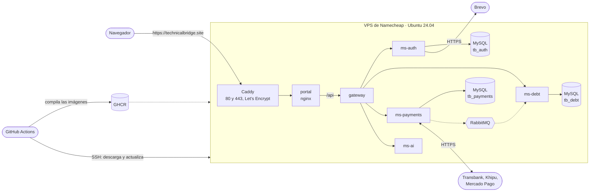

# DataBridge en un servidor

Cómo dejar DataBridge en línea en **`https://technicalbridge.site`**, en un VPS de Namecheap, siempre encendido y
hasta diciembre de 2026. La decisión, y por qué no Railway, están en
[#173](https://github.com/TechnicalBridge/TB_web/issues/173); la tarea, en
[#172](https://github.com/TechnicalBridge/TB_web/issues/172).

**El repositorio ya está listo.** El despliegue automático está **apagado** hasta que se haga el paso 6: mientras no
exista la variable `DESPLIEGUE_HOST`, un push a `main` no compila ni despliega nada.

## Cómo queda



- **Es el mismo `docker compose` de local**, más [`docker-compose.prod.yml`](../../docker-compose.prod.yml):
  - Caddy va delante y es lo único que publica puertos;
  - las tres bases (una por servicio, cada una en su MySQL), RabbitMQ y el portal quedan cerrados;
  - el buzón de prueba no se levanta.
- **El servidor no compila nada.** GitHub Actions ([`desplegar.yml`](../../.github/workflows/desplegar.yml)) compila
  las seis imágenes y las publica en GHCR. El servidor solo las descarga: con 6 GB no le sobra memoria para Maven.
- **Cada push a `main` se despliega solo**, una vez activado (paso 6). Un cambio solo de documentación no
  despliega.

| Qué | Cuánto, hasta diciembre |
| --- | --- |
| Dominio `technicalbridge.site`, en Namecheap | ~US$1, el primer año. **Sin renovación automática** |
| VPS **Quasar** de Namecheap (4 núcleos, 6 GB, KVM) | ~US$13 al mes, pagado mes a mes |

DataBridge usa unos 2,5 GB de memoria, medidos con todo corriendo; los 6 GB le dan margen, y el servidor suma 2 GB
de swap.

## 1. Comprar el dominio y el VPS

En [namecheap.com](https://www.namecheap.com), con la cuenta del equipo:

1. **El dominio:** `technicalbridge.site`, por 1 año. **Se apaga *Auto-Renew*** al pagar: después de diciembre no
   hace falta, y la renovación cuesta ~US$32.
2. **El VPS Quasar.** Antes de pagar se revisa:

   | Opción | Qué elegir | Por qué |
   | --- | --- | --- |
   | Plan | **Quasar**, 6 GB | Pulsar (2 GB) no alcanza |
   | Virtualización | **KVM** | Docker no corre en OpenVZ ni Virtuozzo |
   | Facturación | **Mensual**, si la ofrece | Se apaga en diciembre |
   | Sistema | **Ubuntu 24.04**, sin panel de control | cPanel o Webuzo cobran aparte y no se usan |
   | Ubicación | **EE. UU.**, si se puede elegir | Queda más cerca de Chile |

3. Namecheap manda por correo la **IP** y la clave de `root`. La clave no se pega en el chat ni en un issue:
   va a `Credenciales.md`, que está fuera del repositorio.

## 2. Entrar al servidor y dejar una llave

Desde el equipo de quien despliega, la primera vez con la clave de `root`:

```powershell
type $env:USERPROFILE\.ssh\databridge_vps.pub | ssh root@<IP> "mkdir -p ~/.ssh && cat >> ~/.ssh/authorized_keys"
ssh -i $env:USERPROFILE\.ssh\databridge_vps root@<IP>
```

Desde ahí se entra con la llave. Se puede apagar la entrada con clave
(`PasswordAuthentication no` en `/etc/ssh/sshd_config`, y `systemctl restart ssh`).

## 3. La llave con que GitHub despliega

Una llave aparte, solo para GitHub Actions, que entra como el usuario `databridge` (sin root):

```powershell
ssh-keygen -t ed25519 -N '""' -C "databridge-despliegue (GitHub Actions)" -f $env:USERPROFILE\.ssh\databridge_despliegue
```

La parte pública (`databridge_despliegue.pub`) va al paso 4; la privada, al paso 6.

## 4. Preparar el servidor

En el servidor, como `root`, con el dominio y la llave pública del paso 3:

```bash
curl -fsSL https://raw.githubusercontent.com/TechnicalBridge/TB_web/main/deploy/preparar-servidor.sh \
  | bash -s -- technicalbridge.site "ssh-ed25519 AAAA... databridge-despliegue (GitHub Actions)"
```

[`preparar-servidor.sh`](../../deploy/preparar-servidor.sh) deja:
- Docker y su plugin de compose;
- el firewall abierto solo en 22, 80 y 443;
- las actualizaciones de seguridad automáticas y 2 GB de swap;
- el usuario `databridge`, que despliega;
- el repositorio en `/opt/databridge`;
- un respaldo de cada base cada madrugada ([`respaldar.sh`](../../deploy/respaldar.sh), un archivo por base y
  los últimos 7 días en `/var/backups/databridge`);
- un `.env` con **claves nuevas al azar** y los valores de producción: `PUBLIC_URL`, `COOKIE_SECURE`,
  `CORS_ORIGINS`, `KHIPU_URL_AVISOS`, y para la demo `DEMO_DATOS`, `CONTACTO_SIN_HORARIO` y `CONTACTO_SIN_LIMITE`.

Se puede volver a correr: no pisa lo que ya existe.

Con `DEMO_DATOS=true` y una base de negocio vacía, el primer arranque instala la demo independiente:
Servicios Horizonte cobra directamente, con dos campañas y seis deudas ficticias. Su persona entra
con `camila.reyes@example.com`. Los correos van a Mailpit o, con un proveedor real, al desvío de prueba
obligatorio. Las bases existentes, incluida la demo anterior, no se convierten ni se completan;
no se debe borrar su volumen para intentar activar esta siembra.

## 5. El correo, las pasarelas y el DNS

**Las claves del correo y de las pasarelas** se copian del `.env` del equipo al del servidor, sin que se vean en
la pantalla:

```powershell
Select-String -Path .env -Pattern '^(BREVO_API_KEY|MAIL_FROM|MAIL_FROM_NAME|CORREO_SOLO_A|CORREO_DESVIAR_A|ADMIN_CORREO|KHIPU_LLAVE|KHIPU_SECRETO|MERCADOPAGO_ACCESS_TOKEN|MERCADOPAGO_PUBLIC_KEY|XAI_API_KEY)=.+' |
  ForEach-Object { $_.Line } |
  ssh -i $env:USERPROFILE\.ssh\databridge_vps root@<IP> "cat >> /opt/databridge/.env"
```

Con los datos de la demo, **`CORREO_SOLO_A` y `CORREO_DESVIAR_A` no son opcionales**: los deudores de ejemplo
tienen correos inventados.

En el servidor no hay Mailpit (`docker-compose.prod.yml` deja `CORREO_BUZON_DE_PRUEBA` vacío). Por eso lo que va a
un dominio reservado, como el código de `camila.reyes@example.com`, llega al buzón de `CORREO_DESVIAR_A`, con el
destinatario original en el asunto. Ese desvío gasta el cupo de Brevo, y tiene un tope de
`CORREO_DESVIO_MAXIMO_POR_DIA` correos por día (100, por omisión): sobra para entrar a la demo, pero no para cargar
una planilla grande de prueba en el servidor (#236).

**El DNS**, en Namecheap → *Domain List* → `technicalbridge.site` → **Advanced DNS**:

| Tipo | Host | Valor |
| --- | --- | --- |
| `A` | `@` | la IP del VPS |
| `A` | `www` | la IP del VPS |

Se borran los registros que Namecheap trae por omisión (el *parking*). Caddy saca el certificado apenas el DNS
apunta al servidor, y lo renueva solo.

## 6. Encender el despliegue automático

En GitHub, **Settings → Environments → New environment → `produccion`**, y ahí:

| Tipo | Nombre | Valor |
| --- | --- | --- |
| Secreto | `DESPLIEGUE_LLAVE` | La llave **privada** del paso 3 (`databridge_despliegue`, el archivo sin `.pub`) |
| Secreto | `DESPLIEGUE_KNOWN_HOSTS` | La huella del servidor: `ssh-keyscan <IP>` |

Y en **Settings → Secrets and variables → Actions → Variables**, del repositorio:

| Variable | Valor |
| --- | --- |
| `DESPLIEGUE_HOST` | La IP del VPS. **Esta es la que enciende el despliegue** |
| `DESPLIEGUE_DOMINIO` | `technicalbridge.site` |

El primer despliegue se lanza en **Actions → Desplegar → Run workflow**, con *Solo compilar* sin marcar. Desde ahí,
cada push a `main` se despliega solo.

## 7. Comprobar que funciona

- `https://technicalbridge.site` abre el portal, con el candado; `www.technicalbridge.site` redirige.
- `https://technicalbridge.site/swagger-ui.html` muestra la documentación.
- El correo de prueba sale por Brevo:

  ```bash
  docker compose -f docker-compose.yml -f docker-compose.prod.yml exec -T ms-auth \
    sh -c 'curl -s -X POST "http://127.0.0.1:8081/internal/correo/prueba?para=tucuenta@gmail.com" -H X-Internal-Key:$INTERNAL_KEY'
  ```

- Un deudor entra con su código, paga con Webpay (tarjeta de prueba) y la empresa ve el pago.
- En los tres portales, **Enviar código** manda solo código; **¿No te llegó?** manda código y
  enlace en un único mensaje. El acceso solicitado dura `MAGIC_TTL_MINUTES` (15 por omisión), y
  usar una opción invalida ambas. Las invitaciones iniciales del personal conservan su enlace.
  Probar solo con destinatarios autorizados y el modo de prueba activo.
- Si comprobar la empresa responde `503` porque ms-debt no está disponible, no debe abrirse sesión
  ni consumirse el código o enlace correcto. Al recuperarse el servicio, se puede reintentar el
  mismo acceso mientras siga vigente. Los intentos incorrectos sí siguen contando.
- Antes de desplegar este cambio de acceso, respaldar `tb_auth`: Flyway aplica V6 sobre
  `magic_links` sin borrar registros. Para revertir la aplicación, volver al código anterior
  conservando los archivos de migración hasta V6; no borrar columnas ni modificar su historial.
  Antes de arrancar la versión anterior, invalidar solo los pedidos nuevos aún pendientes, tras
  el respaldo y con autorización de quien opera la base:

  ```sql
  UPDATE tb_auth.magic_links
  SET consumed_at = UTC_TIMESTAMP(6)
  WHERE code_hash IS NOT NULL AND consumed_at IS NULL;
  ```
- En *Reglas*, el horario y el límite de la ley salen **apagados para probar**.

## 8. En diciembre: apagarlo

1. En GitHub se borra la variable `DESPLIEGUE_HOST`: el despliegue se apaga.
2. Si hay que guardar algo, el último respaldo está en `/var/backups/databridge`.
3. En Namecheap se cancela el VPS. El dominio vence solo, porque no se renueva.

**Si DataBridge fuera a cobrar de verdad,** antes se apagan `CONTACTO_SIN_HORARIO` y `CONTACTO_SIN_LIMITE`, y
`DEMO_DATOS`, `CORREO_SOLO_A` y `CORREO_DESVIAR_A` se dejan vacías.
