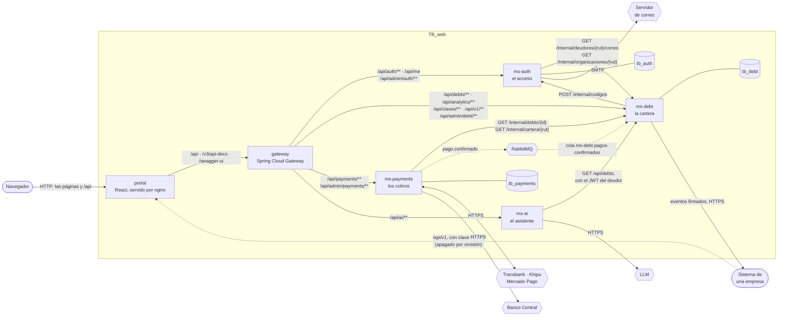
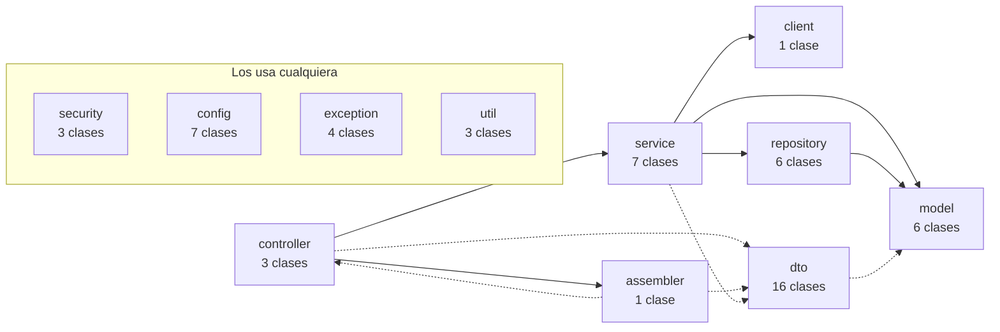
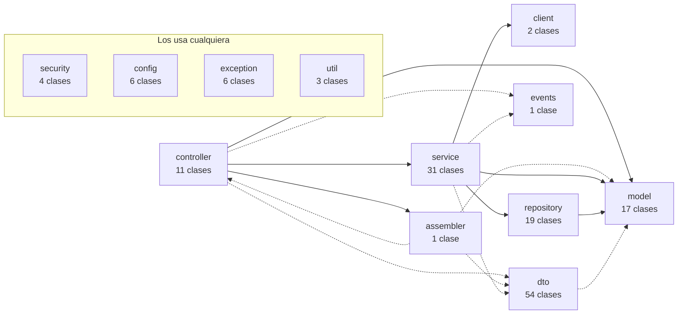
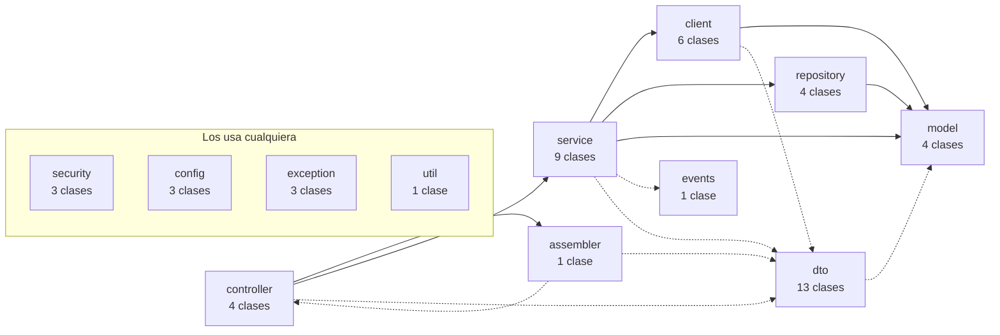
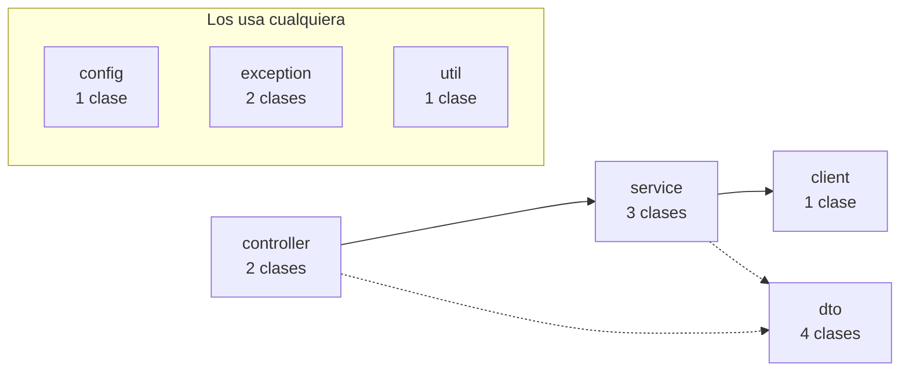
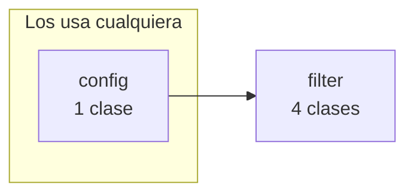
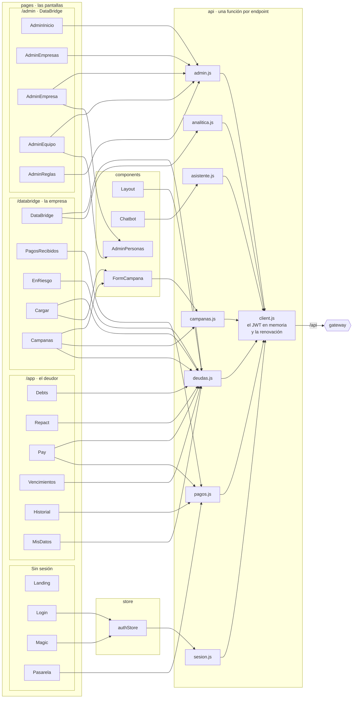
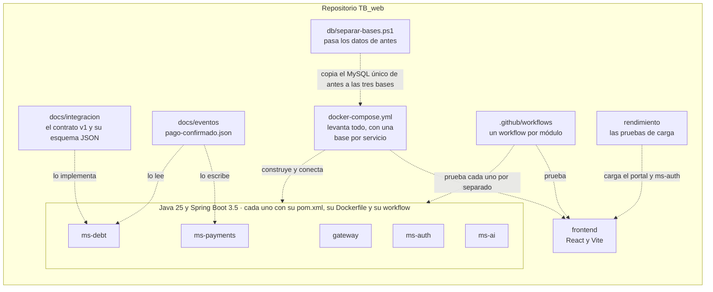

# Diagrama de componentes

Vista de desarrollo del [modelo 4+1](README.md): **cómo está partido el software**. Qué piezas hay, qué ofrece
cada una, qué necesita de las otras, y cómo está organizado el código por dentro.

**Cómo leerlos.** Cada caja es un componente: una pieza que se construye y se despliega por separado, o un
paquete dentro de ella. Una flecha `A --> B` es *A usa a B*, y su texto dice por dónde: la ruta HTTP, la cola o
el protocolo. El cilindro es una base de datos, el hexágono una cola o un sistema de afuera.

Todo sale del proyecto: las rutas, de `RutasConfig` del gateway; las llamadas entre servicios, de los `client`
de cada uno; los paquetes y sus dependencias, de los `import` del código, y el portal, de los de
`frontend/src`.

## Los componentes y lo que se dicen

Cinco servicios de Java, un portal y lo que necesitan para funcionar. Los servicios **no comparten código ni
base**: cada uno tiene su `pom.xml`, su `Dockerfile` y su esquema, y se hablan solo por lo que está dibujado
aquí.

| Componente | Qué ofrece | Qué necesita | Tecnología |
| --- | --- | --- | --- |
| **portal** | Las páginas de los tres portales (`/app`, `/databridge`, `/admin`), y de paso la única puerta: reenvía `/api` al gateway | El gateway | React 18, Vite, Zustand, axios y recharts; nginx para servirlo |
| **gateway** | Una sola entrada a todos los servicios, el límite de peticiones por origen, CORS y la página de Swagger que junta la documentación de todos | Los cuatro servicios | Java 25, Spring Boot 3.5, Spring Cloud Gateway, Bucket4j |
| **ms-auth** | Entrar con código o con enlace, renovar y cerrar la sesión, «quién soy», emitir códigos para ms-debt, y las personas con cuenta para el panel | `tb_auth`, ms-debt (el correo de un deudor, y si una empresa existe) y un servidor de correo | Java 25, Spring Boot 3.5, Spring Security, JJWT, Flyway |
| **ms-debt** | Las deudas y todo lo que se hace con ellas, el contrato de integración `/api/v1`, y lo que le preguntan los otros servicios | `tb_debt`, ms-auth (mandar un código), RabbitMQ y el sistema de cada empresa suscrita | Java 25, Spring Boot 3.5, Spring Data JPA, Spring HATEOAS, Flyway |
| **ms-payments** | Abrir, confirmar y consultar cobros, las vueltas y avisos de las pasarelas, y la UF | `tb_payments`, ms-debt (el monto), RabbitMQ, las tres pasarelas y el Banco Central | Java 25, Spring Boot 3.5, Spring Data JPA, Flyway |
| **ms-ai** | El chat del asistente | ms-debt (las deudas, con la sesión del deudor) y, si está configurado, un LLM | Java 25, Spring Boot 3.5, el SDK de OpenAI para Java |
| **MySQL 8.4** | Tres bases, una por servicio | — | El esquema lo versiona Flyway en cada servicio |
| **RabbitMQ** | La cola del aviso de pago, de ms-payments a ms-debt | — | Si no está, el mismo aviso va por HTTP |

### Tres clases de interfaz, y cada una con su llave

No todo lo que ofrece un servicio es para el mismo público. Cada ruta dice para quién es, y Swagger las separa
en los mismos grupos:

| Interfaz | Rutas | Para quién | Con qué se entra | ¿La publica el gateway? |
| --- | --- | --- | --- | --- |
| **Portal** | `/api/auth/**`, `/api/me`, `/api/debts/**`, `/api/analytics/**`, `/api/payments/**`, `/api/ai/**` | El deudor y el usuario de una empresa, desde el navegador | JWT de una sesión `DEBTOR` o `CREDITOR` | Sí |
| **Panel de administración** | `/api/admin/auth/**`, `/api/admin/debt/**`, `/api/admin/payments/**` | El admin de DataBridge | JWT de una sesión `ADMIN` | Sí |
| **Contrato de integración** | `/api/v1/**`, y las claves en `/api/claves/**` | El sistema de una empresa | Clave de API | Sí, pero apagado por omisión (`INTEGRACION_API`): responde `404` |
| **Interno** | `/internal/**` | Otro servicio, o la operación | Clave interna (`X-Internal-Key`) | No |

Los avisos y las vueltas de las pasarelas (`/api/payments/public/**`) entran por el portal sin sesión: se
validan con la firma del enlace de pago, y lo que dicen se le vuelve a preguntar a la pasarela.

### A dónde manda el gateway cada ruta

Tal como está en `gateway/.../config/RutasConfig.java`:

| Ruta del gateway | Qué rutas toma | A qué servicio |
| --- | --- | --- |
| `ms-auth` | `/api/auth/**`, `/api/me` | ms-auth |
| `ms-debt` | `/api/debts/**`, `/api/analytics/**`, `/api/claves/**`, `/api/v1/**` | ms-debt |
| `ms-payments` | `/api/payments/**` | ms-payments |
| `ms-ai` | `/api/ai/**` | ms-ai |
| `panel-ms-auth` | `/api/admin/auth/**` | ms-auth |
| `panel-ms-debt` | `/api/admin/debt/**` | ms-debt |
| `panel-ms-payments` | `/api/admin/payments/**` | ms-payments |
| `docs-ms-auth`, `docs-ms-debt`, `docs-ms-payments`, `docs-ms-ai` | `/v3/api-docs/<servicio>/**` | La documentación de cada servicio, para la página de Swagger |

Antes de enrutar, cada petición pasa por tres filtros: `RetornoDePasarela` (le quita el `Origin` a la vuelta
desde una pasarela), `RateLimitFilter` (el cupo por origen: uno estrecho para `/api/auth` y uno general) y
`RequestLogFilter` (la anota, con lo que tardó).

---

## Cada servicio por dentro

Los tres servicios con base de datos tienen los mismos paquetes, así que quien conoce uno se ubica en los
otros. Una regla los ordena: **el `controller` traduce y delega, y las reglas viven en el `service`**. Por eso
las reglas se prueban sin levantar el servidor web, y la capa web sin base de datos.

Las flechas continuas son el camino de una petición. Las punteadas, los datos que entran, salen o se avisan.
Los paquetes del recuadro *Los usa cualquiera* no llevan flechas: la sesión, la configuración, los errores y las
utilidades se usan desde todas las capas.

### ms-auth

`com.tbridge.auth` · 58 tipos en 11 paquetes.

### ms-debt

`com.tbridge.debt` · 156 tipos en 12 paquetes.

### ms-payments

`com.tbridge.payments` · 53 tipos en 12 paquetes.

### ms-ai

`com.tbridge.ai` · 15 tipos en 7 paquetes.

### gateway

`com.tbridge.gateway` · 6 tipos en 2 paquetes.

### Qué hay en cada paquete

| Paquete | Qué hay ahí | ms-auth | ms-debt | ms-payments | ms-ai | gateway |
| --- | --- | --- | --- | --- | --- | --- |
| `controller` | Los endpoints. Traducen HTTP y delegan: no tienen reglas de negocio | 3 | 11 | 4 | 2 | — |
| `assembler` | Los enlaces HATEOAS de cada respuesta | 1 | 1 | 1 | — | — |
| `service` | Las reglas de negocio, y las tareas programadas | 7 | 31 | 9 | 3 | — |
| `client` | Las llamadas a otros sistemas: otro servicio, una pasarela, el Banco Central | 1 | 2 | 6 | 1 | — |
| `repository` | El acceso a la base, con Spring Data JPA | 6 | 19 | 4 | — | — |
| `model` | Las entidades, una por tabla | 6 | 17 | 4 | — | — |
| `events` | El aviso de pago que viaja entre ms-payments y ms-debt | — | 1 | 1 | — | — |
| `dto` | Lo que entra (`request`), lo que sale (`response`) y lo que se publica (`evento`) | 16 | 54 | 13 | 4 | — |
| `security` | El JWT: leerlo en cada petición (ms-auth, además, lo firma) | 3 | 4 | 3 | — | — |
| `config` | Quién puede llamar a qué, Swagger, la cola, el cifrado y los datos de ejemplo | 7 | 6 | 3 | 1 | 1 |
| `exception` | Los errores propios y su forma de respuesta | 4 | 6 | 3 | 2 | — |
| `util` | El RUT, el correo y las huellas | 3 | 3 | 1 | 1 | — |
| `filter` | Lo que el gateway le hace a cada petición antes de enrutarla | — | — | — | — | 4 |
| **Total** | Contando la clase que arranca cada servicio | **58** | **156** | **53** | **15** | **6** |

El detalle de cada clase está en los [diagramas de clases](clases.md).

---

## El portal por dentro

Una sola aplicación de React para los tres portales. Las pantallas no llaman al servidor directo: usan las
funciones de `api/`, una por endpoint, y todas pasan por `client.js`, que pone el JWT y renueva la sesión
cuando vence.

| Carpeta | Qué hay | Qué archivos |
| --- | --- | --- |
| `pages/` | Una pantalla por archivo. `App.jsx` decide cuál se ve según la ruta y el rol de la sesión | 21 pantallas |
| `components/` | Lo que usan varias pantallas | `Layout` (el menú de cada portal), `Chatbot` (el asistente, solo para el deudor), `FormCampana` (crear o cambiar una campaña, en Campañas y en Cargar cartera), `AdminPersonas` (las personas y la historia, en el panel), `Graficos`, `BarraEstado`, `Cargando`, `Iconos`, `Logo`, `LogoPasarela`, `TemaToggle` |
| `api/` | Las llamadas al servidor | Un módulo por tema, y `client.js` |
| `store/` | El estado que comparten las pantallas, con Zustand | `authStore` (la sesión) y `temaStore` (claro u oscuro) |
| `utils/` | Cómo se escriben montos, RUT y fechas en Chile, y las descargas | `formato.js`, `calendario.js`, `exportar.js` y `plantillaCartera.js` (las columnas de la planilla) |

Qué módulo de `api/` habla con qué servicio:

| Módulo | Rutas que llama | Servicio |
| --- | --- | --- |
| `sesion.js` | `/api/auth/codigo`, `/acceso`, `/enlace`, `/verify`, `/logout` y `/api/me` | ms-auth |
| `client.js` | `/api/auth/refresh`, cuando el JWT vence | ms-auth |
| `deudas.js` | `/api/debts/**` | ms-debt |
| `analitica.js` | `/api/analytics/summary` | ms-debt |
| `campanas.js` | `/api/debts/campanas/**` | ms-debt |
| `pagos.js` | `/api/payments/**`, y `/api/debts/pagos/**` para el historial y el comprobante | ms-payments y ms-debt |
| `asistente.js` | `/api/ai/chat` | ms-ai |
| `admin.js` | `/api/admin/<servicio>/estado`, `/api/admin/debt/empresas/**` y `/api/admin/auth/**` | ms-auth, ms-debt y ms-payments |

La pantalla del portal de empresas trae los gráficos (recharts), que pesan más que todo lo demás junto: se
descarga solo al entrar ahí, y el deudor nunca la baja.

---

## El repositorio

Un solo repositorio con dos lenguajes. **Cada servicio es un proyecto de Maven aparte**, con Spring Boot como
padre: no hay un `pom` padre del repositorio ni una librería compartida.

Lo único que dos servicios comparten es **lo publicado**, y los dos se prueban contra el mismo archivo:

| Qué | Dónde | Quién lo cumple |
| --- | --- | --- |
| El contrato de integración v1 | [`docs/integracion`](../integracion/README.md) | ms-debt lo implementa; el sistema de cada empresa lo usa |
| El aviso de pago | `docs/eventos/pago-confirmado.json` | ms-payments lo escribe y ms-debt lo lee. Cada uno tiene su propia clase `PagoConfirmado` |
| El JWT | `JWT_SECRET`, el mismo en los tres | ms-auth lo firma; ms-debt y ms-payments lo verifican |
| La clave interna | `INTERNAL_KEY`, la misma en los tres | Quien llama a `/internal` de otro |

Lo que antes habría ido en una librería común lo tiene cada servicio en sus paquetes, y solo lo que usa:
`security/` (el JWT), `exception/` (la misma forma de error, `{"error": "..."}`) y `util/` (el RUT y las
huellas). Son pocas líneas, y a cambio cada servicio se compila, se prueba y se despliega sin los demás.
