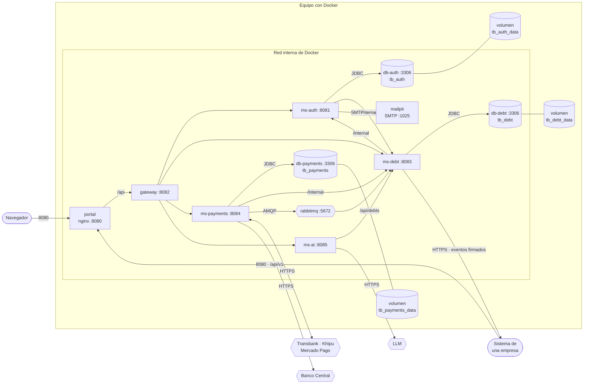
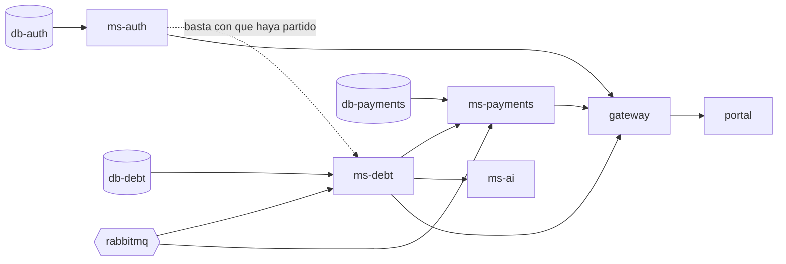
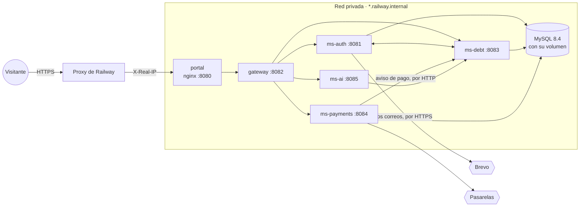

# Diagrama de despliegue

Vista física del [modelo 4+1](README.md): **dónde corre cada pieza**. Qué contenedores hay, qué puerto abre
cada uno, quién ve a quién y qué queda guardado cuando todo se apaga.

**Cómo leerlo.** El recuadro grande es el equipo y el de adentro, la red interna de Docker. Cada caja es un
contenedor, con su puerto. Los cilindros son donde se guardan los datos. Una flecha es una conexión de red, en el
sentido de quien la abre.

Sale de `docker-compose.yml` y del `Dockerfile` de cada módulo.

## Los contenedores

Todo corre en contenedores de Docker, en un solo equipo. **Solo el portal se publica** para usar el sistema:
los servicios se hablan por la red interna y no tienen un puerto hacia afuera.

| Contenedor | Imagen | Puerto interno | Publicado en el equipo | Memoria | Para qué |
| --- | --- | --- | --- | --- | --- |
| `portal` | `tbridge/portal`, sobre `nginx-unprivileged` | 8080 | **8080** (`PORTAL_PORT`) | 128 MB | La única puerta: sirve el portal y reenvía `/api`, `/v3/api-docs` y `/swagger-ui` al gateway |
| `gateway` | `tbridge/gateway`, sobre `eclipse-temurin:25-jre` | 8082 | — | 512 MB | Enruta, limita las peticiones por origen y revisa CORS |
| `ms-auth` | `tbridge/ms-auth`, sobre `eclipse-temurin:25-jre` | 8081 | — | 640 MB | El acceso y los correos |
| `ms-debt` | `tbridge/ms-debt`, sobre `eclipse-temurin:25-jre` | 8083 | — | 640 MB | La cartera |
| `ms-payments` | `tbridge/ms-payments`, sobre `eclipse-temurin:25-jre` | 8084 | — | 640 MB | Los cobros |
| `ms-ai` | `tbridge/ms-ai`, sobre `eclipse-temurin:25-jre` | 8085 | — | 640 MB | El asistente |
| `db-auth` | `mysql:8.4` | 3306 | 3308 (`DB_AUTH_PORT`) | — | `tb_auth`, la base de ms-auth. Se publica solo para revisarla desde el equipo |
| `db-debt` | `mysql:8.4` | 3306 | 3309 (`DB_DEBT_PORT`) | — | `tb_debt`, la base de ms-debt |
| `db-payments` | `mysql:8.4` | 3306 | 3310 (`DB_PAYMENTS_PORT`) | — | `tb_payments`, la base de ms-payments |
| `rabbitmq` | `rabbitmq:3.13-management` | 5672 y 15672 | 5672 y 15672 | — | La cola del aviso de pago, y su consola |
| `mailpit` | `axllent/mailpit` | 1025 y 8025 | 1025 y 8025 | — | El buzón de prueba: recibe los correos y los muestra en una página. Es adonde van mientras el `.env` no traiga un `SMTP_HOST` |

**Una base por servicio, cada una en su MySQL** ([#238](https://github.com/TechnicalBridge/TB_web/issues/238)):
la misma imagen y la misma configuración, pero cada una con su volumen y sus claves. Si una se cae, se llena o
se restaura, las otras dos siguen, y con la clave de un servicio no se entra a la base de otro. Arrancan sin
`performance_schema`, y así cada una usa unos 200 MB.

Los cinco servicios de Java se construyen igual, en dos etapas: se compilan con `maven:3.9-eclipse-temurin-25`
y la imagen final lleva solo el JRE y el `.jar`. Corren con un usuario sin privilegios (`tbridge`), no como
`root`. El portal se compila con `node:22-alpine` y lo sirve un nginx que tampoco corre como `root`.

## En qué orden arrancan

Ningún contenedor arranca antes de que esté sano el que necesita. Cada servicio tiene su revisión de salud
(`/actuator/health`), y Docker espera a que responda antes de partir el siguiente.

Al arrancar, cada servicio con base **migra su esquema** con Flyway y después compara sus entidades con las
tablas: si no calzan, no parte. Cada MySQL crea su base vacía la primera vez (`MYSQL_DATABASE`), y le da
permisos al usuario de la aplicación.

## Qué se levanta con cada perfil

`docker-compose.yml` separa lo que se necesita siempre de lo que se construye:

| Perfil | Qué levanta | Para qué |
| --- | --- | --- |
| Sin perfil | `db-auth`, `db-debt`, `db-payments`, `rabbitmq` y `mailpit` | Programar: los servicios corren desde el editor y encuentran la base, la cola y el correo |
| `app` | Lo anterior, más los cinco servicios y el portal | Usar el sistema completo: `docker compose --profile app up -d --build --wait` |
| `carga` | `k6` | Las pruebas de carga de `rendimiento/`, contra el sistema ya levantado |

## Qué queda guardado

| Qué | Dónde | Sobrevive a |
| --- | --- | --- |
| Cada base de datos | Su volumen: `tb_auth_data`, `tb_debt_data` y `tb_payments_data` | Apagar y volver a levantar. Se pierde solo si se borra su volumen. Cada una se respalda y se restaura por separado |
| La cola de RabbitMQ | Dentro del contenedor: `rabbitmq` no tiene un volumen | Reiniciarlo, porque la cola es durable. Si el contenedor se borra, se pierde lo que estuviera en la cola sin leer: ms-payments ya lo dio por entregado al publicarlo |
| Los correos de prueba | Dentro de `mailpit`, en memoria | Nada: son de prueba |
| Las sesiones | En `tb_auth` | Reiniciar los servicios. El JWT se valida solo con su firma, así que ningún servicio guarda sesiones en memoria |

Ningún servicio guarda estado propio fuera de su base, salvo el límite de peticiones del gateway, que vive en
memoria: con más de una copia del gateway, cada una llevaría su propia cuenta.

## Con qué se configura

Todo sale de variables de entorno, que `docker-compose.yml` lee del archivo `.env` (lo crea
`preparar-env.ps1`, con claves al azar). Lo que no es secreto tiene un valor por omisión. **Los secretos no**: si
falta uno, el servicio no arranca y dice cuál.

| Secreto | Quién lo usa | Para qué |
| --- | --- | --- |
| `DB_AUTH_ROOT_PASSWORD` y `DB_AUTH_PASSWORD`; lo mismo con `DB_DEBT_` y `DB_PAYMENTS_` | Cada base, y solo el servicio que la usa | Entrar a esa base: con la clave de una no se entra a las otras |
| `JWT_SECRET` | ms-auth, ms-debt y ms-payments | ms-auth firma el JWT; los otros dos lo verifican. Tiene que ser el mismo en los tres |
| `INTERNAL_KEY` | ms-auth, ms-debt y ms-payments | Las llamadas a `/internal` entre servicios |
| `RABBIT_PASSWORD` | `rabbitmq`, ms-debt y ms-payments | Entrar a la cola |
| `WEBHOOK_SECRET` | ms-payments | Firmar los enlaces de pago y verificar los avisos de la pasarela simulada |
| `CIFRADO_LLAVE` | ms-debt | Cifrar el secreto de cada suscripción |

Las credenciales de las pasarelas (`TRANSBANK_*`, `KHIPU_*`, `MERCADOPAGO_*`), del Banco Central (`BCENTRAL_*`),
del LLM (`XAI_*`) y del servidor de correo (`SMTP_*`) son opcionales: sin ellas, cada pasarela se simula, la UF
se carga a mano, el asistente responde con reglas y los correos van al buzón de prueba.

**El correo, con un servidor real.** Con `SMTP_HOST` en el `.env`, ms-auth deja de usar `mailpit` y le entrega
a ese servidor (una cuenta de Gmail para probar, o un proveedor de correo), sin tocar el compose. Ahí entra el
**modo de prueba**: `CORREO_SOLO_A` dice a qué direcciones se les escribe directo y `CORREO_DESVIAR_A`, adónde
va todo lo demás. Sin las dos se le escribe a cualquier dirección, que es lo que corresponde en producción y lo
que no puede pasar con los datos de la demo, que traen correos inventados.

## Los sistemas de afuera

| Sistema | Quién le habla | Cómo | Qué pasa si no responde |
| --- | --- | --- | --- |
| Transbank (Webpay) | ms-payments | HTTPS, con el código de comercio y su llave | El pago queda abierto y se vuelve a preguntar. Si nadie lo cierra, vence |
| Khipu | ms-payments | HTTPS, con la llave de la cuenta de cobro | Lo mismo |
| Mercado Pago | ms-payments | HTTPS, con el token de acceso | Lo mismo |
| Banco Central | ms-payments | HTTPS | La UF del día se puede cargar a mano. Sin UF, un cobro en UF responde `503`; los cobros en pesos siguen |
| LLM | ms-ai | HTTPS, con el SDK de OpenAI | El asistente responde con reglas |
| Servidor de correo | ms-auth | SMTP, con STARTTLS o SSL | Falla a los 10 segundos (`SMTP_TIMEOUT_MS`). El correo no cuenta como enviado: la empresa ve el motivo y sale solo en la pasada siguiente |
| Sistema de cada empresa | ms-debt | HTTPS, con cada evento firmado | El evento espera en la bandeja de salida y se reintenta |

Las pasarelas también le hablan a DataBridge: devuelven al deudor al portal, y Khipu y Mercado Pago pueden
avisar un pago. Para eso DataBridge necesita una dirección pública; en un equipo local no la tiene, y por eso
ms-payments no depende de esos avisos: les pregunta a las pasarelas cada 10 segundos.

## En un servidor

La demo corre en un VPS de Namecheap, en `https://technicalbridge.site`: el mismo compose de arriba, con
Caddy delante (el único que publica puertos) y las imágenes que compila GitHub Actions. El diagrama y la guía
están en [`docs/despliegue`](../despliegue/README.md).

## En Railway

Una alternativa que quedó preparada y se descartó por costo (#173).

Las mismas imágenes, una por servicio, cada una desde su carpeta y con su `railway.json`. La guía, con las
variables de cada servicio, está en [`docs/railway`](../railway/README.md), y lo que falta decidir, en #173.

| Lo distinto de Docker Compose | Por qué |
| --- | --- |
| Solo el portal tiene dirección pública | El gateway y los servicios se hablan por la red privada; ninguno se publica |
| No hay RabbitMQ | El aviso de un pago va de ms-payments a ms-debt por HTTP, con sus reintentos: un servicio menos que pagar |
| No hay buzón de prueba: los correos salen por la API de Brevo | Railway bloquea el SMTP fuera de su plan Pro, y Brevo va por HTTPS |
| Las bases las crea cada servicio | Cada servicio se conecta con `createDatabaseIfNotExist` |
| Cada servicio escucha también en IPv6 (`SERVER_ADDRESS=::`) | La red privada de los ambientes antiguos de Railway es solo IPv6 |
| nginx le cree al proxy de Railway la IP del visitante | Sin eso, el límite de peticiones contaría a todos como uno solo |
| La memoria de cada JVM tiene techo (`JAVA_TOOL_OPTIONS`) | En Railway se cobra la que se usa, y no hay un límite de contenedor tan bajo como el del compose |
